# Minpentai in the book: a study for the game

> DRAFT, 2026-10-30 (v2: pieces split by kind; rocks as a resource on their own). The design that builds on it is `docs/proposals/minpentai-agent-play.md`. Read-only research by the coding agent (Anthropic's Claude, a closed model), for the owner to read. **Spoilers** for chapters 2–15, with short notes from later chapters at the end of part 1. Quotes are the book's words, as committed in `content/snowmoon/text`, with markup removed (`*word*` is the book's emphasis); `[…]` marks words left out. Block IDs are `c<chapter>-b<block>`; on the site, `/chapter/<chapter>#c<chapter>-b<block>`. This edition is not affiliated with the author.

**What this adds to what exists.** `docs/minpentai-rules.md` reads the rules out of the book, and `docs/minpentai/passages.md` lists 152 passages (blocks that name Minpentai or are cited somewhere). Neither has every block that describes play. This file cites over 130 blocks that `passages.md` does not list, almost all from the matches in chapters 4, 7, 10, 12 and 14. It quotes every block in those matches that describes play, sorted by topic (1.1–1.11, with the rest in order in 1.12). Pieces are split into gliders, glider factories, walls, mirror walls, moving walls, spaceships and symbol-carrying spaceships, then describes every board figure with what changes between frames, compares the book to Play as it is on `main` (02ddf08), and sets out what an AI-commander version would need.

**Where play happens.** Chapter 2 mentions a game (c2-b11, c2-b12). Chapter 4 shows the start of Zei's earlier game (the animation c4-b5) and the 2-v-2 Pafogai Du quarter-final. Chapter 5 mentions the semi-finals (c5-b30). Chapter 7 is the 1-v-1 Pafogai Du final, with AIs. Chapter 10 ends a practice game between Zei and Bai (c10-b159–c10-b164). Chapter 12 opens with a bot game (c12-b8–c12-b10) and plays the national qualifier on a hex grid. Chapter 14 plays the national semi-final with shrines and summarises Deluin's semi-final. The national final is not shown; chapter 15 says Zei won it (c15-b99).

Chapter 2's two figures (c2-b55, c2-b71) are slides about jars of gas in a physics lesson, not boards. The other figures in chapters 2–14 that are not listed in part 2 are menus, a hash diagram and similar, not boards.

---

## Part 1. What the book says about how it is played

### 1.1 Pieces and structures

**The board and its rule.**

- **c4-b7** "This was from my last Minpentai game. We were playing with the 'rotate one eighty if three' rule. Someone discovered this new way to breach the usual wall construction, and flooded their opponent's territory with garbage. I'm trying to figure out some countermeasures."
- **c4-b8** (Fin) "What's the endgame? Are you trying to get to a perfect wall, or is it rock paper scissors all the way down?"
- **c4-b9** "Well, remember, the rules are time-reversible. So any wall that can be created in some way can be destroyed in some way."
- **c4-b13** "Turns out they weren't dumb, we are. Because the laws of physics are time-reversible, nothing can be invincible. Anything that can be created can be destroyed. You just have to take the path that creates it and do the same thing in reverse. So a shield that can't be destroyed is not something that can be created. There has to be a weakness somewhere - it's just a matter of how well you hide it."
- **c4-b84** "Walls, gliders, rocks, techniques for extracting usable negentropy from rocks, sideways attacks."
- **c4-b94** "where he was allowed to put down squares during the initiation phase" (the board is made of squares that players put down).
- **c14-b36** "a steerable symbol-carrying spaceship he had developed months prior, that could change its direction if you intervene in only a few cells."
- **c14-b35** "The shrines are the only objects that violate mass conservation - though even still, with these new rules, nothing decreases entropy. XOR is not weight-preserving, but it is reversible."
- **c12-b147** "Today, Minpentai will be played on a hex grid." (so the usual grid is not hexagonal; see 1.11).

**Gliders.** Small shapes that keep their shape as they move; they bounce, crash, and break things, including their sender's.

- **c4-b106** "Gliders started flying."
- **c4-b109** "A few stray gliders from Bai accidentally flew into Zei's territory, and wrecked one of his factories. […] When putting up one of his walls, his finger slipped, and he accidentally created a glider that began to fly back toward his own base. Zei cursed silently, but then felt a sigh of relief when the glider harmlessly crashed into a rock formation."
- **c4-b113** "sending three unusual-looking gliders deep into Dza's territory along the edge."
- **c7-b89** "manually send a large number of gliders down both diagonals, targeted so that one would pass right after the other, to strike both of Bai's home bases."
- **c7-b110** "Zei's AI took the opportunity to design a storm of gliders to attack Bai's flanks from behind"
- **c12-b152** "seeing what stayed stable and what turned into a glider. Within one minute, he identified a few gliders and a few static structures that could be used for walls. To his surprise, the gliders that moved the fastest moved ... directly east."
- **c12-b154** "He watched the gliders carefully, to try to quickly get an intuition for what kinds of shapes can move while preserving their shape."
- **c14-b56** "To avoid giving up his location, they would not fly north directly - instead, they would reflect off of the northern rock shrine."
- **c14-b74** "Then, a glider storm came toward Zei's ship from all directions."
- **c14-b82** "One of the gliders was destroyed, hit by another stray glider before it even left Zei's visual field."

**Glider factories.** Structures that turn rock into more gliders; one can hold a choice of strategies and wait for a trigger.

- **c4-b95** "Zei saw Bai setting up walls and glider factories - gliders that would fly right to a nearby rock formation, and then reflect one glider back into Bai's territory where a mirror wall would send the glider right back, but also shoot another glider upward."
- **c4-b121** "spent a whole intervention turn to put up walls and build glider factories there. He put up *more* walls, just to let the gliders build up and bounce back and forth."
- **c7-b102** "Construct near that symbol a factory capable of executing each of those strategies. It should be activated by a glider coming in from the southwest, and the exact strategy chosen should depend on the type of glider and the time it hits."
- **c7-b107** "Part of the factory had been built during the intervention turn, the rest continued to be constructed in real time out of nearby rock formations by gliders."
- **c7-b109** "The factory quickly started generating symbol-carrying spaceships that began to move toward the east, and a storm of gliders that moved north, and then bounced off of rock formations and Bai's own walls to move toward the west."
- **c7-b115** "immediately create many glider factories in the northeast, and have their exact style and direction be set off by a trigger that would only appear in ten turns."
- **c9-b70** (Den) "you figured out a really basic version of that - just sixteen possible algorithms, melded into one factory - and used that, plus a hidden glider to provide the input, to hide your intentions."
- **c12-b188** "Immediately, Zei switched to the next task: figuring out how to build glider factories."
- **c14-b38** "an eternal glider factory: a glider would bounce back and forth, at each collision it would break off rock to spray even more gliders further north, and then every thousand turns, the rock would reset."
- **c14-b46** "it would take him four intervention turns to make a symbol-carrying spaceship or glider factory."
- **c14-b83** "He figured out how to bounce a glider southward off of one of his own walls so that it would hug the edge of the shrine. […] The glider would bounce back and forth between the center and the north. Each time it hit the center, it would simultaneously release another glider that would go west."
- **c14-b91** "Kau's eternal glider factories proved to be of limited use: though the gliders would keep coming forever, they would only have any effect for a short period of time."

**Walls.** Static structures; they stop and bounce gliders, and they wear down.

- **c4-b13** "So a shield that can't be destroyed is not something that can be created."
- **c4-b109** "spent his next intervention turn putting up more walls facing Bai."
- **c4-b113** "The gliders hit the wall that Dza had set up around his home base in the northeast corner"
- **c4-b135** "Zei used his intervention turn to remove his own wall. Dozens of gliders flew in all directions"
- **c7-b106** "add a brick south of his factory to block the glider that the AI was sending"
- **c14-b75** "At first, the walls handled it. But then, the gliders kept coming, and soon they began to breach the walls."
- **c14-b85** "Zei had built four layers of walls around this ship, and finally the walls were beginning to crumble faster than he could create new ones."
- **c14-b90** "Deluin spent all his attention early on to use the resources in the rock formations near his north and northeast to build walls."

**Mirror walls.** Walls built to send gliders back.

- **c2-b12** "I got third place! Finally figured out a wall structure that reflected their gliders right back at them, completely wreaked havoc on their territory."
- **c4-b95** "where a mirror wall would send the glider right back, but also shoot another glider upward."
- **c14-b91** "As soon as a storm of gliders came, Deluin would figure out how to reflect it."

**Moving walls.** A wall that travels, as a large slow glider.

- **c4-b111** "At the front, Zei put down a "moving wall" design that he had perfected - a sort of large glider that flew half as fast, but was optimized for reflecting more basic types of gliders right back at the sender. Right behind his three moving walls, all aimed at Dza's corner of the game board, he put his symbol-carrying spaceships."
- **c4-b124** "Then, Zei saw that Pan was sending against Zei the same type of moving wall that Zei had used himself."
- **c7-b72** "with a different style of moving wall in front of it."

**Spaceships.** Large, slow gliders; when they break they become storms of gliders.

- **c4-b107** "Larger spaceships flew out from Zei and Bai's bases."
- **c4-b108** "Spaceships flew out, acting as large slow-moving gliders that eventually crashed into a rock formation in a controlled way, leaving behind copies of each player's symbols."
- **c4-b131** "Zei's spaceship crashed against the remaining intact southern wall of Pan's home base. It briefly fluttered into chaotic shapes."
- **c10-b160** "Suddenly, as the spaceship hit a rock formation and was in the process of reflecting, gliders from Bai hit it. The spaceship exploded into a storm of gliders."
- **c14-b47** "his spaceship and two of Gun's spaceships flew past each other in the center."

**Symbol-carrying spaceships.** Spaceships that carry a copy of the player's symbol, so they give sight and a place to build as they travel; they can be steered.

- **c4-b111** "Right behind his three moving walls, all aimed at Dza's corner of the game board, he put his symbol-carrying spaceships."
- **c7-b72** "Zei started planting one last major structure by hand: a symbol-carrying spaceship. There were already four created by his AI, but he figured that he would make one all on his own, so that Bai would not see it, and with a different style of moving wall in front of it. He aimed the symbol-carrying spaceship so that it would reflect off a wall that his AI had already constructed, and then move upwards along the middle of the game field."
- **c7-b81** "Zei's symbol-carrying spaceship started moving west from the southeast corner. The portion of the game field that Zei could see increased."
- **c7-b85** "Shortly after that, Zei's symbol-carrying spaceship reflected off the wall in the south, and began moving north."
- **c7-b91** "Soon, one of Zei's symbol-carrying spaceships on the west was breached, and it exploded into a storm of gliders flying in all directions."
- **c7-b96** "Then, suddenly, gliders flew at the spaceship from the west, north and east side. It quickly crumbled, and exploded into rubble and a dozen gliders."
- **c14-b36** "a steerable symbol-carrying spaceship he had developed months prior, that could change its direction if you intervene in only a few cells."
- **c14-b56** "On his next intervention turn, he steered that spaceship to temporarily stop, just outside of visual range of Gun's northeastern base. He set the spaceship to fire off gliders to destroy the symbols that were undoubtedly in Gun's northeastern base."
- **c14-b77** "He figured that the existing ship's symbol would get destroyed within a hundred turns, but the wreck could still coast west, and crash into the northern shrine and release a large glider storm southward."
- **c14-b91** "Deluin did not build any mobile symbol-carrying spaceships. Instead, he simply fortified."
- **c15-b103** "by pre-publishing most of the data - the symbol-carrying spaceship - and then using only a few bits of manipulation at the end to deploy the most important parts of your strategy."

### 1.2 Rocks as a resource

Rock formations are hidden at first, and gliders that hit them make more gliders, symbols and debris. They are the material everything is built from.

- **c4-b84** "techniques for extracting usable negentropy from rocks"
- **c4-b108** "For the first few hundred turns, there was no combat - it was simply a matter of expanding into the field and gathering resources. Gliders flew out, interacted with rock formations, and created more gliders."
- **c4-b99** "Zei intentionally not targeting gliders toward a few rock formations, Bai taking the hint and taking those rock formations herself, and similarly leaving some rock formations to Zei."
- **c4-b112** "turning some rock formations into a chaotic mess that blasted gliders everywhere, and destroyed some of Pan's symbols."
- **c7-b82** "Both AI transcripts were focused intensely on exploiting their territories, building more gliders, spaceships and walls, and expanding."
- **c7-b107** "the rest continued to be constructed in real time out of nearby rock formations by gliders."
- **c12-b10** "playing in that style was not in their training data, so they made basic mistakes and cannibalized each other's negentropy."
- **c12-b157** "He realized that to make actual headway, he would need to interact with the rock formations. He made a couple of guesses about what shape the rock formations in the hexgrid version of Minpentai might look like, and examined the behavior of gliders as they crashed into them."
- **c12-b177** "As time moved backwards, past the moment of the crash, the rock-formation-plus-symbol turned into a bare rock formation, and two gliders flew back out."
- **c12-b181** "Zei quickly put up symbols, walls, and gliders that would create symbols if they crashed into favorable rock formations."
- **c12-b187** "One of his gliders had successfully created a symbol, and revealed a part of the board that showed what the rock formations look like."
- **c14-b33** "the shrine will reset to being a default rock formation."
- **c14-b45** "Zei shot off a few gliders to turn more rock formations into symbols and glider factories."
- **c14-b78** "Zei used a nearby rock formation, which was almost destroyed by the gliders, to bounce a glider"
- **c14-b90** "Deluin spent all his attention early on to use the resources in the rock formations near his north and northeast to build walls."

The intervention budget, a second resource handed out each turn:

- **c4-b138** "Zei and Bai could do twice as much together in their intervention turns as Pan could do alone in his."
- **c4-b116** "Remove one of the two players completely, he thought, and that takes out half the activity in the intervention turns - always the biggest source of surprise."
- **c7-b89** "He toned down the amount of resources allocated to the AI, and used those resources to manually send a large number of gliders down both diagonals"
- **c7-b102** "Allocate eighty percent of resources this intervention turn to this."
- **c7-b116** "Zei spent half his resources generically shoring up his defenses"
- **c14-b33** "The resources you can allocate in each intervention turn are reduced by eighty percent."
- **c14-b35** "The reduced resource allocation meant that the intervention turns were not for building - they were for *steering*."
- **c14-b62** "He stopped his symbol-carrying spaceship, and started on a five-intervention-turn-long quest to build another one."
- **c14-b73** "Zei put all resources into building the new ship. Almost finished."

Entropy, the board's slow ruin:

- **c4-b140** "A thousand turns later, most of the game field had become a high-entropy wasteland."
- **c14-b79** "Nothing seemed to happen, except debris. More and more debris."
- **c14-b84** "By this point, the debris and stray gliders in the game field were so intense that offense was impossible."
- **c14-b93** "the number of stray gliders and debris kept increasing, and Deluin's walls made him far more protected than Kau was."

### 1.3 Setup

Before the match:

- **c4-b77** "A tray opened up, and a robotic voice […] asked Zei for all electronic devices."
- **c4-b81** "Drones about the size of a hand device buzzed as they flew around Zei, scanning for any kind of equipment that could be used for cheating."
- **c4-b82** "A tray slid out from under the game console, offering glasses attached to a long cable."
- **c12-b133** "So what now? We sit here for a longhour without internet while the others play, so we don't learn the new rule ahead of time?"
- **c12-b134** "Exactly. And no hand devices or watches allowed either."

The countdown and the initiation phase:

- **c4-b83** "MU GU GEI FA". Starting in fifty ticks.
- **c4-b85** "LE MU GEI FA". Starting in twenty-five ticks.
- **c4-b93** "Zei could see the game field, which at the beginning appeared completely black. He saw in the corner of his display his *symbol*: a pattern of dots that, were a copy of it anywhere on the board, would allow him to see everything within thirty squares."
- **c4-b94** "He drew a few copies of his symbol in the bottom right corner of the board, where he was allowed to put down squares during the initiation phase. As soon as he did, nearby parts of the game field became visible. Almost simultaneously, he also became able to see a few parts of the field at the bottom left. Bai had put down her symbols too."
- **c4-b96** "He experimented with a few glider and wall formations in his sandbox, and after confirming that they work, deployed them to the field."
- **c4-b97** "MU GU GEI TAU FA" / **c4-b98** "The battle begins in fifty ticks."
- **c4-b102** "Zei suddenly realized: there had not yet been a new rule announced."
- **c4-b104** "PA GU ... SO ... BI ... ZE ... HA ... MU ... FO ... SHI ... LE ... PA ..." / **c4-b105** "TAU FA"

So there are two countdowns: one to the start ("GEI FA", the initiation phase begins) and one to the battle ("GEI TAU FA"). Placing happens in between.

In the final (c7) and the national matches (c12, c14), the rule is announced at the start and setup is longer:

- **c7-b63** "And today, I am also pleased to announce the new rule for this round."
- **c7-b66** "He asked it to set up standard glider and wall formations, in his own style."
- **c7-b70** "Zei started planting a few structures by hand, speeding up his work by copying and pasting pieces of what the AI had already made"
- **c7-b76** "Zei put down a few last squares."
- **c12-b149** "You will have twenty minutes to figure out your structures, any gliders, spaceships and walls, to the best of your ability. And then the serene battle over a field of snowflakes will begin."
- **c12-b151** "LE FI SHI GEI TAU FA", the automated loud voice shouted. The battle begins in two thousand ticks.
- **c12-b155** "PA MU GU GU GEI TAU FA." The battle begins in fifteen hundred ticks.
- **c12-b158** "FI SHI GEI TAU FA." The battle begins in a thousand ticks.
- **c12-b168** "MU FI LE GEI TAU FA." The battle begins in five hundred ticks.
- **c12-b178** "FI LE GEI TAU FA." The battle begins in one hundred ticks.
- **c12-b181** "Zei quickly put up symbols, walls, and gliders that would create symbols if they crashed into favorable rock formations."
- **c12-b182** "figuring out what to deploy is the hard part, deployment is just copy and paste."
- **c14-b36** "Zei put down his usual walls, gliders and spaceships."
- **c14-b38** "he adjusted the positioning of his spaceships so that they could be located right past the shrines after exactly two intervention turns."
- **c14-b40** "Zei put all of his effort into glider storms that would protect his spaceships as they went to the center, east and south; he decided to sacrifice the west."
- **c14-b42** "Until the last moment, Zei kept optimizing his structures."

### 1.4 Intervention turns

- **c4-b110** "A thousand turns later, the two sides' gliders and ships met. At the same time, the first intervention turn came. Here, all players were able to put down more squares near any copy of their symbols."
- **c4-b109** "Zei cursed silently, and spent his next intervention turn putting up more walls facing Bai." (This comes before c4-b110 calls the next one "the first"; the book is inconsistent here.)
- **c4-b113** "The gliders hit the wall that Dza had set up around his home base in the northeast corner, and came together into Zei's symbol for exactly one turn - Zei's next intervention turn. Zei quickly removed junk and put up walls around the symbol, and three gliders aimed in strategic directions. He now had a base right at the core of Dza's territory."
- **c4-b124** "he used his intervention turn to try a new strategy."
- **c4-b126** "Zei checked the clock. Sixty turns until the next intervention turn." / **c4-b127** "Forty turns." / **c4-b130** "Twenty turns."
- **c4-b135** "Zei used his intervention turn to remove his own wall. Dozens of gliders flew in all directions […]. Bai struggled in her sandbox view, made a few attempts at copying Zei's trick from over a thousand turns earlier. On her third try, she succeeded, and she repeated her moves live."
- **c7-b88** "The first intervention turn came. Zei let his AI do the work adjusting structures near the frontline, as the consequences would be immediately visible to Bai anyway."
- **c7-b92** "He knew that he would not get to see the results of his attack for a long time."
- **c7-b94** "The best that Zei could come up with was constructing more factories beside his symbol-carrying spaceship […]. He put up more walls along the west side."
- **c7-b110** "By the time the next intervention turn came, Zei's spaceships had gotten well behind Bai's lines on the east."
- **c10-b159** "The hand devices buzzed. It was their intervention turn. Zei arranged a few gliders and symbol-carrying spaceships. A few hundred turns passed."
- **c12-b156** "otherwise he would be able to progress only very slowly, by repeatedly building a new symbol beside his existing symbol during each intervention turn."
- **c12-b189** "When the first intervention turn hit, Zei had not yet figured this out. However, he did send out several more gliders that flew from his home base"
- **c12-b193** "On the second intervention turn, Zei launched gliders from the sides of the board, aiming straight toward Bo's home base."
- **c12-b195** "Zei used that intervention turn to send gliders directly toward the three of Bo's symbols that he could see, and more toward some locations nearby just in case."
- **c14-b45** "A thousand turns later, the first intervention turn came. Zei shot off a few gliders to turn more rock formations into symbols and glider factories."
- **c14-b49** "The second intervention turn came. He decided on the last course of action, sending gliders out that would bounce between the center shrine and the south shrine"
- **c14-b56** "On his next intervention turn, he steered that spaceship to temporarily stop, just outside of visual range of Gun's northeastern base."
- **c14-b76** "The eighth intervention turn came just in time. […] He could now finish his new ship, and give his existing ship one last instruction."
- **c14-b77** "Zei programmed both to head west."
- **c14-b85** "The thirteenth intervention turn came. Zei had built four layers of walls around this ship, and finally the walls were beginning to crumble faster than he could create new ones."

Thirteen intervention turns in a game won a few hundred turns after the thirteenth (c14-b86) fits "a thousand turns" between them.

### 1.5 Sight

- **c4-b93** "a pattern of dots that, were a copy of it anywhere on the board, would allow him to see everything within thirty squares."
- **c4-b108** "The portion of the game field that Zei could see increased." (also c7-b81)
- **c4-b114** "The audience was able to see a large detailed map of everything that was happening onscreen. Fin, checking from far away on his hand device, saw the summary view which showed the locations of each player's symbols:"
- **c4-b122** "Pan and Dza did not see any of this."
- **c4-b125** "With all of Pan's symbols cleared from the path, Pan and Dza were oblivious to this."
- **c7-b84** "their symbol-carrying spaceships got within sight of each other."
- **c10-b162** "Caught you, I had a symbol along the path, right in the position where you could not see it. So I could see the edge of your spaceship coming."
- **c12-b187** "Five hundred turns later, a part of the board came into view. One of his gliders had successfully created a symbol, and revealed a part of the board that showed what the rock formations look like."
- **c12-b194** "one of Zei's gliders hit a rock formation right beside Bo's home base, allowing Zei to see all of Bo's symbols."
- **c14-b51** "Zei and Gun could not see the full view of what was going on, but the audience could."
- **c14-b56** "his last symbol-carrying spaceship was the last mobile structure he had that Gun knew nothing about. His best advantage might be keeping it that way. […] To avoid giving up his location, they would not fly north directly - instead, they would reflect off of the northern rock shrine."
- **c14-b61** "Zei's only advantage was staying hidden."
- **c14-b64** "his attack succeeded in heavily damaging Gun's bases in the northwest - though Zei had no way to know how much damage was done."
- **c14-b70** "The spaceship finally did get destroyed, but only after it had gotten within visual range of Zei's own." / **c14-b71** "Gun had been able to see Zei's ship, but not the new ship that Zei was building."
- **c14-b82** "One of the gliders was destroyed, hit by another stray glider before it even left Zei's visual field."

### 1.6 Symbols

- **c4-b93** "his *symbol*: a pattern of dots"
- **c4-b108** "leaving behind copies of each player's symbols."
- **c4-b113** "came together into Zei's symbol for exactly one turn - Zei's next intervention turn."
- **c4-b132** "Then, seemingly miraculously, for one single turn, the chaos came together into a symbol." / **c4-b133** "Bai's symbol."
- **c4-b139** "He copied Zei's signature tactic, sending a spaceship to try to set up a symbol there. The plan partially succeeded. But the keystone, setting up the symbol, did not."
- **c7-b95** "Some of Bai's gliders got into Zei's base in the southwest, and destroyed two of his symbols."
- **c10-b163** "More gliders from Bai came in, and shredded through both of his remaining symbols in the southwest corner."
- **c12-b156** "Zei began experimenting with shapes that were similar to his symbol, seeing if any of them could function as a glider."
- **c12-b159** "No combination of a glider, a plausible rock shape and an offset that he tried led to a copy of his symbol." / **c12-b160** "He thought more about the exact shape of his symbol."
- **c12-b177** "As time moved backwards, past the moment of the crash, the rock-formation-plus-symbol turned into a bare rock formation, and two gliders flew back out."

Counts (the score the narrators and the audience track):

- **c4-b138** "By total symbol count, it was fifteen to fifteen - exactly even."
- **c4-b140** "Total symbol count: Zei five, Bai five, and Pan four."
- **c7-b98** "Seventeen symbols to twenty-two, she thought."
- **c7-b114** "Fourteen to eleven. Zei was winning again. And he had a better position."
- **c7-b119** "Twelve to six."

The symbol's shape is never drawn. The only shape the text gives near a game is the door emblem, which is not a player's symbol: "the symbol at the top: two horizontal arms, meeting in the middle with clashing fists." (c12-b65; the same at c4-b61).

### 1.7 Teams

- **c2-b12** "I got third place!" (a game with placings, so more than two sides)
- **c4-b68** "Hey, the teams are randomly assigned! No relationships to manage, it's more like math than diplomacy." / **c4-b69** "You'd be surprised. I think it makes the real-time diplomacy all the more important."
- **c4-b89** "Today, fated by chance to be on team Ja, we have Pan Munbau and Dza Dzingo." / **c4-b90** "And on team Zau, we have ... Zei Leimin and Bai Jahen."
- **c4-b94** "he also became able to see a few parts of the field at the bottom left. Bai had put down her symbols too." (teammates share sight)
- **c4-b99** "Normally, at this stage, the players would be speaking intensely by voice chat, coordinating their strategies. Between Zei and Bai, neither spoke a word."
- **c4-b118** "This was the "price of anarchy", she thought - the amount that a group lost from its members independently pursuing their own separate goals without coordinating."
- **c4-b128** "Finally, Zei said the first words that went across his team's audio channel in this entire game." / **c4-b129** "Bai, next intervention turn is your chance to shine."
- **c4-b132**–**c4-b133** a player can form a teammate's symbol (above).
- **c4-b138** "But now, Dza was out, and Zei and Bai could do twice as much together in their intervention turns as Pan could do alone in his."
- **c4-b148** "The rule change was: the team selection was not done through cryptographic randomness."
- **c4-b150** "despite making a new all-time record for the fewest messages exchanged in the audio channel during an entire game, when the moment came, almost without talking at all, you cooperated."
- **c12-b10** "he had adjusted the game to only give him one corner and three other AIs the other three corners, and put them all on the same team against him." (four corners, so four players is the usual full board)
- **c10-b197** "People who can compete with their foes, but also cooperate with their allies, even allies that they do not personally get along with."

### 1.8 Winning

- **c4-b136** "Two hundred turns later, all of Dza's remaining symbols had been eliminated." / **c4-b138** "now, Dza was out"
- **c4-b141** "At that moment, Pan resigned."
- **c7-b120** "Bai resigned."
- **c10-b164** "Zei clicked a button to resign."
- **c12-b196** "Within three hundred turns, all of Bo's symbols were destroyed, and Zei was announced the winner."
- **c14-b86** "Finally, a few hundred turns after that, an alarm buzzed." / **c14-b87** "And ... Zei Leimin is the winner!" (Gun's last symbols are not shown going; the game ends on an alarm.)
- **c14-b94** "Ten thousand two hundred turns into the game, Deluin was announced the winner."
- **c12-b90** "There will be six rounds of qualifying games, with an eight-day-long break in between each game."
- **c12-b91** "Out of the thirty-two of you, the four players who win the most games will advance to the semifinals. If there is no win threshold that exactly four players pass, we will break ties by the geometric average of the number of turns that you survived before losing your losing games and the inverse of the number of turns that you needed to win your winning games, counted up to a maximum of eight thousand turns. Thus, there is no incentive to resign before eight thousand turns."
- **c14-b31** "Zei Leimin from Pafogai Du who won five of six with an average win time of 5,047 turns, Gun Caibai from Dzundei who won five of six with an average win time of 5,699 turns"
- **c14-b32** "the two winners will face off in an epic best-two-out-of-three"
- **c14-b23** "I know the scoring system of the qualifying rounds incentivizes this, but ... it carried over even past the eight thousand turn threshold"
- **c15-b102** "First, you hunkered down and played defense, and outlasted your opponent." / **c15-b103** "Second, you made the most out of a very limited-bandwidth information channel, by pre-publishing most of the data - the symbol-carrying spaceship - and then using only a few bits of manipulation at the end to deploy the most important parts of your strategy."

### 1.9 The sandbox

- **c4-b96** "He experimented with a few glider and wall formations in his sandbox, and after confirming that they work, deployed them to the field."
- **c4-b135** "Bai struggled in her sandbox view, made a few attempts at copying Zei's trick from over a thousand turns earlier. On her third try, she succeeded, and she repeated her moves live."
- **c12-b152** "Zei began by quickly drawing random junk in his sandbox, seeing what stayed stable and what turned into a glider. Within one minute, he identified a few gliders and a few static structures that could be used for walls."
- **c12-b153** "His next move was to deliberately draw different kinds of walls, fly gliders at them, and see what sticks."
- **c12-b157** "He made a couple of guesses about what shape the rock formations in the hexgrid version of Minpentai might look like, and examined the behavior of gliders as they crashed into them."
- **c12-b163** "And so if he knew his desired end state ... he just had to put that end state into the sandbox, and play it backwards."
- **c12-b167** "Zei took the gliders he saw, and tried the most basic transformations: flipping them, rotating them 60 degrees, launching them one timestep later. None worked."
- **c12-b171** "He confirmed: there was a button to play one step forward, and two buttons to shift time - either forward or backward. So that's what he would have to do. A, B, A, B, B."
- **c12-b173** "He put a glider into the sandbox, and tried it. It was an arduous process, and his fingers quickly tired. But it worked. The glider moved backwards."
- **c12-b175** "Zei tried the real test: using the same technique, starting with a symbol forming beside a rock formation and a glider flying out."
- **c12-b176** "So in that particular history that Zei had just sampled, before the crash, the symbol had been there all along."
- **c14-b63** "he remembered what he saw of the rock formations near the center just before his symbol-carrying spaceship there was destroyed, replicated the pattern in his sandbox"
- **c14-b83** "From his simulations in the sandbox, he saw that if it hit the corner of the middle shrine, it would bounce off back north."

The sandbox is open during the battle too (c4-b135, c14-b63, c14-b83), and it starts empty: players redraw what they remember (c14-b63).

### 1.10 The AI in the final (chapter 7)

Before the final, bots:

- **c7-b13** "Did about five games against the bots in the past longhour"
- **c7-b14** "So in my last two games I asked the bots to come up with random rule changes, and played against them. Problem is, I won easily both times: the bots play better than me on stock Minpentai, but they are much worse at adapting to any new situation they don't have training data for."
- **c7-b15** (Fin) "Can't you make a pipeline where once they come up with the new rule, they self-play finetune to get good at it, and then you play against that?"
- **c12-b9** "Fin had never gotten around to writing the harness to fine-tune the AI to play well on custom rulesets, and so Zei was still playing against the stock AI."

The rule and how each player set the AI up:

- **c7-b61** "between contestants whose playing skills have both been rated by AI as better than the national champions of only five years before."
- **c7-b63** "Both players will have access to a powerful personal AI, which will be able to assist them in their gameplay."
- **c7-b64** "A new tab suddenly opened up on Zei's display."
- **c7-b65** "However, the players and their AIs will have full read access to the thought transcripts of each other's AI."
- **c7-b66** "He asked it to set up standard glider and wall formations, in his own style. To his surprise, the AI knew what his style was."
- **c7-b67** "He saw Bai's AI transcript in a separate tab to the side; Bai was doing the same, and Bai's AI also knew her style."
- **c7-b69** "The AIs kept optimizing their glider and wall formations. At this point, both AIs started designing countermeasures to the strategies in the other's transcripts."
- **c7-b70** "Zei started planting a few structures by hand, speeding up his work by copying and pasting pieces of what the AI had already made, looking attentively at Bai's transcript to see what strategies Bai's AI had not yet built countermeasures to."
- **c7-b72** "he would make one all on his own, so that Bai would not see it"

During the battle:

- **c7-b82** "Both AI transcripts were focused intensely on exploiting their territories, building more gliders, spaceships and walls, and expanding."
- **c7-b88** "Zei let his AI do the work adjusting structures near the frontline, as the consequences would be immediately visible to Bai anyway."
- **c7-b89** "He scanned Bai's AI's transcript for weak points. He found one: it was not thinking at all about glider attacks coming down the diagonals. He toned down the amount of resources allocated to the AI, and used those resources to manually send a large number of gliders down both diagonals"
- **c7-b91** "Both AIs were playing near-optimally, and there was little opportunity for trickery because both sides could see each other's moves and thoughts."
- **c7-b94** "this was the one structure that Bai had no way of knowing about - unless his AI decided to ignore Zei's instruction to focus exclusively on the domain it was assigned to, and blurted out the spaceship's position mid-transcript."
- **c7-b96** "Bai's AI's lack of thought about the diagonals had not been a mistake at all. Rather, Bai had deliberately directed the AI to focus on the other directions, and she had put up a strong multilayered defense along the diagonals herself. It had been a trap"
- **c7-b102** "Take my fourth westernmost symbol", he told the AI. "Take the best sixteen strategies that you can come up with. Construct near that symbol a factory capable of executing each of those strategies. It should be activated by a glider coming in from the southwest, and the exact strategy chosen should depend on the type of glider and the time it hits. Then, near my second westernmost symbol, make that glider. Allocate eighty percent of resources this intervention turn to this."
- **c7-b103** "The AI started thinking in detail, implementing the factory, and the glider."
- **c7-b104** "Bai's AI started thinking about countermeasures to all sixteen strategies, but soon hit a limit: it could not optimize defenses against all of them at the same time."
- **c7-b105** "Bai herself did not realize just how much damage she had done on the west side, and just how little Zei had done to compensate. And so neither she nor her AI realized that by this point, Zei's fourth westernmost symbol could be in the middle of the field."
- **c7-b106** "He used the resources he had not allocated to the AI to add a brick south of his factory to block the glider that the AI was sending, and add two of his own gliders coming in from the south."
- **c7-b108** "the glider sent by Zei's AI from the west was blocked by the brick that Zei had put in place. A few hundred turns after *that*, the gliders that Zei sent manually crashed into the factory, and activated it."
- **c7-b109** "The factory picked a strategy that was none of the four that Bai's AI had focused on planning for."
- **c7-b110** "Zei's AI took the opportunity to design a storm of gliders to attack Bai's flanks from behind, and Zei added a few of his own gliders to attack Bai's northeastern base - building them himself so that they would not appear in the transcript."
- **c7-b115** "Bai could not see the exact internal logic of the trigger, and Zei designed that piece himself, so that it would not appear in the transcript."
- **c7-b116** "Bai attempted to copy Zei's strategy."

After: **c9-b61** "I studied the transcripts from the game." **c10-b201** "And people who can work with the latest technology - including AI - but also understand and work around its limits." **c12-b10** the stock AIs lose three-on-one because "playing in that style was not in their training data".

### 1.11 Each match's special rule

New rules are chosen in secret: "right before the priests went into the dungeon to decide on the rule sets" (c4-b148). "Though every game there's always some kind of new rule, and the most important tactic of all was knowing how to adapt." (c4-b84)

| Match | Special rule | Words |
|---|---|---|
| Zei's earlier game, shown in c4-b5 | A rule variant | "We were playing with the 'rotate one eighty if three' rule." (c4-b7) |
| Pafogai Du quarter-final, 2 v 2 (c4) | Teams were chosen, not drawn; never announced during the game | "The rule change was: the team selection was not done through cryptographic randomness." (c4-b148); "This time, the game was a psychological trial." (c4-b150) |
| Pafogai Du semi-finals (offscreen) | A rule that changed mid-game | "my opponent was just not prepared for the sudden rule change four thousand turns in" (c5-b30) |
| Pafogai Du final, 1 v 1 (c7) | A personal AI each; each side reads the other AI's thoughts | c7-b63, c7-b65 |
| Bot games (c7, c12) | Rules the players set | "I asked the bots to come up with random rule changes" (c7-b14); one corner against three (c12-b10) |
| National qualifier, Zei v Bo (c12) | Hex grid; 20 minutes of setup | c12-b147, c12-b149. The rule, as Zei works it out: "During each step, the game board split up into triangles, and the hexagons rotated inside each triangle - clockwise if it had one hex filled, counterclockwise if it had two hexes filled." (c12-b169); "after each time step, the split into triangles shifted." (c12-b170). What it led to: "the gliders that moved the fastest moved ... directly east" (c12-b152); "Neither player had managed to figure out any gliders that move vertically" (c12-b192) |
| National semi-final, Zei v Gun (c14), and Deluin v Kau | Intervention budget cut by 80%; five shrines | "there will be five shrines, four arranged along the center of each edge of the board, and one in the center. Each thousand turns, any changes that had taken place to the contents of the shrine will be applied as an XOR to the regions near the four corners of the shrine, and the shrine will reset to being a default rock formation." (c14-b33) |

### 1.12 The rest of the play-by-play

Blocks inside the matches that describe play and are not quoted in full above, in order. The other blocks in the match scenes are countdown words, the announcer's welcome, breathing, and the audience's faces.

- **c4-b117** "Meanwhile, more of Bai's symbols disappeared, as Pan launched an attack going into the middle of the bottom of the field, seeking to cut Zei off from Bai."
- **c4-b123** "Zei saw that Bai was struggling. But the communication line between the two remained silent. She was still too proud to beg."
- **c4-b134** "Zei could hear a gasp - the second message that went across his team's audio channel in this game."
- **c7-b83** "After a few hundred turns, Zei and Bai's gliders began to crash into each other, and then into each other's spaceships and walls."
- **c7-b99** "An unexpected set of gliders knocked out another two of Zei's symbols, one slightly southwest of the center of the field, and another slightly west of the center near the south end. Another set of gliders unexpectedly hit Zei's southeast base, but bounced off harmlessly against now well-prepared walls."
- **c12-b150** "Zei's display turned on, and he could see the hexagonal grid in front of him."
- **c12-b154** "He watched the gliders carefully, to try to quickly get an intuition for what kinds of shapes can move while preserving their shape. He did several rounds of defining both the gliders and the walls."
- **c12-b161** "After another two minutes of fruitless exploration, Zei's mind flashed back to the textbook he had been reading less than two longhours before."
- **c12-b162** "The core building block maps inputs to outputs one-to-one. And not only that, it can be efficiently run both forwards and backwards."
- **c12-b164** "But ... how do you play it backwards?"
- **c12-b165** "In the internal permutation of a hash function, you walk backwards from the last layer to the first layer, and invert each step as you go."
- **c12-b166** "Here ... what was the inverse of the hexgrid rules that Zei was interacting with for the first time in his life?"
- **c12-b174** "Basic test passed."
- **c12-b179** "Zei quickly repeated the same experiment with other candidates for a rock formation. He paid no attention to the voice announcing the countdown, and kept trying until he found one for the two other most natural options."
- **c12-b183** "After making a basic setup on the board, he breathed out. Just as he breathed back in and started doing a final pass refining his structures, a final countdown began."
- **c12-b186** "Gliders started flying out. At first, nothing happened."
- **c12-b188** "Immediately, Zei switched to the next task: figuring out how to build glider factories."
- **c14-b44** "The spaceships and gliders started moving."
- **c14-b47** "Just before the second intervention turn, his spaceship and two of Gun's spaceships flew past each other in the center. Evidently, Gun was even more intent on doing something in the center than he was."
- **c14-b48** "Zei realized that he had a choice to make: he could send gliders out to attack Gun's ship, he could put up walls to defend against Gun's ship, or he could set up the eternal glider factory."
- **c14-b50** "Right after the intervention turn finished, Zei noticed that Gun had done the exact same thing, using both his symbol-carrying spaceships in the center. He had also adjusted the heading of both of his ships, so that they would also head south."
- **c14-b53** "A few hundred turns later, Zei realized that Gun's attack had been more effective. He had not only created eternal glider factories between the center and south shrines, and the center and west, but he had also unleashed a glider attack that destroyed Zei's symbol-carrying spaceship."
- **c14-b54** "Meanwhile, Gun's two symbol-carrying spaceships were moving south, one of them on a collision course with Zei's own - a collision that would happen before the next intervention turn."
- **c14-b55** "Zei would only have one symbol-carrying spaceship left, the one in the east."
- **c14-b57** "Meanwhile, in the southeast, Zei's own symbols began to disappear one by one - first, from Gun's eternal glider factories, then from new gliders fired by his symbol-carrying spaceship now moving eastward from the south."
- **c14-b58** "And just before the next intervention turn, Zei briefly saw Gun's symbol-carrying spaceship come into view near his southwest base - just before it sent out gliders that destroyed it."
- **c14-b65** "Shortly after that, Zei's last symbol in the southeast got destroyed by a storm of gliders. The last thing he could see in the southeast was Gun's symbol-carrying spaceship starting to move northwards."
- **c14-b66** "Zei sent gliders to create another eternal glider factory, this time flooding the space along the center of the west."
- **c14-b67** "He did not move his own spaceship. He could not: for the next three thousand turns he was a sitting duck, as he was building his new spaceship."
- **c14-b69** "The sixth intervention turn came, right when Gun's symbol-carrying ship was getting hit by a barrage of gliders. This gave Gun a lucky chance to protect it from gliders, allowing it to survive a little bit longer."
- **c14-b72** "Zei decided to do the only thing that he could do: he kept building, while putting up extra walls along the west and the diagonal. He judiciously ignored his south: the existing glider storm, and the debris from Gun's ship, would itself be enough protection."
- **c14-b74** "Then, a glider storm came toward Zei's ship from all directions."
- **c14-b75** "At first, the walls handled it. But then, the gliders kept coming, and soon they began to breach the walls."
- **c14-b78** "When the ninth intervention turn came, Zei used a nearby rock formation, which was almost destroyed by the gliders, to bounce a glider that would then head southward and re-adjust the eternal glider factories that were attacking to the south. He did not have time to calculate what the adjustment would look like, and he did not have any way to know what its exact consequences would be, but he hoped that it would make previously safe territory unsafe. He also launched one more glider attack westward."
- **c14-b81** "Zei reinforced the eastern and western walls beside his last symbol-carrying spaceship."
- **c14-b82** "He launched a few gliders to try to create more eternal glider factories, that would hopefully create more chaos southward. One of the gliders was destroyed, hit by another stray glider before it even left Zei's visual field."

### 1.13 Beyond the matches (later chapters, short)

What the game is for, as the book says it: "It's military training." (c10-b194); "People who can deal with suddenly changing rules." (c10-b199); "People who are able to micromanage, but are also able to set a plan in motion and watch it unfold." (c10-b200). Later the players fly real drones from consoles like the game's: "a console that looked remarkably similar to the consoles on which he had played all of his championship Minpentai games." (c26-b79); "Embedded in each of the army groups […] were a large number of Dzego's best Minpentai players" (c29-b71). Den's warning: "Not outside the box as in figuring out some clever way to encode an entire computer inside of a glider structure" (c26-b154).

---

## Part 2. The board figures

There are twelve board figures. One (c4-b5) is a cell board; the other eleven are symbol maps, the "summary view which showed the locations of each player's symbols" (c4-b114). The images below are the book's own SVGs, exported to `docs/source-figures/`.

**How to read the symbol maps.**

- Each map is a 200 × 200 picture (a square, or a hexagon in c12-b191) with no grid. Markers sit on a 5-pixel lattice. Nothing in them gives the board's size in cells; the picture is a summary, not a board.
- The markers are not the players' symbols. The book says a symbol is "a pattern of dots" (c4-b93) and never draws one. The map gives each player a marker shape and colour: pale-blue circle, lilac square, cyan triangle (point down), green plus.
- **The same player gets a different shape in different chapters.** In chapter 4 Zei is the circle and Bai the square. In chapters 7 and 14 Zei is the square. The text says where each player's base is, and that settles it.
- I counted markers by parsing the SVGs (script kept outside the repo). "Same spot" below means a marker at exactly the same coordinates in both frames.

| Figure | Board | Circle | Square | Triangle | Plus |
|---|---|---|---|---|---|
| c4-b115 | square | Zei 15 | Bai 9 | Pan 13 (14 drawn, one duplicate) | Dza 8 |
| c4-b137 | square | Zei 10 | Bai 5 | Pan 15 (17 drawn, two duplicates) | none |
| c7-b87 | square | Bai 16 | Zei 17 | | |
| c7-b97 | square | Bai 22 | Zei 17 | | |
| c7-b112 | square | Bai 11 | Zei 14 | | |
| c7-b118 | square | Bai 6 | Zei 12 | | |
| c12-b191 | hexagon | Bo 5 (most likely) | Zei 8 (most likely) | | |
| c14-b52 | square | Gun 9 | Zei 9 | 5 shrines | |
| c14-b60 | square | Gun 5 | Zei 2 | 5 shrines | |
| c14-b68 | square | Gun 3 | Zei 1 | 5 shrines | |
| c14-b80 | square | Gun 1 | Zei 1 | 5 shrines | |

### c4-b5: the cell board (Zei's earlier game)


- **What it is:** an animation on Zei's hand device of "my last Minpentai game", under the 'rotate one eighty if three' rule (c4-b7). It is the only figure that shows cells and the only one that moves.
- **Board:** 24 × 16 cells on a white grid, black cells, 120 frames on a 12-second loop, with a counter `t=0` to `t=119` in the top left. The view is cropped: cells come in from beyond the right edge.
- **Shapes:** no players, no symbols, no colours by owner. A gold outline marks columns 10–13, the wall band.
- **What changes between frames:** at t=0 the wall is eight single cells in a zigzag down the gold band, and two pairs of cells sit at the right edge (column 23, rows 4–5 and 12–13). Material flows in from the right and hits the wall; by t=30 and t=60 the wall's cells are knocked out of line and debris builds up on its right side; by t=90 cells have broken through to the left half (around columns 5–7 near the top). That is "this new way to breach the usual wall construction, and flooded their opponent's territory with garbage" (c4-b7).
- **The rule:** `docs/minpentai-rules.md` §3.1 fits every interior update to a reversible 2×2 block rule with alternating blocks (the Critters rule, drawn with every other turn inverted), 10,303 block updates and no mismatches. The site shows it at `/minpentai/rule`.

### c4-b115 and c4-b137: the quarter-final, 2 v 2

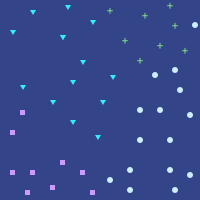 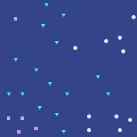

**c4-b115** (Fin's summary view, partway through the game; the text gives no count here):
- **Circles, Zei** (team Zau): 15, down the east side from the bottom-right corner up to the middle, one in the north-east. Zei started "in the bottom right corner" (c4-b94) and has pushed north towards Dza.
- **Squares, Bai** (team Zau): 9, bottom-left and a few up the west edge and in the south centre (c4-b94: "at the bottom left").
- **Triangles, Pan** (team Ja): 13, the north-west and the centre. Pan's home base is north-west (c4-b125, Zei's spaceship flies "diagonally northwest […] straight toward Pan's").
- **Plus signs, Dza** (team Ja): 8, the north-east ("his home base in the northeast corner", c4-b113). The plus signs are text characters ("+"); their only words, "+ + + + + + + +", are why `passages.md` lists the figure as having words.

**c4-b137** (after "all of Dza's remaining symbols had been eliminated", c4-b136):
- **Plus signs:** all 8 gone. Dza is out.
- **Circles, Zei:** 10. Nine of the 15 are gone (six from the east middle); four are new, two of them in the north-east where Dza was. That is Zei's base "right at the core of Dza's territory" (c4-b113).
- **Squares, Bai:** 5. Four are left in the bottom-left; one new square is deep in the north-west, in Pan's base. That is the symbol Zei's spaceship formed there: "Bai's symbol." (c4-b133).
- **Triangles, Pan:** 15 distinct. Five are gone from the north-west and centre; seven are new, three in the south-west and two in the south centre, around Bai. That is Pan's attack that "pushed Bai back all the way to her home base, surrounded on all sides" (c4-b125).
- **The count:** Zei 10 + Bai 5 = 15 against Pan 15, as "By total symbol count, it was fifteen to fifteen" (c4-b138). It matches only if the two duplicated triangles count once.

### c7-b87, c7-b97, c7-b112, c7-b118: the final, 1 v 1 with AIs

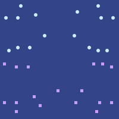 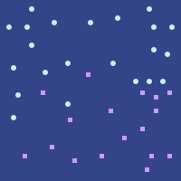 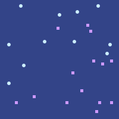 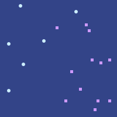

Squares are Zei, in the south (his ship starts "from the southeast corner", c7-b81; "Zei's base in the southwest", c7-b95). Circles are Bai, in the north ("both of Bai's home bases", c7-b89). Both start with bases in two corners: Zei south-west and south-east, Bai north-west and north-east.

- **c7-b87** (before the first intervention turn; the audience's screen, c7-b86): Zei 17, Bai 16, no text count. Each side holds its two corners and a band towards the middle. One Zei square sits alone low in the centre-south, about where the hand-made ship reflects "off the wall in the south" and turns north (c7-b85).
- **c7-b97** (after Zei's ship is destroyed, c7-b96): Zei 17, Bai 22, as "Seventeen symbols to twenty-two" (c7-b98). Ten of Zei's squares moved: gone from the south-west and west middle (c7-b95, "destroyed two of his symbols"), new ones in the east middle and centre. Bai has thirteen new circles across the middle, west to east: she has advanced.
- **c7-b112** (five hundred turns after the factory fires, c7-b111): Zei 14, Bai 11, as "Fourteen to eleven." (c7-b114). Fourteen of Bai's 22 circles are gone, most from her two northern corners. Zei has three new squares in the north: one at the top centre and two in the north-east. That is the factory "halfway point between the center of the board and the northern edge" and its spaceships moving east (c7-b109).
- **c7-b118** (the end): Zei 12, Bai 6, as "Twelve to six." (c7-b119). Zei lost exactly his two south-western squares, as "Bai's only significant accomplishment was destroying the remaining symbols in Zei's southwestern base" (c7-b117). Bai's six are scattered in the west and centre; none is left in the north-east.

### c12-b191: the hex-grid qualifier

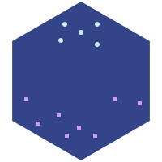

- **Board:** the only figure drawn as a hexagon, pointy-topped. The hex grid itself is not drawn.
- **Circles:** 5, close together in the top centre. **Squares:** 8, spread along the south and up both sides.
- **Who is who:** the text does not say. Squares are Zei in every other 1-v-1 figure, and the squares' spread fits Zei, who made symbols away from home (c12-b187) and "also sent gliders from nearby his new symbol, rapidly heading east" (c12-b189). The circles' tight cluster fits Bo, whose three visible symbols Zei later targets (c12-b195).
- **The point of the picture:** both sides are spread sideways and neither reaches up or down the board: "Neither player had managed to figure out any gliders that move vertically, they realized." (c12-b192).

### c14-b52, c14-b60, c14-b68, c14-b80: the semi-final with shrines

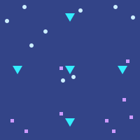 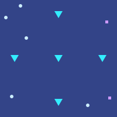 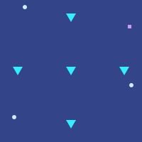 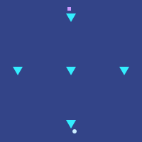

The five large cyan triangles are the shrines, "four arranged along the center of each edge of the board, and one in the center" (c14-b33). They never move. Squares are Zei; circles are Gun.

- **c14-b52** (after the second intervention turn, "the audience could", c14-b51): Zei 9, Gun 9. Three of Zei's squares are beside the centre, south and east shrines, his three ships ("as they went to the center, east and south", c14-b40); the rest are in his south-east and south-west bases. Gun holds the north-west and north-east and has two circles beside the centre shrine ("using both his symbol-carrying spaceships in the center", c14-b50).
- **c14-b60** (the fourth intervention turn, c14-b59): Zei 2, Gun 5, the "large advantage in material" (c14-b61). Eight of Zei's squares are gone (the centre ship, c14-b53; the south-east, c14-b57). His one new square is in the north-east: the ship he stopped "just outside of visual range of Gun's northeastern base" (c14-b56). Gun's north-east circles are gone (Zei's gliders, c14-b56), and two new circles are in the south: Gun's ships moving south (c14-b54).
- **c14-b68** (Zei building a new ship, c14-b67): Zei 1, Gun 3. Zei's last south-east square is gone (c14-b65). Only the north-east ship is left. Gun has a new circle on the east edge: his ship "starting to move northwards" (c14-b65), heading for Zei's.
- **c14-b80** (the tenth intervention turn, "More and more debris", c14-b79): Zei 1, Gun 1. Nothing is in the same spot as before. Zei's square is at the top centre, just north of the northern shrine, where "the new ship would *also* head west, but stop just north of the northern shrine" (c14-b77). Gun's last circle is at the bottom centre, below the southern shrine.

---

## Part 3. The book and our game today

"Our game" is Play (`src/lib/minpentai/play-game/`), the real game at `/minpentai`, on `main` at 02ddf08. Learn still teaches Play's earlier version (v3); the book's cell rule is at `/minpentai/rule` (`src/lib/minpentai/engine.ts`). See `docs/minpentai/code-map.md`.

| Topic | The book | Play today | Gap |
|---|---|---|---|
| What the board is | A grid of cells that evolves by a reversible rule (c4-b9, c12-b163); players put down squares (c4-b94) | Pieces on squares: towers, gliders, squares (walls) and rocks (`game.ts`). Gliders are single pieces with a direction | **Large.** Play is a piece game. The book's cell rule exists only on `/minpentai/rule` and in Learn's Under the hood |
| Board size | Never given. Vision is "thirty squares" (c4-b93); games last thousands of turns | 15 × 10 | Book boards are far larger. Unknown how much |
| Reversibility | Central: nothing is invincible (c4-b13); the sandbox can run backward (c12-b171) | Play's `step` is not reversible (pieces break and vanish). `/minpentai/rule` runs the book's rule backward | Large |
| Gliders, spaceships, moving walls, factories | Shapes in the cells; factories make gliders; a factory can be a program with a trigger (c7-b102) | One glider piece (cost 4, or 3); it flies straight, bounces off edges and rocks, breaks a square in two hits, destroys an enemy tower | No spaceships, moving walls, factories or triggers |
| Rock formations | Hidden at first (c12-b157); the resource: gliders hitting them make more gliders (c4-b108); "negentropy" (c4-b84) | Six fixed rocks, always shown; gliders bounce off them | Rocks are obstacles, not a resource |
| Resources | Taken from rocks during play; plus an intervention budget, split by percentage (c7-b102) | 8 points a turn, unspent points lost | Budget exists; no resource you gather |
| Entropy and debris | The board fills with debris and stray gliders (c4-b140, c14-b79) | Broken pieces flash white and disappear | No debris |
| Symbols | A dot pattern; any copy anywhere gives sight; made by placing or by collisions; anyone can form anyone's (c4-b93, c4-b108, c4-b133) | Towers (cost 4), placed only; sight and placing reach R = 3 (or 2) around them | Towers stand in for symbols. No forming by collision |
| Sight | Dark at start; 30 squares around each symbol; teammates share; hidden watchers (c10-b162) | Dark outside R of your towers (Chebyshev distance); "last seen" outlines of enemy towers (invented) | Same idea, small scale |
| Setup | Countdowns; placing only in the home corner; minutes long (c12-b149) | Setup 90 s on the server (`SETUP_MS`); 8 points in the lit area near your two towers | Same shape, much shorter |
| Intervention turns | About every thousand turns (c4-b110, c14-b45); place near any copy of your symbol (c4-b110); also remove cells (c4-b135) | Every 12 steps (8 under one rule); 45 s; place within R of towers that stood when the turn began; take back pieces placed this turn; no removing | Same shape. No removing your own walls, which c4-b135 turns on |
| Sandbox | Separate, empty, open all game; step forward, shift time back or forward (c12-b171); copy and paste to the field (c12-b182) | Free play: any board, an eraser, rule switches; placing at step 0 only; no step back; no copy to a live match | No in-match sandbox, no backward step, no paste |
| Teams | 2 v 2 normal (c4-b89), four corners (c12-b10), voice chat (c4-b99), shared sight | 1 v 1 only. Learn's four-player broadcast is scripted, not playable | No teams |
| Winning | A side is out when all its symbols are gone (c4-b136); resign (c4-b141); symbol count as the running score (c7-b98) | No towers left, or most towers at step 96; resign; leaving counts as resigning | Close. Play's step cap is invented; the book has none (c14-b94: 10,200 turns) |
| Tournament scoring | Wins, with a tiebreak on turns survived and turns needed, capped at 8,000 (c12-b91) | The ladder (five computer players); one-on-one with rematches | No tournament |
| Each match's special rule | Secret, sometimes hidden (c4-b148), sometimes mid-game (c5-b30); announced at the start in c7, c12, c14 | One of four drawn at random and shown at the start: diagonal gliders, gliders cost 3, sight 2, turns every 8 | Present, small. No secret or mid-game rules; no hex grid; no shrines |
| Audience view | A full map for the audience (c4-b114, c14-b51) | The whole board is shown at the end; "watch it again" from the stored history | No live spectator view |
| Bots | Strong on the usual rules, weak on new ones (c7-b14) | Five computer players, rule-aware (Opportunist uses the drawn rule); not in order of strength (`ideas.md`) | Fine for practice |
| Personal AI in a match | c7: a personal AI each; thought transcripts readable by both sides (c7-b65) | None. No AI model is called anywhere in Minpentai's code | **Missing**; see part 4 |

---

## Part 4. What an AI-commander version would need

Chapter 7 describes a game played at two levels: the player gives orders in words and decides how much of the turn's budget the AI gets; the AI builds; the opponent reads the AI's thoughts. Each need below cites the passage it comes from.

### 4.1 What the book requires

1. **An AI per player that builds from words.** "Take my fourth westernmost symbol […] Construct near that symbol a factory capable of executing each of those strategies." (c7-b102). The AI turns an order into placements.
2. **A budget split each turn.** "Allocate eighty percent of resources this intervention turn to this." (c7-b102); "He toned down the amount of resources allocated to the AI, and used those resources to manually send a large number of gliders" (c7-b89). The player sets a share; the AI spends its share; the player spends the rest by hand.
3. **The AI's thoughts, live, to both sides.** "the players and their AIs will have full read access to the thought transcripts of each other's AI." (c7-b65), shown in a tab (c7-b64, c7-b67). The opponent's AI reads it too and plans against it (c7-b69).
4. **Hand moves stay private.** Zei builds pieces "himself so that they would not appear in the transcript" (c7-b110, c7-b115). The transcript holds the AI's thinking, not the player's moves; the opponent still sees the board where their sight reaches.
5. **The player's orders: private or public?** The book does not say outright. Bai "had deliberately directed the AI to focus on the other directions" and Zei did not see it (c7-b96), and Zei worries the AI might "ignore Zei's instruction to focus exclusively on the domain it was assigned to, and blurted out the spaceship's position mid-transcript" (c7-b94). Both read as: the orders are private, and only what the AI thinks aloud is public. A version needs to decide this, and the book leans to private.
6. **The AI knows its player's style.** "He asked it to set up standard glider and wall formations, in his own style. To his surprise, the AI knew what his style was." (c7-b66). Needs each player's past games.
7. **The AI sees what its player sees.** Neither Bai nor her AI knew where Zei's symbol was (c7-b105). Its view should be the player's fog, not the whole board.
8. **Limits that a clever player can exploit.** The AI "could not optimize defenses against all of them at the same time" (c7-b104); a bait in one's own transcript works (c7-b96). The AI should not be perfect, and its plans should be readable enough to be read against it.
9. **Copy from the AI's work.** "copying and pasting pieces of what the AI had already made" (c7-b70).
10. **Structures that act later, on a trigger.** The winning move is a factory that chooses one of sixteen strategies from "the type of glider and the time it hits" (c7-b102), and a trigger "that would only appear in ten turns" (c7-b115). Den calls it a meta-program (c9-b70). Without something like this, the hidden choice that wins chapter 7 can't be played.
11. **Awareness of the match's rule.** Bots "are much worse at adapting to any new situation they don't have training data for" (c7-b14). The AI must be told the drawn rule, and the version should keep the book's point that a human adapts better.
12. **Transcripts kept after the game.** Den "studied the transcripts from the game" (c9-b61). Store them with the match, for "watch it again".

### 4.2 What that means for Play

- **Possible on Play's pieces (1–9, 11, 12).** An AI commander can work on today's board: at each turn to act it gets the fogged view the computer players already get (`PlayerView` in `players.ts`), the player's order and its share of the 8 points, and returns placements, which `checkPlacements` validates like any other. Its reasoning streams to both players' screens. The player places the rest by hand.
- **8 points is too coarse for "eighty percent".** Two gliders is the whole turn. An AI mode would need a bigger budget per turn, or shares in whole points.
- **Trigger structures (10) need an invention.** Play has no piece that waits and then chooses. Options: an invented "factory" piece that fires a set pattern when a glider of yours hits it, its pattern chosen by the side it is hit from; or play this mode on the book's cell rule, where a factory can be built from cells but is far harder for a model to design.
- **Speed.** Today's turn lasts 45 s. A model's plan plus its streamed reasoning must fit inside the turn, or the turn must be longer in this mode.
- **Fairness and cost.** Both sides need the same model and limits. Each turn is one model call per side, so a 96-step match with a turn every 12 steps is about eight calls per side. The price per call is unknown until measured.

### 4.3 Things the owner would decide first

- Which model, and through what. The site's standing rules: batch and agent jobs go through the AI gateway with zero data retention, not the site's own model key; a closed model is allowed if labelled, with the provider named first.
- Whether orders are private (the book leans that way, 4.1 item 5).
- Whether this is a new mode on Play or on the book's cell rule.
- Legal texts: sending a player's orders and board to a model provider would need Privacy wording, shipped with the feature and not before.
- Who pays per match, and whether AI-v-AI matches (two commanders, no humans) are allowed. The book has a version of that: AIs against AIs, three-on-one (c12-b10).

This fits the site's main goal as recorded: the person supplies the idea, the order, and the AI does the work.
