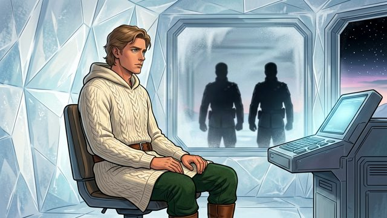
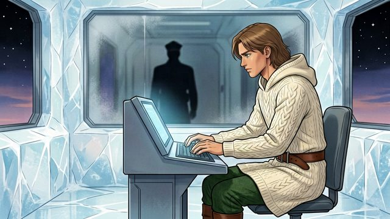
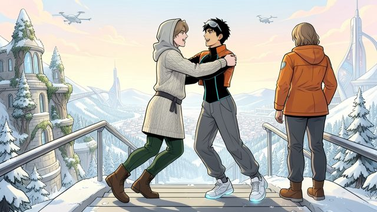

# Favourites: candidates and cost, for the owner's picks (DRAFT)

Drafted by the coding agent (Claude, a closed model by Anthropic), 2026-11-04, on branch `favourites-candidates`. **A list and an estimate only:** no picture made, nothing spent, nothing published, nothing written to the database. Production was read once, in one read-only transaction as `studio_writer`, plus public GETs. Every picture here is AI-made and keeps that label wherever it is used.

**The decision (owner, 2026-11-04):** for each favourite he picks, a remix of the chosen base is made with the edit model, using the base and the favourite as references, and published from his account as an admin remix, shown on /challenge under its character as "Remixes from our adaptations". Not entries; anyone can remix them. $2 cap; this estimate first.

**Reply with labels**, e.g. **"Zei · F1, Zei · F6, Bai · F2"**, and for each the base it remixes (e.g. **"Zei · F1 on Printed"**). Strongest first in every section, judged by how clearly the picture shows the character's look against their sheet.

## Where they came from

| Source | What was looked at | Used |
|---|---|---|
| Seeded chapter images (`content/snowmoon/illustrations/published.json`, recipes in `content/snowmoon/recipes/images/chapter-*.json`, files on `media.snowmoon.party`) | all 139; 89 show at least one of the six | 27 listed |
| Fifteen Days, the live adaptation (`adaptations/fifteen-days/versions/1.json` and `2.json`; frames served at `snowmoon.party/editor/1/v1/` and `/v2/`) | every frame with a person in it (80); the 42 single-person frames looked at one by one | Zei, Bai, Deluin |
| DOG at dawn (`adaptations/dog-dawn/picks.json`; files local, unpublished) | the locked pictures | 3 of Deluin |
| `studio.admin_picks` (production) | read-only | **empty**: no picks yet |
| `studio.seeded_hidden` (production) | read-only | one hidden image, `c1-b089-autobus` (none of the six); every listed image is not hidden |
| Readers' published images (production: `studio.elements` images, `studio.remix_frames`, `studio.piece_versions`) | 2 published images, 3 Remix frames, 6 agent drafts | see "Readers' images" |

**How the characters are known:** a seeded image's job lists the character files (`designs/characters/<name>.json`) and its recipe sends that character's sheet as a reference (e.g. `gladias-sheet.png`); a Fifteen Days frame's shot lists `who` and sends the character's cast card. Each source line below says which.

**Recipe summary key:** *seeded* = FLUX.2 [klein] 4B (open weights, Apache-2.0), run locally with mflux, 4-bit, 4 steps, with the character sheets as references, in the starting style's text ("Techno vistas (starting point)"); *Fifteen Days v1* = FLUX.2 [klein] 4B on fal.ai with the cast cards, then Qwen-Image-Edit-2509 (open weights, Apache-2.0) clean-up edits; *Fifteen Days v2* = the v1 frame redrawn by **GPT Image 2.5 Sunburst, a closed model by OpenAI**, through the Vercel AI Gateway (no seed exposed); *DOG at dawn* = ERNIE-Image Turbo (open weights, Apache-2.0, on fal.ai), text-to-image, the character described in words, or FLUX.2 [klein] 4B locally with the sheets.

All of these are the project's own pictures, so the owner can use them.

## Zei

Sheet: blue streak, visor glasses, orange cropped jacket, black bodysuit with cyan seams, grey gathered trousers, glowing sneakers. The close-ups show face, hair, jacket and bodysuit but no visor glasses and nothing below the chest; F6 and F7 show the whole outfit.

<table>
<tr><td align="center" valign="top"> <b>Zei · F1</b> Fifteen Days v2, shot 63-CU-Z (the gate), frame cov-gate-CU-Z-smile-K7-g1 · who: Z, card zei · GPT Image 2.5 Sunburst, a closed model by OpenAI · one of the three poster panels</td>
<td align="center" valign="top"> <b>Zei · F2</b> Fifteen Days v2, shot 49-b4-2 (the café), cov-cafe-CU-Z-amused-K7-g1 · who: Z, card zei · GPT Image 2.5 Sunburst, closed (OpenAI)</td></tr>
<tr><td align="center" valign="top"> <b>Zei · F3</b> Fifteen Days v2, shot 28-b2-9 (the corridor walk), cov-walk-CU-Z-tease-K8-g1 · who: Z, card zei · GPT Image 2.5 Sunburst, closed (OpenAI)</td>
<td align="center" valign="top"> <b>Zei · F4</b> Fifteen Days v1, shot 63-CU-Z, cov-gate-CU-Z-smile-K7 · who: Z, card zei · FLUX.2 [klein] 4B seed 34757, Qwen-Image-Edit-2509 seed 31757 (open)</td></tr>
<tr><td align="center" valign="top"> <b>Zei · F5</b> Fifteen Days v1, shot 57-b5-2, cov-cafe-CU-Z-smile-K14 · who: Z, card zei · FLUX.2 [klein] 4B seed 35425, Qwen-Image-Edit-2509 seed 31742 (open)</td>
<td align="center" valign="top"> <b>Zei · F6</b> Seeded, c4-b149-new-rule (with Mu) · job: mu, zei; refs mu-sheet, zei-sheet · seeded recipe, seed 4149 · whole outfit, glowing sneakers</td></tr>
<tr><td align="center" valign="top"> <b>Zei · F7</b> Seeded, c4-b073-rival (with Bai) · job: bai, zei; refs bai-sheet, zei-sheet · seeded recipe, seed 4073 · whole outfit, visor glasses</td><td></td></tr>
</table>

## Bai

Sheet: magenta ponytail with shaved sides, lime vest, white back panel, black trousers with magenta piping, knee pads, magenta-soled boots. **The Fifteen Days frames add arm tattoos and dangling earrings** that the sheet doesn't have; a remix from one of them would carry those over (that may be the point; the owner's call). F7 and F8 show the whole outfit as the sheet has it.

<table>
<tr><td align="center" valign="top"> <b>Bai · F1</b> Fifteen Days v2, shot 27-b2-8 (the corridor walk), cov-walk-CU-B-serious-K9-g1 · who: B, card bai · GPT Image 2.5 Sunburst, closed (OpenAI)</td>
<td align="center" valign="top"> <b>Bai · F2</b> Fifteen Days v2, shot 46-b3-13-cut (the café), cov-cafe-CU-B-standing-K7-g1 · who: B, card bai · GPT Image 2.5 Sunburst, closed (OpenAI) · vest, white panel and headphones</td></tr>
<tr><td align="center" valign="top"> <b>Bai · F3</b> Fifteen Days v2, shot 21-CU-B (the corridor), cov-corridor-CU-B-sour-K9-g1 · who: B, card bai · GPT Image 2.5 Sunburst, closed (OpenAI) · one of the three poster panels</td>
<td align="center" valign="top"> <b>Bai · F4</b> Fifteen Days v1, shot 46-b3-13-cut, cov-cafe-CU-B-standing-K7 · who: B, card bai · FLUX.2 [klein] 4B seed 34746, Qwen-Image-Edit-2509 seed 31746 (open)</td></tr>
<tr><td align="center" valign="top"> <b>Bai · F5</b> Fifteen Days v1, shot 27-b2-8, cov-walk-CU-B-serious-K9 · who: B, card bai · FLUX.2 [klein] 4B seed 34922, Qwen-Image-Edit-2509 seed 31722 (open) · v1 vest reads as a grid top</td>
<td align="center" valign="top"> <b>Bai · F6</b> Fifteen Days v2, shot 47-BAI, cov-cafe-BAI-sideeye-R20-g1 · who: B, card bai · GPT Image 2.5 Sunburst, closed (OpenAI) · from behind: ponytail, white back panel</td></tr>
<tr><td align="center" valign="top"> <b>Bai · F7</b> Seeded, c4-b073-rival (with Zei) · job: bai, zei; refs bai-sheet, zei-sheet · seeded recipe, seed 4073 · whole outfit, knee pads, boots</td>
<td align="center" valign="top"> <b>Bai · F8</b> Seeded, c14-b027-lobby-breakfast (with Zei) · job: zei, bai; refs zei-sheet, bai-sheet · seeded recipe, seed 14027 · standing, whole outfit</td></tr>
</table>

## Gladias

Sheet: short brown hair and beard, green sleeveless tunic over cream sleeves, ochre sash, grey leggings and boots, **no privacy robe**. All six listed show the sheet's clothes; none shows the robe.

**Privacy robe: left out on purpose** (Garance is redesigning it): c3-b092-booth, c6-b100-assembly and c6-b116-febric-hug (privacy robe, hood and face cover lowered), c16-b060-helisport-broadcast and c16-b110-trip-news (the dark purple robe), c18-b079-pyramid-view (drawn with a purple hood), and c6-b004-foil-basement (the robe drapes a chair). If any of these is wanted later, it waits for Garance's robe.

<table>
<tr><td align="center" valign="top"> <b>Gladias · F1</b> Seeded, c24-b006-sleepless-call · job: gladias; ref gladias-sheet · seeded recipe, seed 24006 · alone, tunic, sash, sleeves, face</td>
<td align="center" valign="top"> <b>Gladias · F2</b> Seeded, c5-b091-watch-call (with Seila) · job: seila, gladias; refs seila-sheet, gladias-sheet · seeded recipe, seed 5091 · the clearest face</td></tr>
<tr><td align="center" valign="top"> <b>Gladias · F3</b> Seeded, c32-b111-roof-home (with Seila) · job: gladias, seila; refs gladias-sheet, seila-sheet · seeded recipe, seed 32111 · whole figure</td>
<td align="center" valign="top"> <b>Gladias · F4</b> Seeded, c23-b078-red-call · job: gladias; ref gladias-sheet · seeded recipe, seed 23078 · alone, low light, red glow</td></tr>
<tr><td align="center" valign="top"> <b>Gladias · F5</b> Seeded, c25-b017-tapping-circles (with Zei) · job: gladias, zei; refs gladias-sheet, zei-sheet · seeded recipe, seed 25017 · close, upper body</td>
<td align="center" valign="top"> <b>Gladias · F6</b> Seeded, c19-b110-sealed-tea (Zei small behind) · job: gladias, zei; refs gladias-sheet, zei-sheet · seeded recipe, seed 19110 · standing, three-quarter figure</td></tr>
</table>

## Seila

Sheet: long braids, round glasses, rust coat with toggles, olive trousers, tan boots. **Left out for the robe:** c20-b174-standing-up (Seila herself in the dark purple robe) and c11-b126-hug-from-behind (she hugs a robed figure).

<table>
<tr><td align="center" valign="top"> <b>Seila · F1</b> Seeded, c20-b002-red-alert · job: seila; ref seila-sheet · seeded recipe, seed 20002 · alone, close, coat, braids, glasses</td>
<td align="center" valign="top"> <b>Seila · F2</b> Seeded, c21-b040-basement-call · job: seila; ref seila-sheet · seeded recipe, seed 21040 · alone, seated, whole outfit</td></tr>
<tr><td align="center" valign="top"> <b>Seila · F3</b> Seeded, c5-b091-watch-call (with Gladias) · job: seila, gladias · seeded recipe, seed 5091 · the clearest face</td>
<td align="center" valign="top"> <b>Seila · F4</b> Seeded, c32-b111-roof-home (with Gladias) · job: gladias, seila · seeded recipe, seed 32111 · whole figure, standing</td></tr>
<tr><td align="center" valign="top"> <b>Seila · F5</b> Seeded, c28-b057-zven-sofa (with Zven) · job: zven, seila; refs zven-sheet, seila-sheet · seeded recipe, seed 28057 · whole figure, standing</td>
<td align="center" valign="top"> <b>Seila · F6</b> Seeded, c26-b075-seila-runs (with Gladias) · job: seila, gladias · seeded recipe, seed 26075 · running, small in frame</td></tr>
</table>

## Deluin

Sheet: wavy shoulder-length light-brown hair, long cream cable-knit hooded tunic, grey belt, dark green leggings, brown boots. F2 and F5 show the whole outfit seated; F7 standing with the hood up.

<table>
<tr><td align="center" valign="top"> <b>Deluin · F1</b> Fifteen Days v2, shot 50-b4-3 (the café), cov-cafe-CU-D-warm-E16-g2 · who: D, card deluin · GPT Image 2.5 Sunburst, closed (OpenAI) · one of the three poster panels</td>
<td align="center" valign="top"> <b>Deluin · F2</b> DOG at dawn, beat 1 (locked pick), ab-e-01-a2 · prompt names Deluin's command post and describes him · ERNIE-Image Turbo seed 60011 (open) · unpublished: committed here as a small copy (sha256 of the original dc802d35…)</td></tr>
<tr><td align="center" valign="top"> <b>Deluin · F3</b> Fifteen Days v1, shot 50-b4-3, cov-cafe-CU-D-warm-E16 · who: D · FLUX.2 [klein] 4B seed 34943, Qwen-Image-Edit-2509 seeds 31743 and 16 (open)</td>
<td align="center" valign="top"> <b>Deluin · F4</b> Fifteen Days v2, shot 2-PIT-D (the hall), cov-game-PIT-D-playing-K7-g1 · who: D, card deluin · GPT Image 2.5 Sunburst, closed (OpenAI) · hood and belt</td></tr>
<tr><td align="center" valign="top"> <b>Deluin · F5</b> DOG at dawn, beat 5 (locked pick), ab-e-05-a4 · prompt describes him · ERNIE-Image Turbo seed 60052 (open) · unpublished (f6bb7240…)</td>
<td align="center" valign="top"> <b>Deluin · F6</b> Seeded, c14-b124-redshire-photos (with Zei) · job: deluin, zei; refs deluin-sheet, zei-sheet · seeded recipe, seed 14124</td></tr>
<tr><td align="center" valign="top"> <b>Deluin · F7</b> DOG at dawn, beat 10 (locked pick), dd-09-a1 (with Zei) · job: deluin, zei; refs deluin-sheet, zei-sheet · FLUX.2 [klein] 4B locally, seed 50091 (open) · unpublished (bc77355d…) · whole figure, hood up</td>
<td align="center" valign="top"> <b>Deluin · F8</b> Fifteen Days v1, shot 2-PIT-D, cov-game-PIT-D-playing-K7 · who: D, card deluin · FLUX.2 [klein] 4B seed 34702, Qwen-Image-Edit-2509 seed 31716 (open)</td></tr>
</table>

## Mu

Sheet: short silver hair, red glasses, dark grey top with yellow piping over blue sleeves, black leggings, grey boots. **Only four pictures of Mu exist in the project,** all seeded, none a close-up. F4 has her in a silver winter coat, not her sheet's clothes.

<table>
<tr><td align="center" valign="top"> <b>Mu · F1</b> Seeded, c4-b149-new-rule (with Zei) · job: mu, zei; refs mu-sheet, zei-sheet · seeded recipe, seed 4149 · whole figure, standing</td>
<td align="center" valign="top"> <b>Mu · F2</b> Seeded, c7-b049-toast (with Zei) · job: mu, zei · seeded recipe, seed 7549 · whole figure, standing</td></tr>
<tr><td align="center" valign="top"> <b>Mu · F3</b> Seeded, c10-b191-the-reveal (with Zei) · job: mu, zei · seeded recipe, seed 10191 · seated, dark room</td>
<td align="center" valign="top"> <b>Mu · F4</b> Seeded, c29-b002-snowy-hill-sunrise (with Zei) · job: zei, mu · seeded recipe, seed 29002 · winter coat, not the sheet's clothes</td></tr>
</table>

## Readers' images

Production holds three kinds of reader work; none of it is a good favourite:

- **Published images (2), both the owner's own** (@naaate, chapters 7 and 26): two robed friends walking to the pyramid city, and a drone exploding. Neither shows one of the six.
- **Remix frames (3)**, public to anyone with the link:
  - **Deluin · R1, reader's image: needs the maker's agreement or credit.** Remix frame `f4027931…` by **0x48c4…0ab9** (a wallet account, no Farcaster name), 2026-10-18: shot 2-PIT-D with their words "No people behind him."; FLUX.2 [klein] 4B edit on fal.ai, seed 22216332, from the v1 frame F8 with the deluin card. 
  - **luisotravez (2 frames, shot 12-b1-5, Bai and Zei):** both files show grey placeholder shapes, not Bai or Zei, so they aren't candidates at all.
- **Agent drafts (6)**, Zei, Bai and Deluin character versions by an agent named Muse: drafts, never published, with no picture. Not listed.

**Recommendation: leave R1 out.** It is close to the project's own F8 (the reader's change was taking people out of the background), the project already has eight Deluin pictures, and a wallet-only maker can't be asked or credited by name. If the owner wants it anyway, it needs the maker's agreement and a credit line on the remix ("from a Remix frame by 0x48c4…0ab9"); Terms 5 licenses it to everyone under GPL-3.0, so it may be used, but asking is the courtesy.

## Cost

From the site's own prices and formula (`src/lib/config.ts`, `src/lib/images/fal.ts`): FLUX.2 [klein] 4B edit at **$0.01 per megapixel**, and `makeEdit` counts the output **plus every reference picture's pixels** (fal's page doesn't say whether inputs count, so the site counts them). With two references (the base and the favourite):

| Picture | Pixels counted | Cost |
|---|---|---|
| Front: output 576 × 768 + base front 576 × 768 + favourite sent at 1024 × 576 | 1.47 MP | **$0.01475** |
| same, favourite sent at the editor's 1280 × 720 | 1.81 MP | $0.01806 |
| same, favourite sent as committed (v2 PNG 1536 × 864) | 2.21 MP | $0.02212 |
| Side or back, from the new front only (the site's rule: a side or back is made from its front) | 0.88 MP | **$0.00885** |
| Prompt check (gpt-oss-safeguard-20b, through the gateway): measured $0.00012 on average on 2026-11-03, one retry in four | per picture | **$0.0003** counted |

**Recommended: send every favourite as a 1024 × 576 copy** (Lanczos, recorded in the recipe with the original's sha256), so each front costs the same and each picture stays under 1 MP.

Per favourite: **front only $0.0150**; **front, side and back $0.0333**. The worst case the site would reserve (every picture rounded up to 1 MP, check $0.0015): front $0.0315, side or back $0.0215 each, so $0.0745 with three views.

| Favourites per character (6 characters) | Pictures | Front only | Front, side, back | Worst case, front only | Worst case, three views |
|---|---|---|---|---|---|
| 1 (6 remixes) | 6 or 18 | **$0.09** | **$0.20** | $0.19 | $0.45 |
| 2 (12 remixes) | 12 or 36 | **$0.18** | **$0.40** | $0.38 | $0.89 |
| 3 (18 remixes) | 18 or 54 | **$0.27** | **$0.60** | $0.57 | $1.34 |

**Under $2:** every row fits, even at the worst case. At the estimate, $2 covers about 59 favourites with three views or 132 fronts only; at the worst case, 26 with three views. Room is left for retakes: 3 per character with three views and one retake of every picture is $1.20 at the estimate ($2.68 at the worst case, which the script's cap would stop). Mu has only four candidates, so 3 for Mu is nearly all of them.

**Dependency:** the bases come first. A remix is a fork of a published base, so the owner's base picks (bases.md) and the starting sheets' publish (`seed-designs.ts --apply`) must be done before any favourite is made; each favourite needs to know which base (which style) it remixes.

## Design notes for the publish step (no code yet)

1. **Making, then publishing, as for the bases.** A make step (the edit model, with the base's front and the favourite as references, the base's style text, through the site's `viewPrompt` and `makeEdit` unchanged, the prompt check first, the cap checked before every call) writes drafts here for the owner's look; the publish step comes after his go.
2. **The publish script extends `scripts/seed-designs.ts`**: dry run by default (SELECTs in one read-only transaction; prints every R2 key, sha256, row and recipe), `--apply --favourites=<file> --confirm-owner-go` to write, idempotent (an existing remix is skipped). Each favourite is `makeDesign(mode: 'fork', kind: 'character', fromVersionId: <the base's version>)` by FID 6786 (the owner, an admin), so its first version has a `remixed_from` link to the base: that is what makes it a remix, and what anyone forking it builds on.
3. **"Uses" links.** `studio.links` has `uses` from an image's version to a design it used. The favourite is not a design and, for seeded pictures, editor frames and the DOG at dawn pictures, is not an element at all (seeded images aren't stored as elements yet), so no `uses` row can point at it. What can be true: the `remixed_from` link to the base, and the recipe's `references` naming both pictures by sha256, with the favourite's source (its media URL, or its frame id and adaptation version, or its committed file), its own recipe file, its model and maker (GPT Image 2.5 Sunburst, a closed model by OpenAI, for the v2 frames), and the downscaling step. The owner should confirm this reading of "uses links".
4. **On /challenge, a separate list per character, "Remixes from our adaptations"**, under that character's "Sheets to start from". Today it can't show this way without code: a sheet published **before** the window opens (6 Nov, 09:00 Pacific) is listed under "Sheets to start from" (`startingSheets` lists every published sheet of the character from before the window), and one published **during** the window shows in the general "Made by admins (not eligible for rewards)" list. So the page needs a marker on these versions (for example a `from_adaptation` field in the body: adaptation, version, frame or image id), read by a new list that both of the others skip. The body is JSON, so no migration.
5. **Order and P5g.** P5g says the challenge's entries, sheets to start from and "Posted on" are in time order only (every `.sort()` is `newestFirst`; no order reads likes, built-on counts, scores, costs or payments). **Time order (newest first) needs no exception** and is the recommendation. **The owner's own order would be an admin choosing an order**, which principle 5 allows only as a labelled pick with the switch (P5b, P5d), and Terms 7 describes picks only for a moment of the book or a glossary item; so it would need a P5 exception or a new pick kind, its "Picked by @naaate" label and switch, and a Terms 7 sentence with the owner's reread.
6. **Never entries.** Admins are never eligible (`eligibility()` in `src/lib/challenge/rules.ts`), so these can't be entries and don't count toward any character's three entrants. Each remix's page shows the admin line. A fork of one of them by someone else is a fork of a challenge character's sheet, so it can be an entry: "anyone can remix them" works today.
7. **Labels.** Each view keeps "AI-generated, not by the author" and its recipe (P1, P2); a remix built on a v2 frame names "GPT Image 2.5 Sunburst, a closed model by OpenAI" for that reference (closed models allowed since 2026-10-18), while the remix itself is made by the open FLUX.2 [klein] 4B. The text (the sheet's words) and title: see decisions.
8. **What the Terms and Privacy already cover:** Terms 6e ("Admins can make versions but aren't eligible for rewards"), Terms 5 (what is published is GPL-3.0, so others may remix it), Terms 7 ("Nothing on the Service is official or canonical"; admins may hide the project's own images), Terms 8 (AI-made material is labelled), Privacy 4 and 6 (character sheets are public with their views, name and recipe), and Privacy 7's fal.ai line (fal receives the prompt and pictures sent). **Nothing new is needed for time order.** Not covered: an owner-ordered list (point 5). Using a reader's frame (R1) needs no new text but does need the maker's agreement or credit. Before anything goes live, reread the texts as they stand that day.
9. **Spend accounting.** As with the bases, the script calls fal directly with the hard $2 cap; nothing counts toward the site's daily image cap, and the daily publish limit (3 a day) doesn't apply to the script. Say so in its report.

## Decisions owed

1. **The bases** (bases.md) and their publish, first.
2. **The picks:** which favourites, and on which base each.
3. **Front only, or front, side and back** ($0.0150 or $0.0333 each).
4. **Order on /challenge:** newest first (no exception), or the owner's order (needs a P5 exception and a Terms 7 reread).
5. **When to publish:** before 6 Nov 09:00 Pacific or during the window; either way the page needs the marker (point 4) first.
6. **The text and title** of each remix: keep the base's text word for word with a title such as "From Fifteen Days" (recommended), or new words.
7. **"Uses":** accept that the favourite is linked through the recipe's references, not a `uses` row (point 3).
8. **Reader frame R1:** leave out (recommended), or include with the maker's agreement and credit.
9. **DOG at dawn's pictures** (Deluin F2, F5, F7) aren't on the site yet: a remix built on one would publish that picture's small copy with the recipe. OK, or only published pictures?
