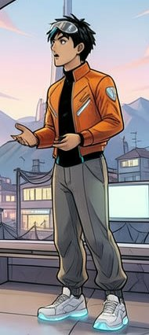
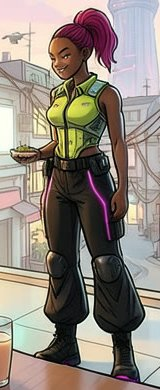
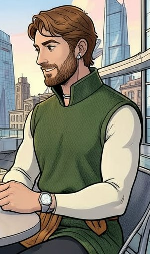
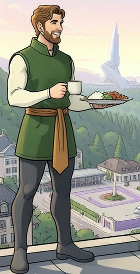
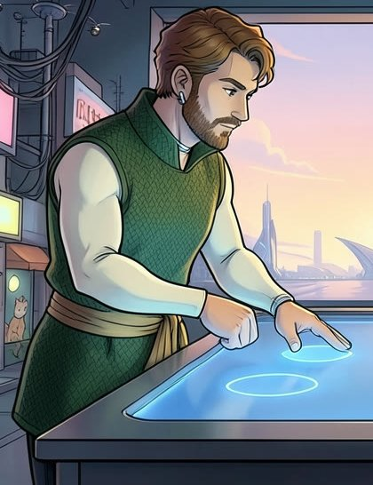
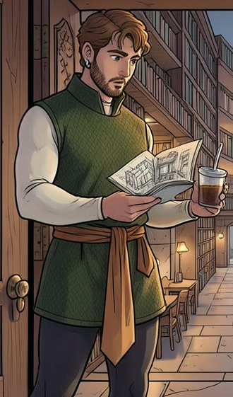
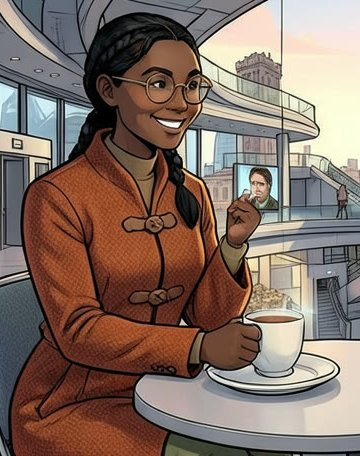
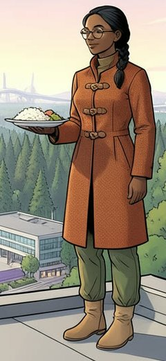
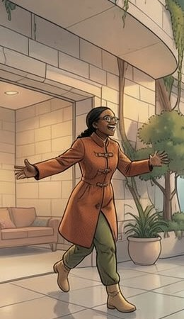
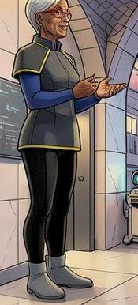

# Favourites: candidates and cost, for the owner's picks (DRAFT, v2)

Drafted by the coding agent (Claude, a closed model by Anthropic), 2026-11-04, on branch `favourites-candidates`. **A list and an estimate only:** no picture made, nothing spent, nothing published, nothing written to the database. Production was read once, read-only, as `studio_writer`. Every picture here is AI-made and keeps that label wherever it is used.

**v2 (the owner's decisions, 2026-11-04):** every candidate was looked at again, full size, and dropped if it has an anatomy glitch, someone close to the character, or the privacy robe on or near them. Where the character is clear but others are nearby, the picture is **cropped to the character** (no model: a Pillow crop of the published file; box and sha256 in [`favourites/crops.json`](favourites/crops.json), the full-size crops kept locally in `/Users/nathan/snowmoon-starting-drafts/favourites/crops/`). DOG at dawn pictures are out (not on the site), and so is the reader's frame R1. **Labels are unchanged from v1**, so a gap in the numbers is a dropped picture.

**Reply with labels**, e.g. **"Zei · F1, Bai · F2, Gladias · F3"**. Each one becomes a remix, in three views, of the base the owner picks for that character.

**29 kept:** Zei 6, Bai 7, Gladias 6, Seila 5, Deluin 4, Mu 1. **10 of them cropped.**

**Sources** (unchanged from v1): the seeded chapter images (`content/snowmoon/illustrations/published.json`, on `media.snowmoon.party`; each job lists its characters and sends their sheets), Fifteen Days v1 and v2 (`adaptations/fifteen-days/versions/`, frames at `snowmoon.party/editor/1/`; each shot lists `who` and sends that character's card), `studio.admin_picks` (empty) and the readers' work on production (nothing usable). Seeded = FLUX.2 [klein] 4B (open, Apache-2.0), local, with the sheets as references, in the starting style. Fifteen Days v1 = FLUX.2 [klein] 4B, then Qwen-Image-Edit-2509 (open). Fifteen Days v2 = **GPT Image 2.5 Sunburst, a closed model by OpenAI**.

**Titles and text lines** are suggestions. Titles: "From Fifteen Days" (v2 frames), "From Fifteen Days, version 1" (v1 frames), and for seeded pictures **"From the chapter N picture"**, rather than "From the book, chapter N", which could read as the author's own picture (principle 2). Each text line says what the favourite changes from the sheet; all are **drafted by the coding agent, for the owner's OK**. The base's text stays word for word and the line is added after it. Every line fits the 600-character limit (Zei's text leaves 55 characters, Gladias's 60).

## Zei

Sheet: blue streak, visor glasses, orange cropped jacket, black bodysuit with cyan seams, grey gathered trousers, glowing sneakers. The close-ups show nothing below the chest; F6 shows the whole outfit.

<table>
<tr><td valign="top"></td><td valign="top"><b>Zei · F1</b> Fifteen Days v2, shot 63-CU-Z, frame cov-gate-CU-Z-smile-K7-g1 · who: Z, card z · GPT Image 2.5 Sunburst, a closed model by OpenAI Shows: face, blue streak, jacket and bodysuit collar; chest up Title: “From Fifteen Days” · Text line (drafted by the coding agent, for the owner's OK): “No visor glasses; white triangle panels on the jacket.”</td></tr>
<tr><td valign="top"></td><td valign="top"><b>Zei · F2</b> Fifteen Days v2, shot 49-b4-2, frame cov-cafe-CU-Z-amused-K7-g1 · who: Z, card z · GPT Image 2.5 Sunburst, a closed model by OpenAI Shows: face, streak, jacket; chest up Title: “From Fifteen Days” · Text line (drafted by the coding agent, for the owner's OK): “No visor glasses; a warm, amused half-smile.”</td></tr>
<tr><td valign="top"></td><td valign="top"><b>Zei · F3</b> Fifteen Days v2, shot 28-b2-9, frame cov-walk-CU-Z-tease-K8-g1 · who: Z, card z · GPT Image 2.5 Sunburst, a closed model by OpenAI Shows: face, streak, jacket; chest up Title: “From Fifteen Days” · Text line (drafted by the coding agent, for the owner's OK): “No visor glasses; a sly, teasing smile.”</td></tr>
<tr><td valign="top"></td><td valign="top"><b>Zei · F4</b> Fifteen Days v1, shot 63-CU-Z, frame cov-gate-CU-Z-smile-K7 · who: Z, card z · FLUX.2 [klein] 4B seed 34757, Qwen-Image-Edit-2509 seed 31757 (open) Shows: face, streak, zip jacket; chest up Title: “From Fifteen Days, version 1” · Text line (drafted by the coding agent, for the owner's OK): “No visor glasses; a zip-front jacket, rounder face.”</td></tr>
<tr><td valign="top"></td><td valign="top"><b>Zei · F5</b> Fifteen Days v1, shot 57-b5-2, frame cov-cafe-CU-Z-smile-K14 · who: Z, card z · FLUX.2 [klein] 4B seed 35425, Qwen-Image-Edit-2509 seed 31742 (open) Shows: face, wide streak, zipped jacket; chest up Title: “From Fifteen Days, version 1” · Text line (drafted by the coding agent, for the owner's OK): “No glasses; a wide blue streak and a zipped jacket.”</td></tr>
<tr><td valign="top"> </td><td valign="top"><b>Zei · F6</b> (cropped) Seeded, c4-b149-new-rule · job: mu, zei; FLUX.2 [klein] 4B (open), seed 4149, Techno vistas (starting point) crop x 560, y 150, w 190, h 426 of the 1024 × 576 original (sha256 65e8e38b1d4ee656…); full record in favourites/crops.json Shows: whole figure: visor glasses, jacket, bodysuit, trousers, glowing sneakers Title: “From the chapter 4 picture” · Text line (drafted by the coding agent, for the owner's OK): “A shield badge on the jacket's left sleeve.”</td></tr>
</table>

**Dropped (Zei):**

- Zei · F7: c4-b073-rival. Why: someone close: Bai stands against him with her hand on his shoulder.

## Bai

Sheet: magenta ponytail with shaved sides, lime vest, white back panel, black trousers with magenta piping, knee pads, magenta-soled boots. The Fifteen Days frames add arm tattoos and dangling earrings.

<table>
<tr><td valign="top"></td><td valign="top"><b>Bai · F1</b> Fifteen Days v2, shot 27-b2-8, frame cov-walk-CU-B-serious-K9-g1 · who: B, card b · GPT Image 2.5 Sunburst, a closed model by OpenAI Shows: face, shaved sides, ponytail, earrings, vest, tattoos; chest up Title: “From Fifteen Days” · Text line (drafted by the coding agent, for the owner's OK): “Adds arm tattoos and long diamond earrings.”</td></tr>
<tr><td valign="top"></td><td valign="top"><b>Bai · F2</b> Fifteen Days v2, shot 46-b3-13-cut, frame cov-cafe-CU-B-standing-K7-g1 · who: B, card b · GPT Image 2.5 Sunburst, a closed model by OpenAI Shows: face, vest, white panel with magenta piping, headphones, tattoos; waist up Title: “From Fifteen Days” · Text line (drafted by the coding agent, for the owner's OK): “Adds arm tattoos, earrings and black headphones.”</td></tr>
<tr><td valign="top"></td><td valign="top"><b>Bai · F3</b> Fifteen Days v2, shot 21-CU-B, frame cov-corridor-CU-B-sour-K9-g1 · who: B, card b · GPT Image 2.5 Sunburst, a closed model by OpenAI Shows: face, vest, white undershirt, tattoos; waist up Title: “From Fifteen Days” · Text line (drafted by the coding agent, for the owner's OK): “Adds arm tattoos, diamond earrings, a white undershirt.”</td></tr>
<tr><td valign="top"></td><td valign="top"><b>Bai · F4</b> Fifteen Days v1, shot 46-b3-13-cut, frame cov-cafe-CU-B-standing-K7 · who: B, card b · FLUX.2 [klein] 4B seed 34746, Qwen-Image-Edit-2509 seed 31746 (open) Shows: face, high collar, vest, shoulder tattoos; chest up Title: “From Fifteen Days, version 1” · Text line (drafted by the coding agent, for the owner's OK): “Adds a high black collar, shoulder tattoos, earrings.”</td></tr>
<tr><td valign="top"></td><td valign="top"><b>Bai · F5</b> Fifteen Days v1, shot 27-b2-8, frame cov-walk-CU-B-serious-K9 · who: B, card b · FLUX.2 [klein] 4B seed 34922, Qwen-Image-Edit-2509 seed 31722 (open) Shows: face, grid-panelled top, black collar; chest up Title: “From Fifteen Days, version 1” · Text line (drafted by the coding agent, for the owner's OK): “A grid-panelled lime top with a black collar; tattoos.”</td></tr>
<tr><td valign="top"></td><td valign="top"><b>Bai · F6</b> Fifteen Days v2, shot 47-BAI, frame cov-cafe-BAI-sideeye-R20-g1 · who: B, card b · GPT Image 2.5 Sunburst, a closed model by OpenAI Shows: from behind: ponytail, headphones, vest back, white panel, tattoos Title: “From Fifteen Days” · Text line (drafted by the coding agent, for the owner's OK): “Adds headphones, back and arm tattoos.”</td></tr>
<tr><td valign="top"> </td><td valign="top"><b>Bai · F8</b> (cropped) Seeded, c14-b027-lobby-breakfast · job: zei, bai; FLUX.2 [klein] 4B (open), seed 14027, Techno vistas (starting point) crop x 515, y 160, w 160, h 390 of the 1024 × 576 original (sha256 5ccd90418a0329f8…); full record in favourites/crops.json Shows: whole figure: vest, black trousers with magenta piping, knee pads, boots Title: “From the chapter 14 picture” · Text line (drafted by the coding agent, for the owner's OK): “Little change: her sheet's look, drawn in a scene.”</td></tr>
</table>

**Dropped (Bai):**

- Bai · F7: c4-b073-rival. Why: someone close: she has her hand on Zei's shoulder.

## Gladias

Sheet: short brown hair and beard, green sleeveless tunic over cream sleeves, ochre sash, grey leggings, boots, no privacy robe. None kept shows the robe on or near him.

<table>
<tr><td valign="top"></td><td valign="top"><b>Gladias · F1</b> Seeded, c24-b006-sleepless-call · job: gladias; FLUX.2 [klein] 4B (open), seed 24006, Techno vistas (starting point) Shows: alone, seated: face, tunic, cream sleeves, sash, watch Title: “From the chapter 24 picture” · Text line (drafted by the coding agent, for the owner's OK): “Adds a wristwatch and an ear-cuff earpiece.”</td></tr>
<tr><td valign="top"> </td><td valign="top"><b>Gladias · F2</b> (cropped) Seeded, c5-b091-watch-call · job: seila, gladias; FLUX.2 [klein] 4B (open), seed 5091, Techno vistas (starting point) crop x 610, y 70, w 300, h 506 of the 1024 × 576 original (sha256 1d085761f92c287c…); full record in favourites/crops.json Shows: face (the clearest), stand-up collar, sleeves, watch; seated Title: “From the chapter 5 picture” · Text line (drafted by the coding agent, for the owner's OK): “Adds a wristwatch and a stand-up collar.”</td></tr>
<tr><td valign="top"> </td><td valign="top"><b>Gladias · F3</b> (cropped) Seeded, c32-b111-roof-home · job: gladias, seila; FLUX.2 [klein] 4B (open), seed 32111, Techno vistas (starting point) crop x 150, y 30, w 280, h 546 of the 1024 × 576 original (sha256 9fe8999d7215a098…); full record in favourites/crops.json Shows: whole figure, standing: tunic, sash, leggings, boots Title: “From the chapter 32 picture” · Text line (drafted by the coding agent, for the owner's OK): “Little change: his sheet's look, drawn in a scene.”</td></tr>
<tr><td valign="top"></td><td valign="top"><b>Gladias · F4</b> Seeded, c23-b078-red-call · job: gladias; FLUX.2 [klein] 4B (open), seed 23078, Techno vistas (starting point) Shows: alone, seated, low light: face, tunic, sash, watch Title: “From the chapter 23 picture” · Text line (drafted by the coding agent, for the owner's OK): “Adds a wristwatch; a darker, olive tunic.”</td></tr>
<tr><td valign="top"> </td><td valign="top"><b>Gladias · F5</b> (cropped) Seeded, c25-b017-tapping-circles · job: gladias, zei; FLUX.2 [klein] 4B (open), seed 25017, Techno vistas (starting point) crop x 80, y 30, w 420, h 546 of the 1024 × 576 original (sha256 7738df3c6921cf75…); full record in favourites/crops.json Shows: upper body: face, knit-textured tunic, sash, earring Title: “From the chapter 25 picture” · Text line (drafted by the coding agent, for the owner's OK): “Adds a small earring; a knit-textured tunic.”</td></tr>
<tr><td valign="top"> </td><td valign="top"><b>Gladias · F6</b> (cropped) Seeded, c19-b110-sealed-tea · job: gladias, zei; FLUX.2 [klein] 4B (open), seed 19110, Techno vistas (starting point) crop x 200, y 15, w 330, h 561 of the 1024 × 576 original (sha256 e5768c853917973b…); full record in favourites/crops.json Shows: three-quarter figure, standing: face, tunic, long sash Title: “From the chapter 19 picture” · Text line (drafted by the coding agent, for the owner's OK): “Adds an earring; a knit-textured tunic, longer sash.”</td></tr>
</table>

**Dropped (Gladias):**

- Not listed before: c3-b092-booth, c6-b100-assembly, c6-b116-febric-hug. Why: the robe: privacy robe on him (hood and face cover lowered).
- Not listed before: c16-b060-helisport-broadcast, c16-b110-trip-news. Why: the robe: the dark purple robe on him.
- Not listed before: c18-b079-pyramid-view. Why: the robe: drawn with a purple hood.
- Not listed before: c6-b004-foil-basement. Why: the robe: it drapes the chair beside him.

## Seila

Sheet: braids, round glasses, rust coat with toggles, olive trousers, tan boots.

<table>
<tr><td valign="top"></td><td valign="top"><b>Seila · F1</b> Seeded, c20-b002-red-alert · job: seila; FLUX.2 [klein] 4B (open), seed 20002, Techno vistas (starting point) Shows: alone, seated on a bed: face, glasses, braid, coat, trousers Title: “From the chapter 20 picture” · Text line (drafted by the coding agent, for the owner's OK): “Adds a wristwatch; one long braid over her shoulder.”</td></tr>
<tr><td valign="top"></td><td valign="top"><b>Seila · F2</b> Seeded, c21-b040-basement-call · job: seila; FLUX.2 [klein] 4B (open), seed 21040, Techno vistas (starting point) Shows: alone, seated: glasses, braid, coat toggles, olive trousers Title: “From the chapter 21 picture” · Text line (drafted by the coding agent, for the owner's OK): “Adds a stand-up collar on the coat; one long braid.”</td></tr>
<tr><td valign="top"> </td><td valign="top"><b>Seila · F3</b> (cropped) Seeded, c5-b091-watch-call · job: seila, gladias; FLUX.2 [klein] 4B (open), seed 5091, Techno vistas (starting point) crop x 180, y 120, w 360, h 456 of the 1024 × 576 original (sha256 1d085761f92c287c…); full record in favourites/crops.json Shows: face (the clearest), glasses, braids, coat, olive collar; seated Title: “From the chapter 5 picture” · Text line (drafted by the coding agent, for the owner's OK): “Adds a high olive collar under the coat.”</td></tr>
<tr><td valign="top"> </td><td valign="top"><b>Seila · F4</b> (cropped) Seeded, c32-b111-roof-home · job: gladias, seila; FLUX.2 [klein] 4B (open), seed 32111, Techno vistas (starting point) crop x 530, y 55, w 240, h 521 of the 1024 × 576 original (sha256 9fe8999d7215a098…); full record in favourites/crops.json Shows: whole figure, standing: coat, trousers, tan boots Title: “From the chapter 32 picture” · Text line (drafted by the coding agent, for the owner's OK): “Little change: her sheet's look, drawn in a scene.”</td></tr>
<tr><td valign="top"> </td><td valign="top"><b>Seila · F6</b> (cropped) Seeded, c26-b075-seila-runs · job: seila, gladias; FLUX.2 [klein] 4B (open), seed 26075, Techno vistas (starting point) crop x 240, y 90, w 260, h 450 of the 1024 × 576 original (sha256 6f52c2656c607aaf…); full record in favourites/crops.json Shows: whole figure, running, small in the frame Title: “From the chapter 26 picture” · Text line (drafted by the coding agent, for the owner's OK): “Little change: her sheet's look, drawn in a scene.”</td></tr>
</table>

**Dropped (Seila):**

- Seila · F5: c28-b057-zven-sofa. Why: the glitch: the boy jumping off the sofa beside her has one leg; and he is close.
- Not listed before: c20-b174-standing-up. Why: the robe: she wears it.
- Not listed before: c11-b126-hug-from-behind. Why: the robe: she hugs a robed figure.

## Deluin

Sheet: wavy shoulder-length light-brown hair, long cream cable-knit hooded tunic, grey belt, dark green leggings, brown boots. Only Fifteen Days frames are left; the crowd in F4 and F8 is far behind him, so no crop.

<table>
<tr><td valign="top"></td><td valign="top"><b>Deluin · F1</b> Fifteen Days v2, shot 50-b4-3, frame cov-cafe-CU-D-warm-E16-g2 · who: D, card d · GPT Image 2.5 Sunburst, a closed model by OpenAI Shows: face, hair, cable-knit tunic, brown belt; waist up Title: “From Fifteen Days” · Text line (drafted by the coding agent, for the owner's OK): “A brown leather belt and a stand-up collar.”</td></tr>
<tr><td valign="top"></td><td valign="top"><b>Deluin · F3</b> Fifteen Days v1, shot 50-b4-3, frame cov-cafe-CU-D-warm-E16 · who: D, card d · FLUX.2 [klein] 4B seed 34943, Qwen-Image-Edit-2509 seeds 31743 and 16 (open) Shows: face, hair, roll-neck jumper; chest up Title: “From Fifteen Days, version 1” · Text line (drafted by the coding agent, for the owner's OK): “A high roll-neck jumper instead of the hooded tunic.”</td></tr>
<tr><td valign="top"></td><td valign="top"><b>Deluin · F4</b> Fifteen Days v2, shot 2-PIT-D, frame cov-game-PIT-D-playing-K7-g1 · who: D, card d · GPT Image 2.5 Sunburst, a closed model by OpenAI Shows: profile, hair, hooded tunic, belt; seated Title: “From Fifteen Days” · Text line (drafted by the coding agent, for the owner's OK): “A brown leather belt; blue eyes.”</td></tr>
<tr><td valign="top"></td><td valign="top"><b>Deluin · F8</b> Fifteen Days v1, shot 2-PIT-D, frame cov-game-PIT-D-playing-K7 · who: D, card d · FLUX.2 [klein] 4B seed 34702, Qwen-Image-Edit-2509 seed 31716 (open) Shows: profile, hair, roll-neck jumper; seated, crowd far behind Title: “From Fifteen Days, version 1” · Text line (drafted by the coding agent, for the owner's OK): “A roll-neck jumper; hair longer at the back.”</td></tr>
</table>

**Dropped (Deluin):**

- Deluin · F2: DOG at dawn ab-e-01-a2. Why: a DOG at dawn picture (not published on the site).
- Deluin · F5: DOG at dawn ab-e-05-a4. Why: a DOG at dawn picture.
- Deluin · F7: DOG at dawn dd-09-a1. Why: a DOG at dawn picture.
- Deluin · F6: c14-b124-redshire-photos. Why: someone close: Zei holds the same tablet; Zei also shows only one leg.
- Deluin · R1: Remix frame f4027931… by 0x48c4…0ab9. Why: R1 (a reader's frame): out.

## Mu

Sheet: short silver hair, red glasses, dark grey top with yellow piping over blue sleeves, black leggings, grey boots. Only four pictures of Mu exist; one is clean.

<table>
<tr><td valign="top"> </td><td valign="top"><b>Mu · F1</b> (cropped) Seeded, c4-b149-new-rule · job: mu, zei; FLUX.2 [klein] 4B (open), seed 4149, Techno vistas (starting point) crop x 300, y 190, w 175, h 386 of the 1024 × 576 original (sha256 65e8e38b1d4ee656…); full record in favourites/crops.json Shows: whole figure: silver hair, red glasses, grey top with yellow piping, blue sleeves, leggings, boots Title: “From the chapter 4 picture” · Text line (drafted by the coding agent, for the owner's OK): “Little change: her sheet's look, drawn in a scene.”</td></tr>
</table>

**Dropped (Mu):**

- Mu · F2: c7-b049-toast. Why: the glitch, and someone close: a second figure in her clothes stands right behind her (four legs).
- Mu · F3: c10-b191-the-reveal. Why: someone close: a robed figure sits right behind her.
- Mu · F4: c29-b002-snowy-hill-sunrise. Why: someone close: Zei stands at her shoulder; also a winter coat, not her clothes.
## Readers' images

**None kept.** R1 (a Remix frame by 0x48c4…0ab9) is out by the owner's decision. luisotravez's two frames show grey placeholder shapes, not Bai or Zei. The two published reader images are the owner's own and show none of the six.

## Cost: three views for every favourite

Site prices and formula (`src/lib/config.ts`, `makeEdit` in `src/lib/images/fal.ts`): FLUX.2 [klein] 4B edit at **$0.01 per megapixel**, counting the output **plus every reference picture**.

- **Front:** output 576 × 768 + the base's front 576 × 768 + the favourite.
  - A Fifteen Days frame or an uncropped seeded picture is sent at 1024 × 576: 1.47 MP, **$0.01475**.
  - A crop is sent scaled to fit 576 × 768 (Lanczos, recorded in the recipe; recommended, so the model sees the character at a usable size): 1.12 to 1.32 MP, **$0.0112 to $0.0132**.
  - Sent at their native size instead, crops cost about $0.002 less each.
- **Side and back,** each from the new front (the site's rule): 0.88 MP, **$0.00885** each.
- **Prompt check** (gpt-oss-safeguard-20b, through the gateway): **$0.0003** counted per picture (measured average $0.00012, one retry in four).

Per favourite: **$0.0333** (uncropped), **$0.0299 to $0.0318** (cropped). Worst case (what the site reserves: every picture rounded up to 1 MP, a $0.0015 check): **$0.0745**.

| Character | Kept | Cropped | Estimate, three views each | Worst case |
|---|---|---|---|---|
| Zei | 6 | 1 | $0.197 | $0.447 |
| Bai | 7 | 1 | $0.230 | $0.522 |
| Gladias | 6 | 4 | $0.191 | $0.447 |
| Seila | 5 | 3 | $0.159 | $0.373 |
| Deluin | 4 | 0 | $0.133 | $0.298 |
| Mu | 1 | 1 | $0.030 | $0.075 |
| **All 29** | **29** | **10** | **$0.94** | **$2.16** |

**Against the $2 cap:** all 29 fit at the estimate ($0.94, with room for about one retake of every picture: $1.88). The worst case for all 29 is $2.16, over the cap. The script checks the worst case before every call and stops before $2, so at that pricing it would finish about 26 of them. If the owner picks 2 per character (about 11, since Mu has one), it is about $0.36 estimated and $0.82 worst case.

## Plan for the publish step (the owner's settled decisions, 2026-11-04)

1. **Order:** the bases first. The favourites remix the bases the owner picks (bases.md), so nothing here is made until those bases are published.
2. **Views:** all three (front, side, back) for each favourite. The front uses the edit model with the base's front and the favourite (or its crop) as references, in the base's style, through the site's `viewPrompt` and `makeEdit`. The side and back are made from that front, as the site does. Every prompt goes through the check first, and the $2 cap is checked before every call. The drafts come back to the owner before anything is published.
3. **/challenge:** a list per character, "Remixes from our adaptations", **newest first**. That meets P5g (time order only), so **no P5 exception is needed**. The page needs a marker on these versions (a `from_adaptation` field in the body; no migration) so that the list shows them and "Sheets to start from" and "Made by admins" skip them.
4. **Timing:** publish before Fri 6 Nov, 09:00 PT if the bases are up by Wednesday; otherwise on the first day of the window. **It never holds up the launch.** Today is Wednesday 4 Nov and the bases aren't up, so **the plan is the first day of the window, 6 Nov**: they then fall inside the window, never as entries (admins are never eligible), and the marker keeps them out of "Made by admins".
5. **Titles and text** as drafted under each candidate, after the owner's OK: the base's text word for word, plus the one line.
6. **Linking:** the remix's first version has `remixed_from` to the base. The favourite is linked through the recipe's references: sha256 and source (media URL, or adaptation version and frame id), its own recipe and model (naming GPT Image 2.5 Sunburst, a closed model by OpenAI, for v2 frames), and for a crop the box, the original's sha256 and the scaling. **Accepted.**
7. **Cost:** cap $2, as above.
8. **The script** extends `scripts/seed-designs.ts`: a dry run by default (read-only; prints every key, sha256, row and recipe), and `--apply --favourites=<file> --confirm-owner-go` after the go. It makes forks by FID 6786 through `makeDesign(mode: 'fork')`, and is idempotent.
9. **Terms and Privacy** already cover this with newest-first order: Terms 5, 6e ("Admins can make versions but aren't eligible for rewards"), 7 and 8; Privacy 4, 6 and 7 (fal.ai). Reread them on the day the remixes go live.

## Decisions still owed

1. The picks (labels), and the bases they remix.
2. The text lines and titles (each marked for the owner's OK), including "From the chapter N picture" versus "From the book, chapter N".
3. Crops sent scaled to fit 576 × 768 (recommended) or at their native size.
