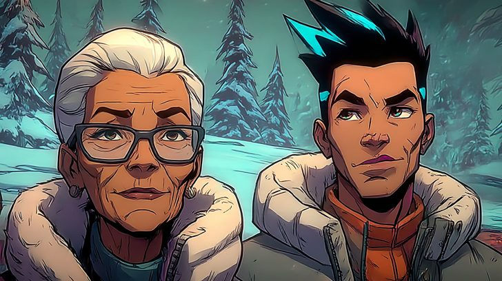
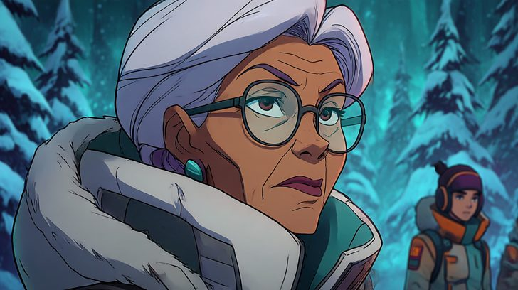
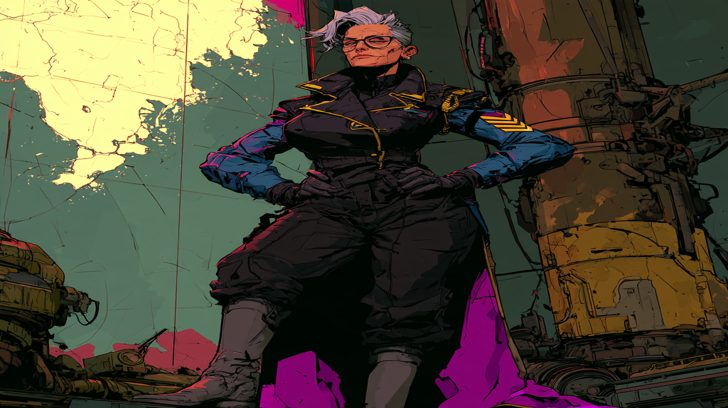
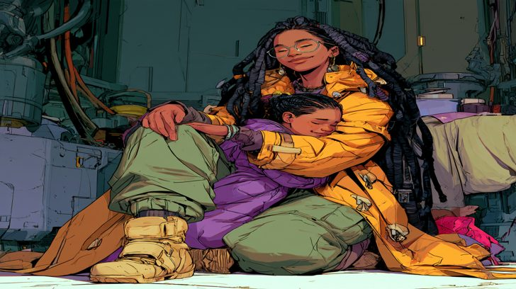
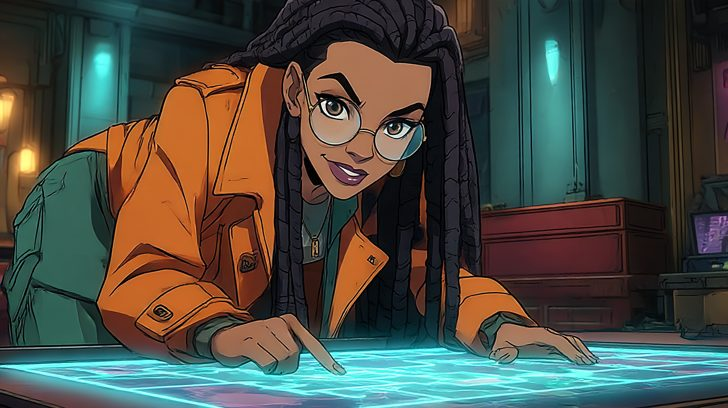
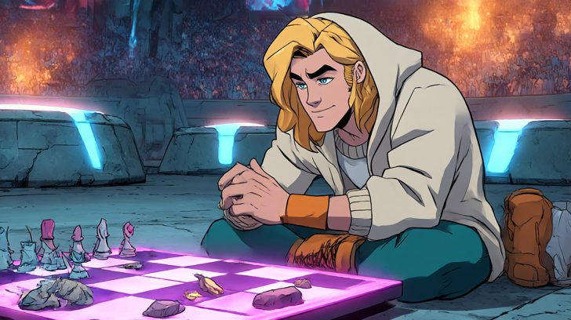
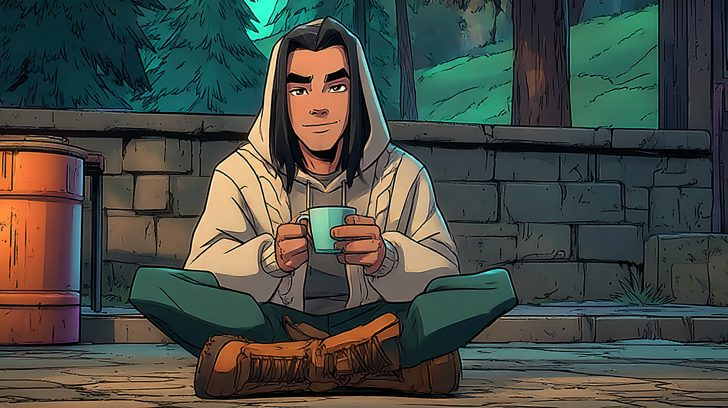
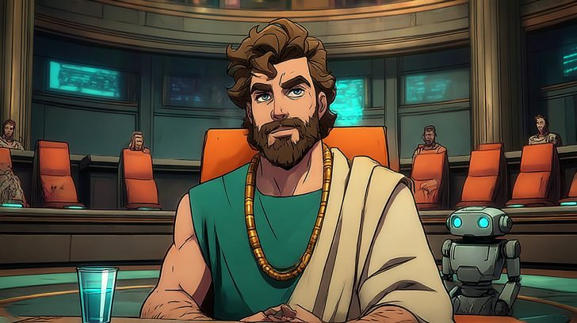
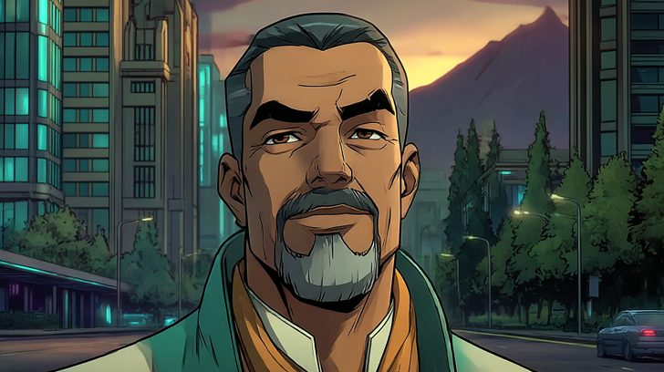
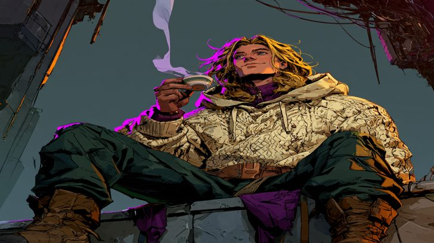

# First remixes by @naaate: made with Midjourney (DRAFT, for the owner's review; nothing published)

Ten pictures the owner made by hand with Midjourney (a closed model by Midjourney), copied byte for byte from the
owner's Downloads on 2026-11-04 (two more added the same afternoon) by the coding agent (Claude, a closed model by Anthropic). Recipes come only from each
file's own metadata (its PNG Description field holds the prompt, parameters and job ID; its XMP repeats the job ID
and marks it as made by a trained algorithm) and its filename. Nothing is reconstructed; midjourney.com and s.mj.run
links were not opened. Full recipes: `first-remixes/recipes.json`. Each will carry the label:

> Made with Midjourney, a closed model by Midjourney, outside the site · recipe reported by its maker; it can't be re-run exactly

**For you to confirm or fill** (marked "not reported" until you do):

- **The references.** Five use `--sref https://s.mj.run/YwM8K-xTQo0` (a style reference) and three use `--profile hu97rol
  rg1f6ql` (Midjourney profiles). Your condition 3 needs them to be only your own pictures or the project's sheets: say
  what each is.
- **Which base each remixes.** Proposed below from the look its prompt describes; Deluin's and Gladias's describe their
  current looks, not a or b.
- Two files were named for another character: `gladias2.png` and `gladias dif style.png` are Deluin (their prompts and
  pictures are his).

**References (owner, 2026-11-05):** the style reference `--sref https://s.mj.run/YwM8K-xTQo0` is the owner's own
picture, so the first remixes that use only it can be published (recorded in each recipe). The three that use
`--profile hu97rol rg1f6ql` (Mu ink cape, Seila ink child, and the Deluin ledge draft) stay unpublished until those
profiles are reported.

**Your picks (2026-11-04):** two first remixes per character where you chose them (Gladias: the council table and the sunset
with a goatee; Deluin: the arena game board and the hood with a mug), Mu and Seila two each, Zei one. The Deluin ledge
picture stays a draft. Your Deluin pick's own prompt says "warm tan skin", the words I suggested for Deluin b.

# First remixes

## Zei · zei-with-mu-snow · first remix

- Base (proposed): Zei (his one base); Mu also appears
- File: `mu and zei 3.png` · 1456×816 · sha256 `e68a9bcbba340ef48a461ccd1d3c2a3da7fb356db7ab3cd0033e7c252f885391`
- Job ID: `a7f15215-1a1b-4fa2-abbc-6cdb73d665c1` · made Wed, 04 Nov 2026 23:26:32 GMT · author in file: naaate
- Prompt: an older woman in her sixties with warm brown skin, short silver-white hair, glasses and fine wrinkles, wearing a thick white-and-grey winter jacket, standing on a snowy hilltop in a strong cold wind, calm and resolute, beside her a slim young man with spiky black hair with one blue streak and a wiry young woman with a tall magenta ponytail, a snow-covered pine forest stretching to the horizon, silence before a battle, epic stillness, flat cel-shaded illustration, bold dark outlines, flat colour blocks, muted teal-grey world with warm accents
- Parameters: `--no text, letters, numbers, logos, watermark, signature, teeth, photograph, 3d render --chaos 5 --ar 16:9 --seed 6061 --sref https://s.mj.run/YwM8K-xTQo0 --sw 250 --stylize 250 --v 7 --draft`

## Mu · mu-snow-closeup · first remix

- Base (proposed): Mu (her one base)
- File: `mu.png` · 1456×816 · sha256 `f9c6084a06bbb492ce45336acd276ce0a6543e2b7758fab71b21a57ae3195e04`
- Job ID: `bc6ef967-858f-4884-bd4e-bec544fbcd63` · made Wed, 04 Nov 2026 23:27:55 GMT · author in file: naaate
- Prompt: an older woman in her sixties with warm brown skin, short silver-white hair, glasses and fine wrinkles, wearing a thick white-and-grey winter jacket, turning in deep snow to lead the way back, glancing over her shoulder as she softly gives an order, two young figures following behind her through snow-covered pines, quiet command, flat cel-shaded illustration, bold dark outlines, flat colour blocks, muted teal-grey world with warm accents
- Parameters: `--no text, letters, numbers, logos, watermark, signature, teeth, photograph, 3d render --chaos 5 --ar 16:9 --seed 6062 --sref https://s.mj.run/YwM8K-xTQo0 --sw 250 --stylize 250 --v 7 --draft`

## Mu · mu-ink-cape · first remix

- Base (proposed): Mu (her one base)
- File: `mu diff style.png` · 1024×1024 · sha256 `e6a0a7d85b6bb3eba928b94b2be0cd4bdd79e61e169d2470c18ec8c520bd7701`
- Job ID: `af0764ef-1e04-4228-b789-a098b178a1e6` · made Wed, 04 Nov 2026 22:45:22 GMT · author in file: naaate
- Prompt: an older woman with short silver-white hair and glasses, wearing a dark officer's uniform with gold trim and chevron insignia over blue sleeves, black trousers and grey boots, standing at a command post before a large glowing tactical map of pure light with no markings, calm resolute expression, hands on her hips, surveying the room like the future will be decided here, expressive quiet authority, flat cel-shaded illustration, bold dark outlines, flat colour blocks, muted teal-grey world with warm accents
- Parameters: `--profile hu97rol rg1f6ql --v 8.2`

## Seila · seila-ink-child · first remix

- Base (proposed): Seila (her one base)
- File: `seala hugging child dif style.png` · 1024×1024 · sha256 `c543d404a6fa262887e6525e0fad93506371dfcfbea67bc98bb4b5f02b7b9a39`
- Job ID: `659d423c-5e07-493b-b6db-dd825cea88dc` · made Wed, 04 Nov 2026 22:45:41 GMT · author in file: naaate
- Prompt: a woman with warm deep-brown skin, long black braids and round glasses, wearing a long orange coat with toggle clasps over green baggy trousers and tan boots, at home in a warm future-city apartment at dinnertime, kneeling down to hug a small sad girl seen from the side, comforting her with a soft warm closed-mouth smile, tender expressive moment, lively natural poses, flat cel-shaded illustration, bold dark outlines, flat colour blocks, muted teal-grey world with warm accents
- Parameters: `--profile hu97rol rg1f6ql --v 8.2`

## Seila · seila-glowing-table · first remix

- Base (proposed): Seila (her one base)
- File: `seila2.png` · 1456×816 · sha256 `4563c7e1e03fe5148a01411e56f5346e0560b6290775b2ef54979f539b31b020`
- Job ID: `97b5cb41-f0ef-4cc5-a235-70cc5659d748` · made Wed, 04 Nov 2026 23:19:04 GMT · author in file: naaate
- Prompt: a woman with warm deep-brown skin, long black braids and round glasses, wearing a long orange coat with toggle clasps over green baggy trousers, leaning over a table spread with a glowing map of pure shapes and light with no words, planning a journey with a bright anticipatory smile, one finger tracing a route, flat cel-shaded illustration, bold dark outlines, flat colour blocks, muted teal-grey world with warm accents
- Parameters: `--no text, letters, numbers, logos, watermark, signature, teeth, photograph, 3d render --chaos 5 --ar 16:9 --seed 6056 --sref https://s.mj.run/YwM8K-xTQo0 --sw 250 --stylize 250 --v 7 --draft`

## Deluin · deluin-game-board · first remix

- Base (proposed): Deluin, current look (the prompt describes wavy shoulder-length sandy hair and the cream hooded sweater)
- File: `gladias2.png` · 1456×816 · sha256 `24bc72294fa52aed728ba0044257fab410f3c233bbc401c3520a99fd864e08b1`
- Job ID: `ec237108-e6d4-4a8d-a26a-75c4204594e9` · made Wed, 04 Nov 2026 23:20:15 GMT · author in file: naaate
- Prompt: a young man with wavy shoulder-length sandy blond hair, wearing a cream cable-knit hooded sweater, dark green trousers and brown boots, seated perfectly still at a vast glowing game board in a great arena, calm with the faintest unreadable smile, while tiny gliders and debris swarm chaotically on the far side of the board and neat fortified walls of light hold firm on his side, a huge crowd blurred far behind, patience against chaos, flat cel-shaded illustration, bold dark outlines, flat colour blocks, muted teal-grey world with warm accents
- Parameters: `--no text, letters, numbers, logos, watermark, signature, teeth, photograph, 3d render --chaos 5 --ar 16:9 --seed 6057 --sref https://s.mj.run/YwM8K-xTQo0 --sw 250 --stylize 250 --v 7 --draft`

## Deluin · deluin-hood-mug · first remix

- Base (proposed): Deluin b (the prompt describes warm tan skin and long straight black hair)
- File: `deluin long black hair.png` · 1456×816 · sha256 `610d235e853183ce3d323be19166e44d6dbacd48290f6910bb4f186710fad0f0`
- Job ID: `26cd4c07-95f3-428d-a082-853fe35a67e3` · made Thu, 05 Nov 2026 00:02:06 GMT · author in file: naaate
- Prompt: a young man with warm tan skin and long straight black hair falling past his shoulders, wearing a cream cable-knit hooded sweater, dark green trousers and brown boots, sitting cross-legged on the ground in a quiet stone courtyard drinking tea from a small cup, serene and quietly confident, relaxed brow and a faint calm knowing smile, completely at ease and in control, green hills and afternoon light beyond the wall, flat cel-shaded illustration, bold dark outlines, flat colour blocks, muted teal-grey world with warm accents
- Parameters: `--no text, letters, numbers, logos, watermark, signature, teeth, photograph, 3d render --chaos 5 --ar 16:9 --seed 6082 --sref https://s.mj.run/YwM8K-xTQo0 --sw 250 --stylize 250 --v 7 --draft`

## Gladias · gladias-council · first remix

- Base (proposed): Gladias, current look (wavy brown hair, short beard)
- File: `gladias.png` · 1456×816 · sha256 `833f4afc44b32d96adcd1839b8cf357408138438c855872f56dfdb52d7cea574`
- Job ID: `168d33c4-e132-4c99-b277-65b81650c1b4` · made Wed, 04 Nov 2026 23:13:41 GMT · author in file: naaate
- Prompt: a calm man with wavy brown hair and a short beard, a silken band around his neck, wearing a green sleeveless tunic over a cream shirt with a tan sash, sitting composed in the centre of a grand circular senate chamber, twenty senators seated in a ring around him, a small robot beside him offering a cup of water, thoughtful and unshaken mid-testimony, flat cel-shaded illustration, bold dark outlines, flat colour blocks, muted teal-grey world with warm accents
- Parameters: `--no text, letters, numbers, logos, watermark, signature, teeth, photograph, 3d render --chaos 5 --ar 16:9 --seed 6053 --sref https://s.mj.run/YwM8K-xTQo0 --sw 250 --stylize 250 --v 7 --draft`

## Gladias · gladias-sunset-goatee · first remix

- Base (proposed): Gladias b, the current default (the prompt describes warm olive-brown skin and short black hair greying at the temples)
- File: `gladias b.png` · 1456×816 · sha256 `b289adcd7e837078186ed0cc79f401cfdfcbd293359e027f75dc7b3fc9489fcc`
- Job ID: `080217ce-0981-4d2e-85ea-fec2ccbe2598` · made Wed, 04 Nov 2026 23:59:36 GMT · author in file: naaate
- Prompt: a calm professional man with warm olive-brown skin, short black hair greying at the temples and a short neatly trimmed greying beard, impeccably groomed, wearing a silken band around his neck and a finely tailored green sleeveless tunic with a structured high collar over a crisp cream shirt, a tan sash tied neatly like a formal belt, well-fitted grey trousers and polished boots, standing midway on a sky bridge above a busy road in a future city with the composed bearing of a statesman, serene confident smile, whispering to the band at his neck, castle-like apartment towers and a tree-covered mountain beyond, flat cel-shaded illustration, bold dark outlines, flat colour blocks, muted teal-grey world with warm accents
- Parameters: `--no text, letters, numbers, logos, watermark, signature, teeth, photograph, 3d render --chaos 5 --ar 16:9 --seed 6081 --sref https://s.mj.run/YwM8K-xTQo0 --sw 250 --stylize 250 --v 7 --draft`

# Drafts only

## Deluin · deluin-ink-ledge · draft only

- Base (proposed): Deluin, current look (same words)
- File: `gladias dif style.png` · 1024×1024 · sha256 `7afc153a4533c34fba24a53597640d048d2be7f66826ee43316078a233267967`
- Job ID: `cff4c855-8b2a-47b4-9109-94c942c8691f` · made Wed, 04 Nov 2026 22:45:40 GMT · author in file: naaate
- Prompt: a young man with wavy shoulder-length sandy blond hair, wearing a cream cable-knit hooded sweater, dark green trousers and brown boots, sitting in a stone courtyard in a future city drinking tea from a small cup, looking up with a distant unreadable gaze and the faintest closed-mouth smile, a quiet mystery about him, steam curling from the cup, expressive stillness, flat cel-shaded illustration, bold dark outlines, flat colour blocks, muted teal-grey world with warm accents
- Parameters: `--profile hu97rol rg1f6ql --v 8.2`
