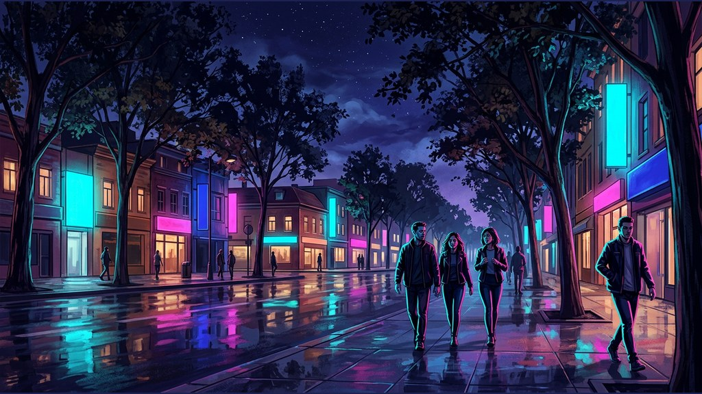
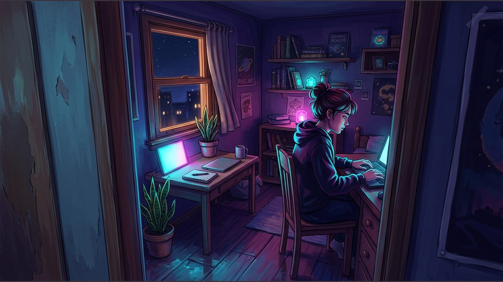
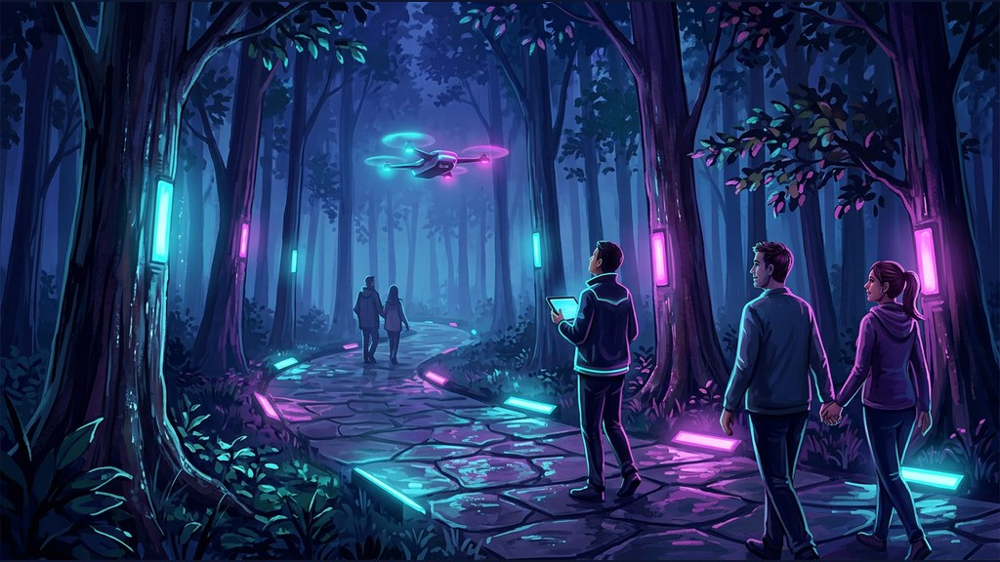
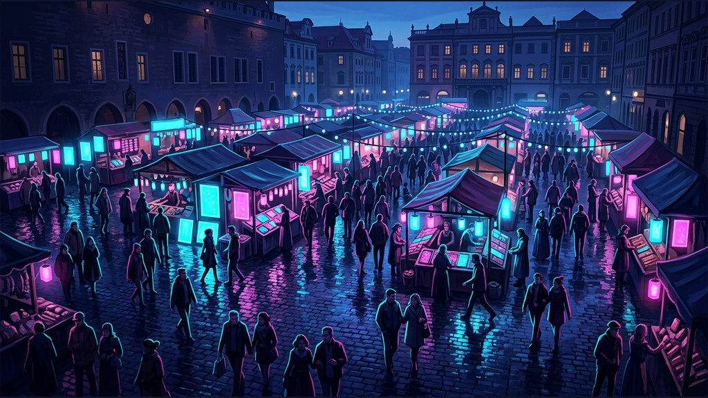

# Neon night: four style samples by Gemini (DRAFT)

Made by the coding agent (Claude, a closed model by Anthropic), 2026-11-03 (machine date), on branch
`challenge-styles`, on the owner's decision of 2026-11-04: Neon night's samples made with **Gemini 3.1 Flash Image, a
closed model by Google**, instead of GPT Image, so that only Google is named. **Drafts only: nothing published, nothing
written to the database, nothing uploaded to the site's storage.** Every picture is AI-made. The style text is the
agent's draft in [styles-proposal.md](styles-proposal.md); the subjects are the site's four fixed sample subjects and the
prompt is the site's `samplePrompt`, as a sample made on the site would be.

**Spent: $0.26850** (4 pictures, 4 prompt checks), against a $0.35 cap checked before every call on the worst case
($0.075 a picture, $0.0015 a check; worst reached $0.3060). Every call went through `scripts/lib/batch-model.ts`:
Vertex AI only, zero data retention and no training; each gateway answer says `"finalProvider": "vertex"`,
`"enabledZeroDataRetention": true`, `"enabledDisallowPromptTraining": true`.

| | |
|---|---|
|  1. A wide street with tall trees and low buildings, a few people walking |  2. A small room with a desk, a window and a plant, seen from the doorway |
|  3. A footpath through tall trees, a small drone flying overhead |  4. A market square at dusk, seen from above |

## Each sample

| Sample | Model | Maker | Cost | sha256 (the committed JPEG, 1024 × 576) |
|---|---|---|---|---|
| [1, street](neon-night/neon-night-sample-1.jpg) | Gemini 3.1 Flash Image, on Vertex AI | a closed model by Google | $0.067041 | `5205f655f3472322e27b45693138c3a3da73d6e98435e7877c542166ad03a697` |
| [2, room](neon-night/neon-night-sample-2.jpg) | Gemini 3.1 Flash Image, on Vertex AI | a closed model by Google | $0.067042 | `4eb3d2ca5184a85e4bdba0cfb7b1e7604aed2a296dfab62924e42004ae2e1ced` |
| [3, footpath](neon-night/neon-night-sample-3.jpg) | Gemini 3.1 Flash Image, on Vertex AI | a closed model by Google | $0.067039 | `5751d899a4bafd85baf3e51f5c1d79d3c921a7dec22050a1cfeda24d2588e039` |
| [4, market](neon-night/neon-night-sample-4.jpg) | Gemini 3.1 Flash Image, on Vertex AI | a closed model by Google | $0.067038 | `ff19c608826219966dda6ab24a250cd9bfc8fd3d7344cb1815cc1f2d4a7ac3be` |
| 4 prompt checks (all passed first time) | gpt-oss-safeguard-20b, through the gateway | open weights | $0.000340 | |

Full recipes (prompt, settings, request id, the original PNG's sha256, the conversion): [`neon-night/ledger.json`](neon-night/ledger.json).
Script: `scripts/neon-night-samples.ts`. Each picture is stored as the site stores samples: JPEG at 1024 × 576, the whole
picture fitted and padded with its own corner colour.

## Does it read differently from Gouache, now that both are by Gemini?

Yes, clearly. Compare the [Gouache test front](styles-test/zei-front-gouache-gemini.jpg) (the only Gouache picture so
far; different subjects, so this is a read of the look, not a side-by-side):

- **Neon night:** night scenes in deep blue and violet, lit by saturated cyan and magenta panels, wet glossy
  reflections, rim-lit figures, crisp inked outlines, high contrast. Every sign is a blank glowing panel, no lettering.
- **Gouache:** daylight, a pale warm palette, no outlines at all, brushed edges and paper grain.

The same model follows each text: what differs is light, palette and line, and those are opposite in the two. The one
thing they share is that both read as illustration rather than photograph or print.
