# Pick from your phone: every front (DRAFT)

**Reply with labels**, e.g. "Zei · MJ · GPT, Bai · MJ · GPT, Gladias · AS, Zei · A", or a direction for everyone ("MJ, A, B").

- **MJ** = Animated series, made from a crop of your Midjourney picture (Zei, Bai).
- **AS** = Animated series, made from the character's descriptor (Gladias, Seila, Deluin, Mu).
- **A** = Grounded: a real teenager in a working city. **B** = Bold reimagining: the champion.

AI-made drafts by the coding agent (Claude, a closed model by Anthropic), 2026-11-04; nothing published. Descriptors and
details: [zei-directions.md](zei-directions.md). Total $0.72238 of the $1 cap.

### Zei · MJ · Gemini

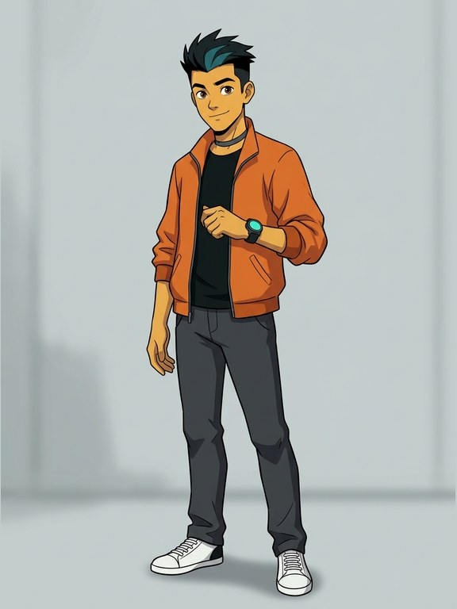

Gemini 3.1 Flash Image · a closed model by Google · $0.0677

### Zei · MJ · GPT

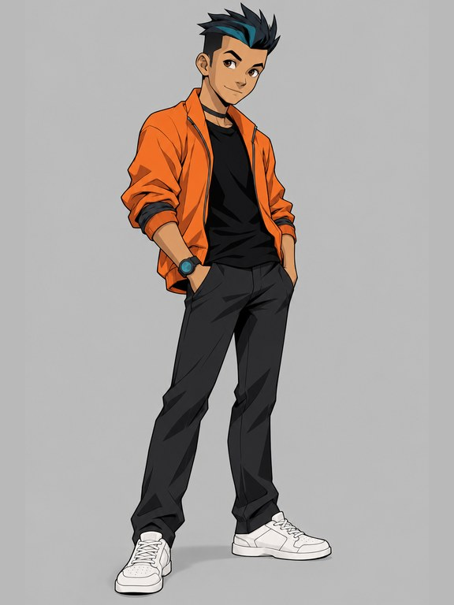

GPT Image 2.5 Sunburst · a closed model by OpenAI · $0.0505

### Bai · MJ · Gemini

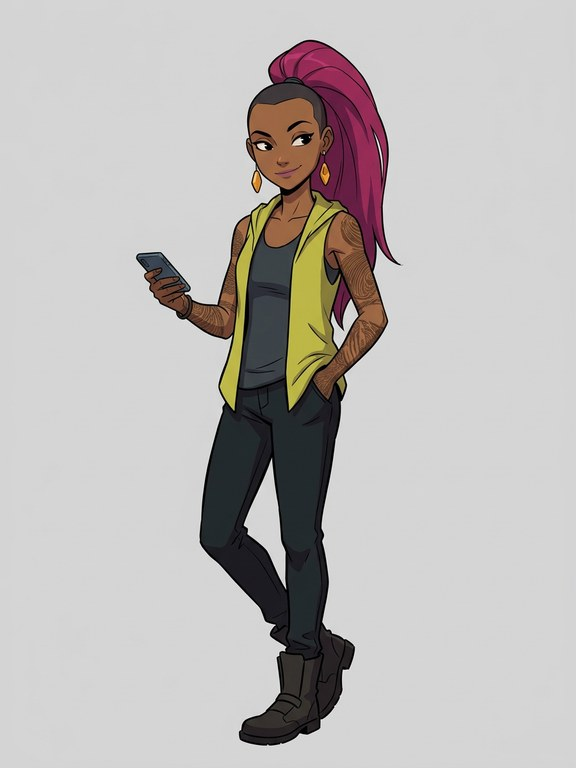

Gemini 3.1 Flash Image · a closed model by Google · $0.0677

### Bai · MJ · GPT

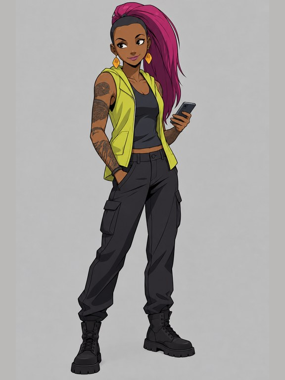

GPT Image 2.5 Sunburst · a closed model by OpenAI · $0.0487

### Gladias · AS

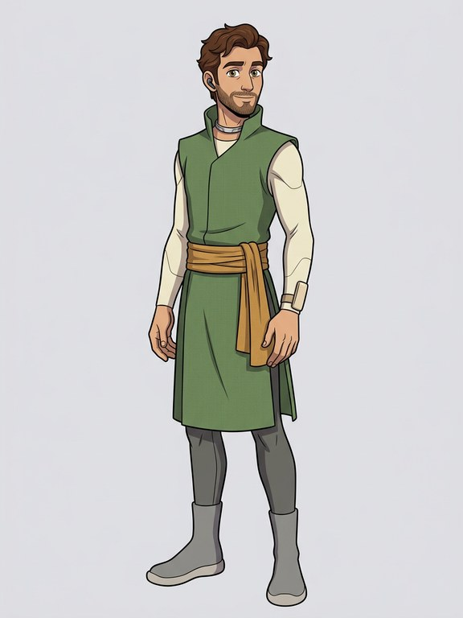

Gemini 3.1 Flash Image · a closed model by Google · $0.0671

### Seila · AS

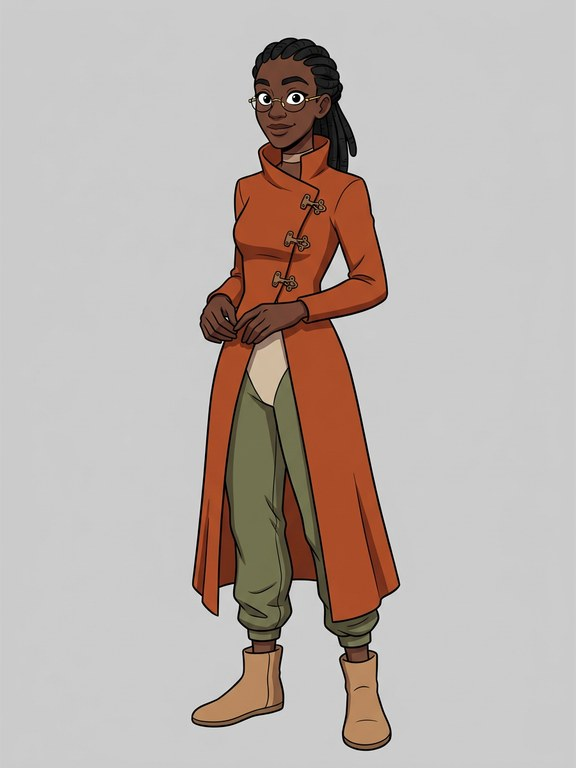

Gemini 3.1 Flash Image · a closed model by Google · $0.0671

### Deluin · AS

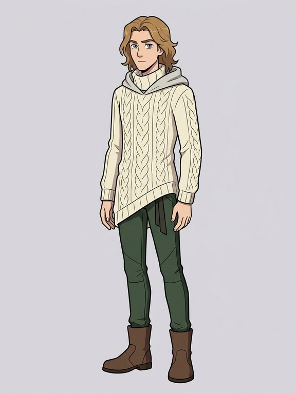

Gemini 3.1 Flash Image · a closed model by Google · $0.0671

### Mu · AS

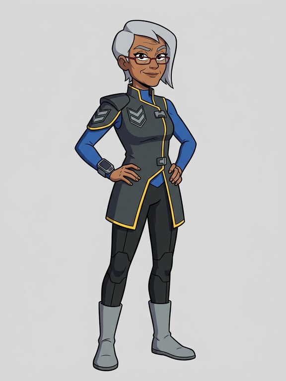

Gemini 3.1 Flash Image · a closed model by Google · $0.0671

### Zei · A · Gemini

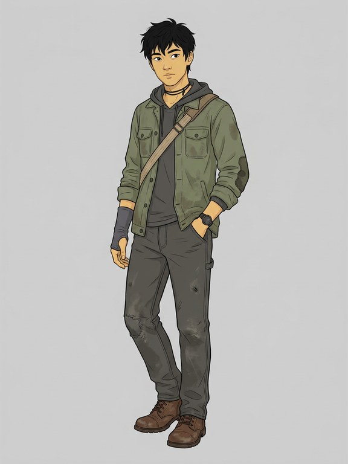

Gemini 3.1 Flash Image · a closed model by Google · $0.0671

### Zei · A · GPT

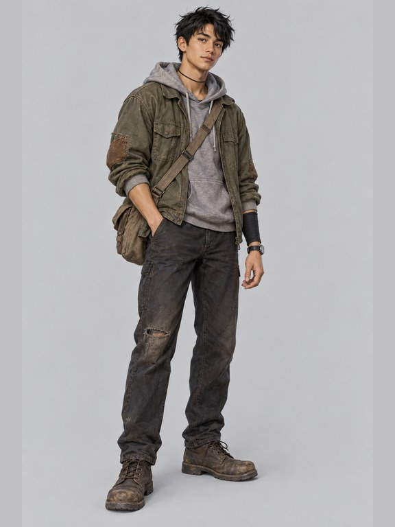

GPT Image 2.5 Sunburst · a closed model by OpenAI · $0.0420

### Zei · B · Gemini

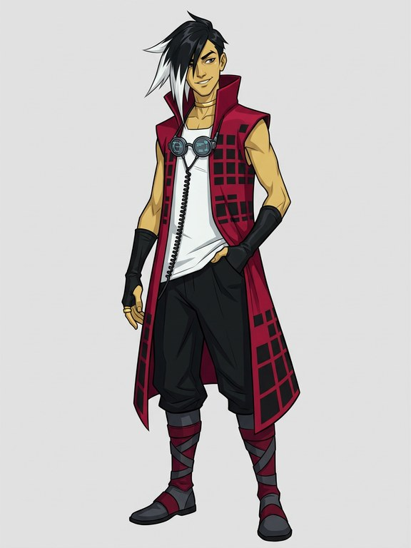

Gemini 3.1 Flash Image · a closed model by Google · $0.0671

### Zei · B · GPT

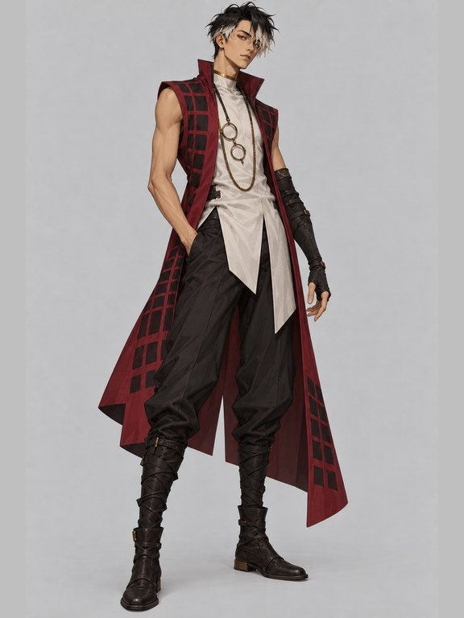

GPT Image 2.5 Sunburst · a closed model by OpenAI · $0.0421
