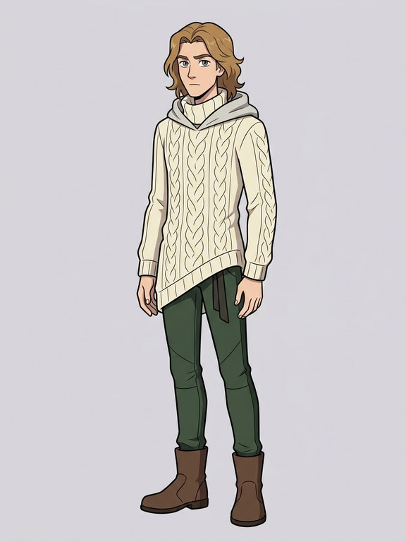
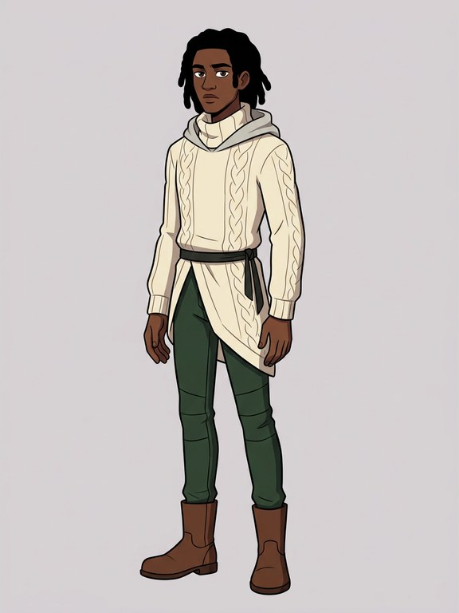
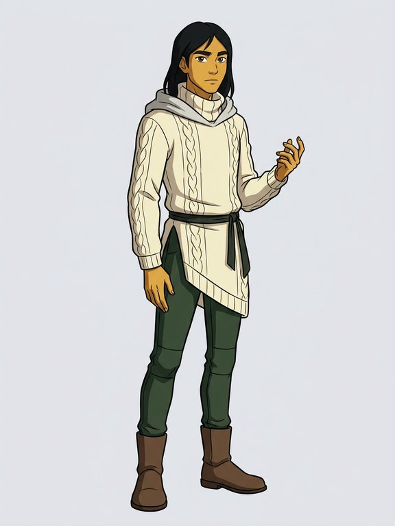
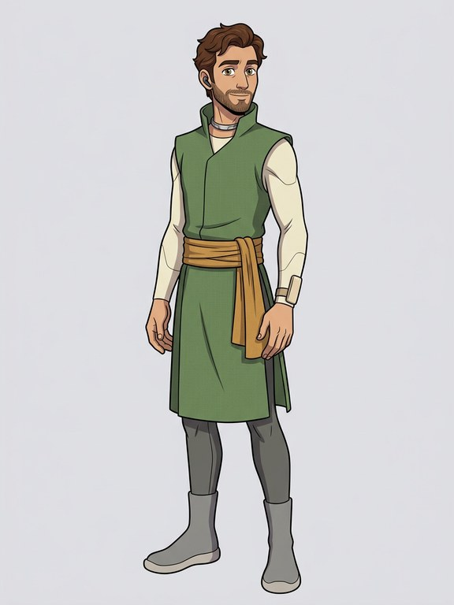
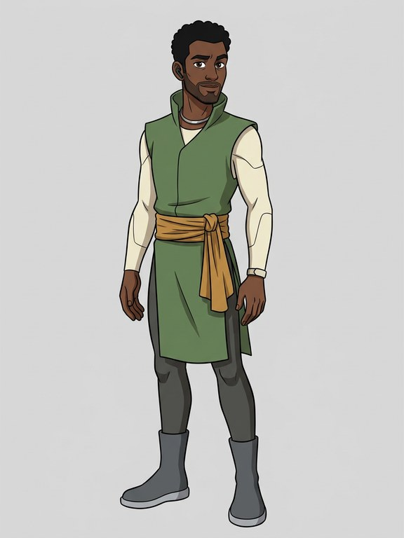
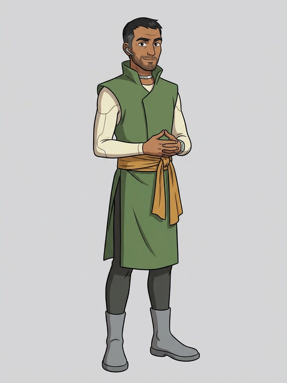
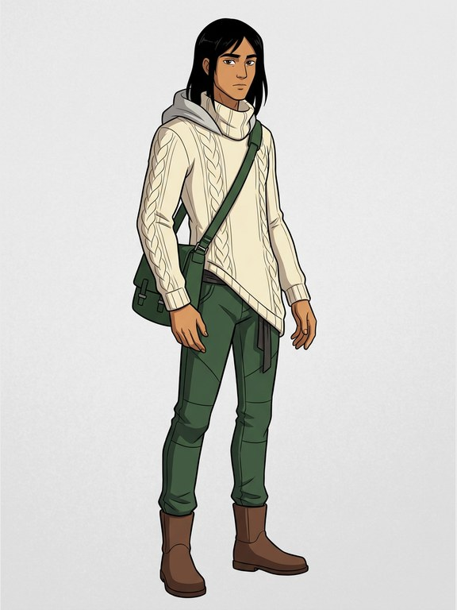
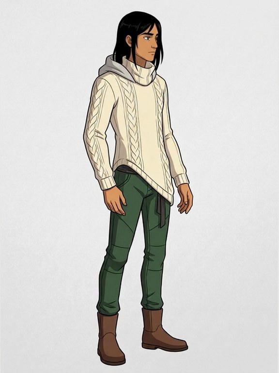
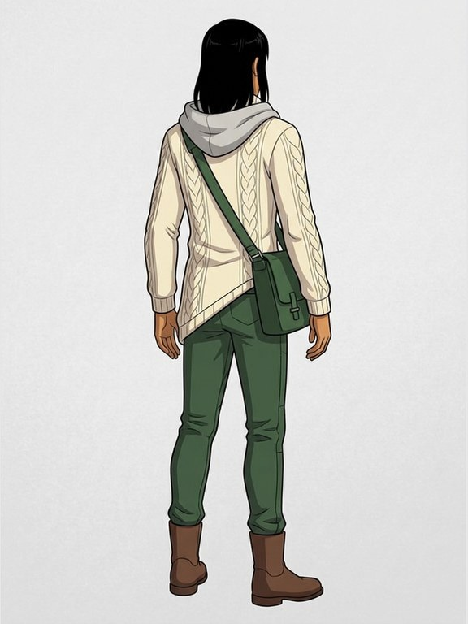

# Recast tests: Deluin and Gladias (DRAFT, for the owner's pick)

Made 2026-11-04 by the coding agent (Claude, a closed model by Anthropic) with **Gemini 3.1 Flash Image, a closed model by
Google** (Vertex AI, zero retention, through Vercel AI Gateway), the same way as the current Animated series fronts:
same prompt, style text and settings, with only the skin, hair and eyes words changed (owner, 2026-11-04). Drafts only;
nothing is published. Recipes: `directions/ledger.json` (rows tagged `recast`). Script: `scripts/recast-fronts.ts`.
Cost: $0.26890 of the $0.30 cap (four pictures and four prompt checks).

## Deluin

<table><tr><td align="center" valign="top"> <b>Now</b> pale skin, wavy shoulder-length light-brown hair, grey-green eyes $0.06709 · sha256 <code>ed9362662479…</code></td><td align="center" valign="top"> <b>Option a</b> deep brown skin, shoulder-length black hair in loose twists, dark brown eyes $0.06724 · sha256 <code>d2ebbc5fc7af…</code></td><td align="center" valign="top"> <b>Option b</b> warm golden-brown skin, straight shoulder-length black hair, dark brown eyes $0.06709 · sha256 <code>a6f08f0c3510…</code></td></tr></table>

Skin check: **a matches** its words. **b doesn't:** the skin came out a flat yellow-orange, not warm golden-brown. If you
want b, it needs one more try (about $0.07; $0.03 is left in the cap).

## Gladias

<table><tr><td align="center" valign="top"> <b>Now</b> light olive skin, short wavy chestnut-brown hair, a neatly trimmed short beard and hazel eyes $0.06711 · sha256 <code>aff6f24f59e5…</code></td><td align="center" valign="top"> <b>Option a</b> deep brown skin, short curly black hair, a neatly trimmed short beard and dark brown eyes $0.06711 · sha256 <code>bca41e700fdb…</code></td><td align="center" valign="top"> <b>Option b</b> warm medium-brown skin, short straight black hair with a few grey strands, a neatly trimmed short beard and dark eyes $0.06711 · sha256 <code>b9b6c00952cb…</code></td></tr></table>

Skin check: **a matches**. **b is lighter than "warm medium-brown"** (closer to light tan). Build, age, clothes, the calm
face, beard and throat band are kept in all four.

After your pick: descriptor and sheet_prompt in both character files and their sheet jobs in `cast.json`; Deluin's side
and back views; Gladias's side and back views again (the current ones are of the old look); then the re-render list
(`recast-rerender-list.md`), for your overnight run.

## Update, 2026-11-04 evening: the bases and current defaults

Nothing is canonical (owner): all three looks of Deluin and of Gladias are challenge bases, shown in a random order on
each visit. Look b is the **current default** for the site's own pictures until the challenge or the owner changes it.

- **Deluin b**, in the owner's words "warm tan skin, straight shoulder-length black hair, dark brown eyes" (the third
  try; "golden" came out yellow twice). Skin, hair and eyes match the words. The model added a **green shoulder bag**
  that isn't in his clothes; it shows in the front and back views but not the side one. Say if you want the front
  made again without it (about $0.07 plus $0.14 for the views).

<table><tr><td></td><td></td><td></td></tr></table>

- **Gladias b** in the owner's corrected words: "warm light-brown skin, short straight black hair greying at the
  temples, a neatly trimmed short beard and dark eyes"; views on the views sheet.
- Character files and cast.json sheet jobs now hold b for both (Deluin's fixed description too, its old words kept in
  its history). The chapter re-render waits for the owner's overnight go.
- Spending: recast $0.40329 of $0.44; views $2.67253 of $2.83 (Gemini 3.1 Flash Image, a closed model by Google, Vertex,
  zero retention). Deluin b in the owner's words cost $0.20276 (front $0.06718, views $0.13558, checks included).
