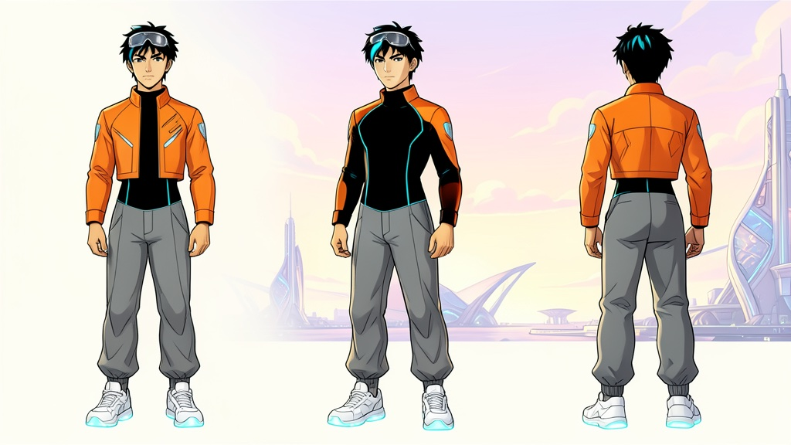
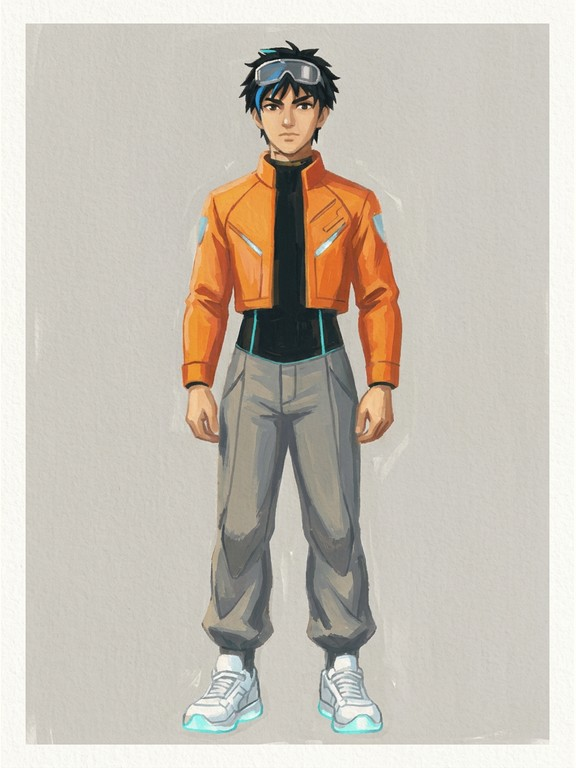
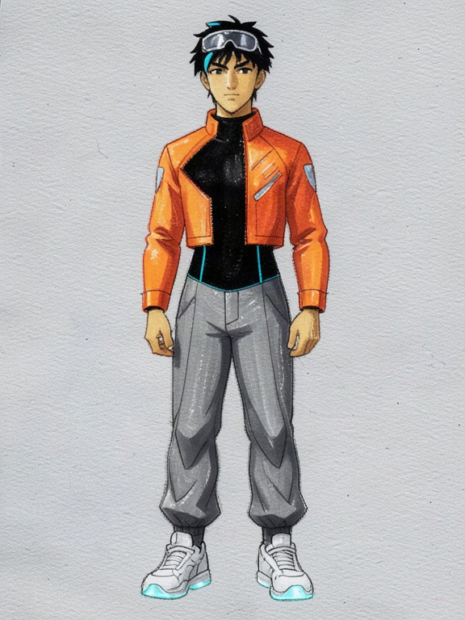
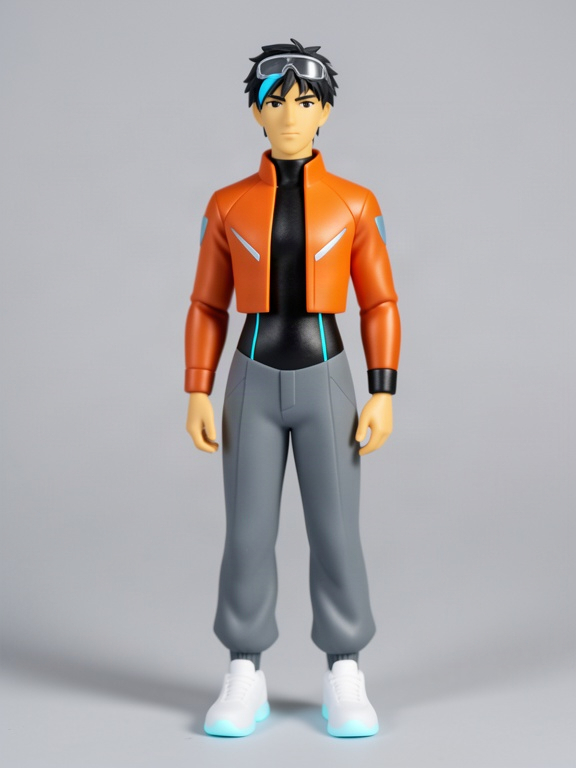

# Style test: Zei fronts in the new styles (DRAFT)

Made by the coding agent (Claude, a closed model by Anthropic), 2026-11-03 (machine date), on branch
`challenge-styles`, on the owner's go of 2026-11-04: "the style test, capped at $0.35, drafts only". **Drafts only:
nothing published, nothing written to the database, nothing uploaded to the site's storage.** Every picture is AI-made.
The style texts are the agent's drafts in [styles-proposal.md](styles-proposal.md).

**Spent: $0.08879** (3 pictures, 3 prompt checks), against a $0.35 cap checked before every call on the worst case
(worst reached $0.1345). Two of the five planned fronts were **not made**: see "Refused" below.

<table>
<tr>
<td align="center" valign="top"> <b>From: the original sheet</b></td>
<td align="center" valign="top"> <b>Gouache · Gemini</b> a closed model by Google</td>
<td align="center" valign="top"> <b>Gouache · open</b> FLUX.2 [klein] 4B, open weights</td>
<td align="center" valign="top"> <b>Miniature · open</b> FLUX.2 [klein] 4B, open weights</td>
</tr>
</table>

For comparison, the drafts of 2026-11-03 in [Printed](bases/zei-front-printed-edit.jpg) and [Mood](bases/zei-front-mood-edit.jpg).

## Each front

| Front | Model | Maker | Cost | sha256 (the committed JPEG) |
|---|---|---|---|---|
| [Gouache · Gemini](styles-test/zei-front-gouache-gemini.jpg) | Gemini 3.1 Flash Image (`google/gemini-3.1-flash-image`), served by Vertex AI | **a closed model by Google** | $0.067665 | `fc14548179449756f1325747b16aee740e8cfb9529f7d82f02f03c5dadbf7f8e` |
| [Gouache · open](styles-test/zei-front-gouache-open.jpg) | FLUX.2 [klein] 4B edit (`fal-ai/flux-2/klein/4b/edit`), seed 559137432 | open weights, Apache-2.0 (Black Forest Labs), on fal.ai | $0.010322 | `26cb17cd35f0fb15a1a74d80700bfabf63ca14100d8619381bebb8da2bd6f688` |
| [Miniature · open](styles-test/zei-front-miniature-open.jpg) | FLUX.2 [klein] 4B edit, seed 320328868 | open weights, Apache-2.0 (Black Forest Labs), on fal.ai | $0.010322 | `7133dde80e7438c0e85695f256688f10b17c5153373c470a3c8704aaec23cc35` |
| Prompt checks (3, each passed first time) | gpt-oss-safeguard-20b, through the gateway | open weights | $0.000477 | |

Full recipes (prompt, settings, seed or request id, reference sha256, the style text): [`styles-test/ledger.json`](styles-test/ledger.json).
Script: `scripts/styles-test.ts`. The Gemini picture is stored as the site stores pictures (JPEG at 576 × 768, the
whole picture fitted and padded with its own corner colour); the original PNG's sha256 is in its recipe. The gateway's
answer for it says `"enabledZeroDataRetention": true, "enabledDisallowPromptTraining": true`, "Provider set restricted
to: vertex".

## Refused, before any call: the two GPT Image 2.5 Sunburst fronts

Gouache by GPT Image 2.5 Sunburst and **Neon night** (whose samples were to be by OpenAI) were not made. Every new closed
call must set zero data retention (owner, 2026-11-04), and the gateway's own endpoint list (read before calling, free)
shows `openai/gpt-image-2.5-sunburst` served only by OpenAI with `has_zdr: false`. The shared batch path
(`scripts/lib/batch-model.ts`) refuses such a call and sends nothing; cost $0.

So **Neon night can't be made by OpenAI under the ZDR rule.** The owner chose Gemini (2026-11-04): its four samples are
in [neon-night-samples.md](neon-night-samples.md).

## What the test shows

- **Gouache by Gemini works.** It reads as paint on paper: no ink outlines, soft brushed edges, the paper's grain and a
  painted border. Zei is kept (the visor glasses, the blue streak, the orange cropped jacket with its panels, the cyan
  seams, the glowing sneakers). The palette is paler than his sheet and the trousers go brownish grey. Clearly different
  from Printed and Mood.
- **Gouache by the open model does not paint.** It keeps the comic outlines and cel shading and adds a paper texture;
  it reads as coloured pencil or marker over a line drawing, close to the Printed draft. The jacket front also changes
  (a black panel across one side). So **plan B uses Mood**, not open Gouache (owner's rule of 2026-11-04).
- **Miniature by the open model works.** It reads as a photographed toy figure: smooth plastic forms, studio light, a
  soft shadow, no outlines. Zei is kept (the glasses, the streak, the jacket and its panels, the glowing sneakers); the
  face is simplified, as a figurine's is, and the bodysuit's cyan seams are fainter. Clearly different from both
  Gouache and Printed, so it holds in plan A and in plan B.

## What this means for the bases

- **Plan A** (the reread lands by Thu 5 Nov): **Gouache (Gemini, Google), Printed (open), Miniature (open)**: all three
  now shown to look clearly different.
- **Plan B** (no reread): **Mood, Printed, Miniature**, all open. Mood and Printed remain the least different pair.
- Nothing further is spent until the owner OKs the samples and the bases.
