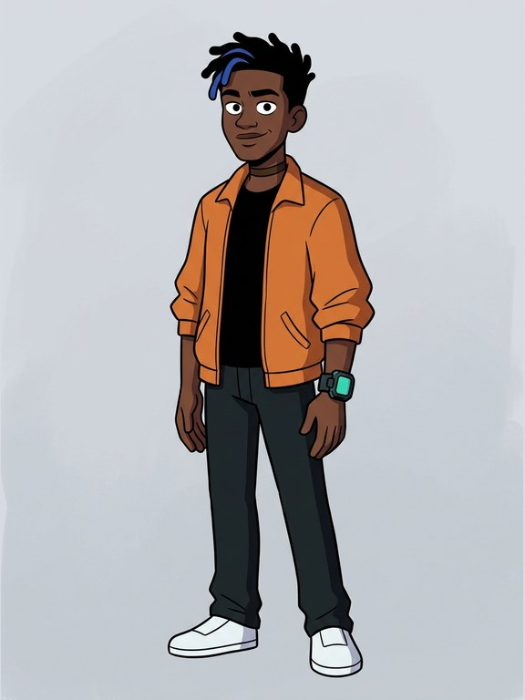
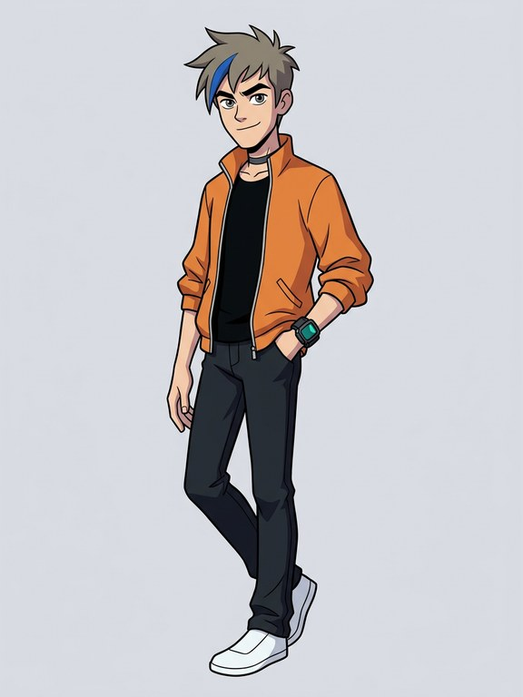
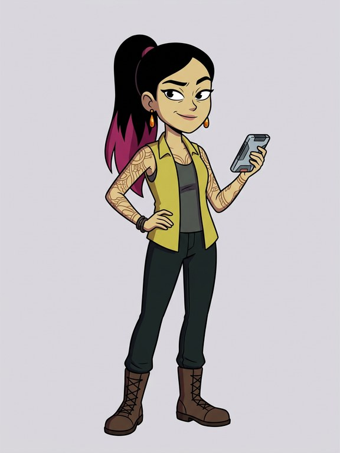
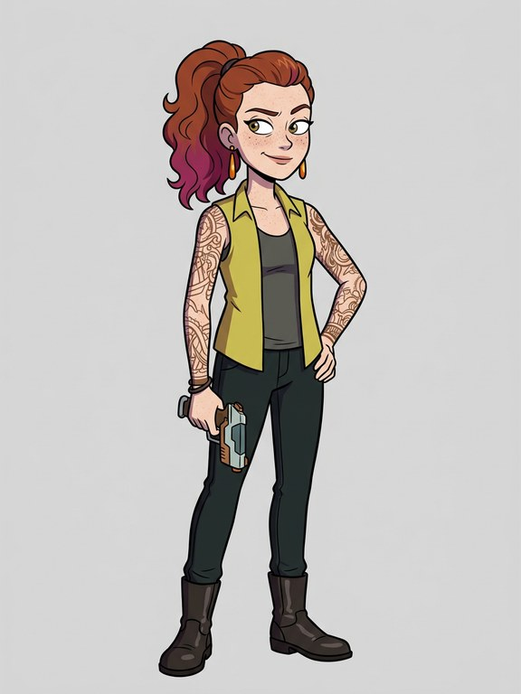
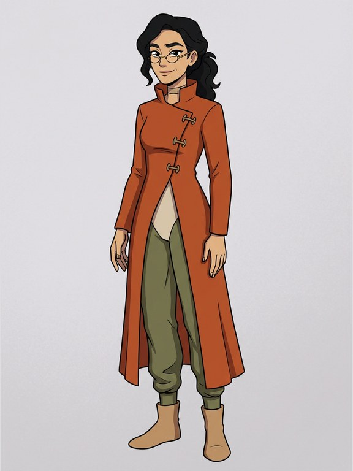
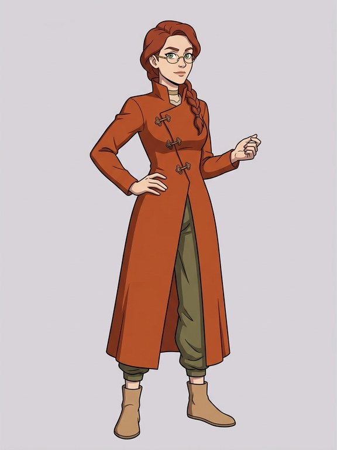
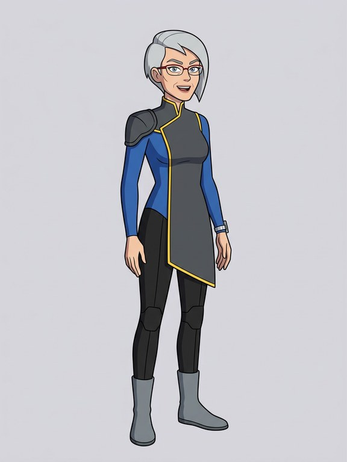
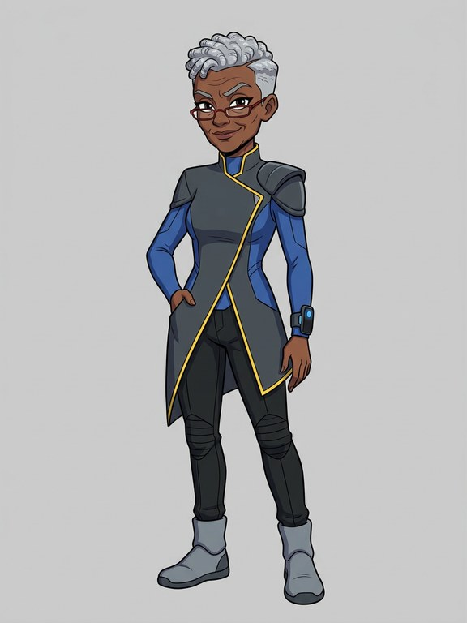

# Three looks: Zei, Bai, Seila and Mu (DRAFT, fronts only)

Made 2026-11-05 by the coding agent (Claude, a closed model by Anthropic), approved by the owner as proposed (up to $1.60;
`three-looks-proposal.md`). **Fronts only:** the owner's rethink of the challenge (moments, not turnaround sheets) may make
side and back views unnecessary, so the 16 views (about $1.09) wait for the owner. All eight are **Gemini 3.1 Flash Image, a
closed model by Google** (Vertex AI, zero retention, through Vercel AI Gateway), from words: each current front's prompt with
only its skin, hair and eyes words replaced by the approved ones. Zei's and Bai's current fronts were GPT Image from a crop of
the owner's picture; their new looks reuse that recipe's prompt as words, so all six sets are made the same way. Drafts only;
nothing published. Recipes: `directions/ledger.json` (rows tagged `looks3`). Script: `scripts/three-looks-fronts.ts`.

**Spent: $0.53780** (8 pictures and 8 prompt checks), of the batch's $0.60 cap within the owner's $1.60.

## Zei

<table><tr><td align="center" valign="top"> <b>Now (current default)</b> light golden-tan skin, tall spiky black hair swept up and back with a broad teal-blue streak and close-cut sides, warm brown eyes (GPT Image 2.5, a closed model by OpenAI, from a crop of the owner's picture) $0.05048</td><td align="center" valign="top"> <b>a</b> deep brown skin, short black twists with one electric-blue streak, quick dark eyes $0.06710</td><td align="center" valign="top"> <b>b</b> fair skin, spiky ash-brown hair with one electric-blue streak, quick grey eyes $0.06710</td></tr></table>

Check: Both match their words.

## Bai

<table><tr><td align="center" valign="top"> <b>Now (current default)</b> dark brown skin, a long sleek magenta ponytail pulled high with the sides of her head shaved close, dark eyes (GPT Image 2.5, from a crop of the owner's picture) $0.04870</td><td align="center" valign="top"> <b>a</b> light olive skin, long straight black hair in a high ponytail dyed magenta at the ends, dark eyes $0.06711</td><td align="center" valign="top"> <b>b</b> fair freckled skin, a high ponytail of loose auburn curls dyed magenta at the ends, hazel eyes $0.06711</td></tr></table>

Check: **a's skin came out yellowish**, not light olive (like Deluin b's first tries); b matches. Both new looks wear slim trousers where her front has cargo pants.

## Seila

<table><tr><td align="center" valign="top"> <b>Now (current default)</b> deep brown skin, black hair in shoulder-length braids gathered loosely back, alert dark eyes $0.06710</td><td align="center" valign="top"> <b>a</b> light tan skin, shoulder-length wavy black hair gathered loosely back, alert dark eyes $0.06721</td><td align="center" valign="top"> <b>b</b> fair skin, shoulder-length auburn hair in a loose braid, alert green eyes $0.06710</td></tr></table>

Check: Both match their words.

## Mu

<table><tr><td align="center" valign="top"> <b>Now (current default)</b> medium brown skin, short silver hair in a sharp asymmetric cut, keen eyes $0.06709</td><td align="center" valign="top"> <b>a</b> pale skin, short silver hair in a sharp asymmetric cut, keen grey eyes $0.06709</td><td align="center" valign="top"> <b>b</b> deep brown skin, short silver coils in a sharp asymmetric cut, keen dark eyes $0.06709</td></tr></table>

Check: Both match their words.
