# The six bases: side and back views, from your phone (DRAFT)

**Reply with labels**, e.g. "Zei ok, Bai back again", or "all ok".

**One base per character, all in Animated series (owner, 2026-11-04).** Each view was made from its front, with the
model that made the front, using the site's own view lines ("…seen from the side…", "…seen from behind…") and the
front's own style text and descriptor. Recipes: [`directions/ledger.json`](directions/ledger.json). Script:
`scripts/cast-views.ts`.

AI-made drafts by the coding agent (Claude, a closed model by Anthropic), 2026-11-04. **Nothing published, nothing
uploaded.** Every picture is AI-made. Every look is this edition's invention; the book gives none.

Grounded and Bold are dropped (owner, 2026-11-04) and are not on this sheet.

**Spent on views: $0.32951** (6 pictures $0.32885, 6 prompt checks $0.000652). **Total $1.72357 of
the $1.75 cap** (raised by the owner, 2026-11-04). Each call was gated first: spent so far plus its worst case ($0.08
for GPT, $0.09 for Gemini, $0.0015 for a check) within $1.75.

**10 of 12 made** (2026-11-04, after the gateway top-up; cap raised by $0.55 to $2.30): Seila's and Mu's views, 4
pictures and 4 prompt checks, $0.27121. **Total $1.99478 of $2.30.** Each view's skin matches its front and its sheet's
words (Seila deep brown, Mu medium brown). Deluin's two views are held until you pick his recast; Gladias's two views
above are of his current look and are made again after his pick (`recast-contact-sheet.md`). The recast tests have
their own $0.30 cap and are not counted here.
The seventh call (Seila's side prompt check) also got a 402 from the gateway (payment required), so it made nothing and
cost nothing. Still needed for the last six Gemini views: about $0.41 at today's prices, $0.549 at the worst case.

## Zei

Agent's read: Side reads as a three-quarter side. Back is a true back.

### Zei · front (the base)

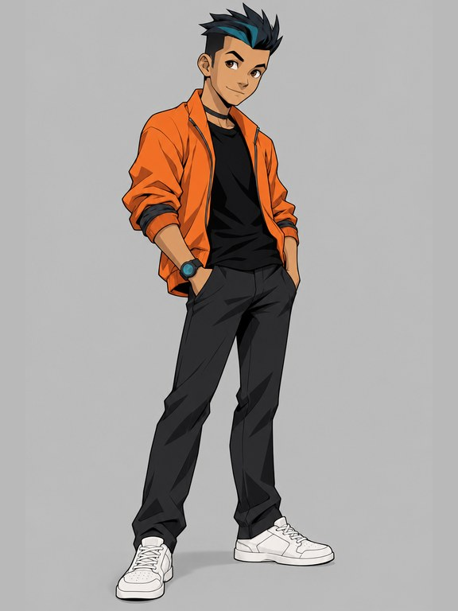

GPT Image 2.5 Sunburst · a closed model by OpenAI · $0.0505

### Zei · side

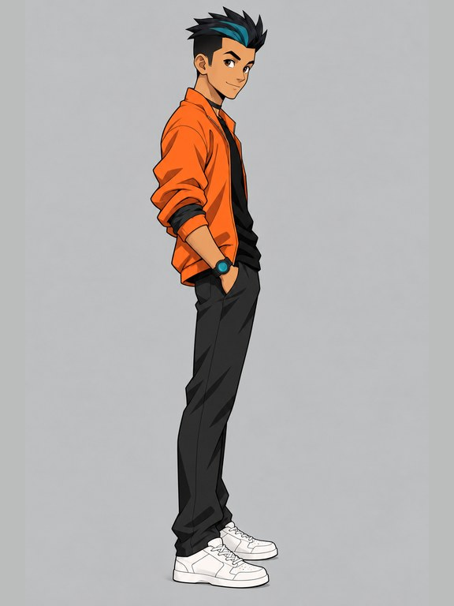

GPT Image 2.5 Sunburst · a closed model by OpenAI · $0.0484

### Zei · back

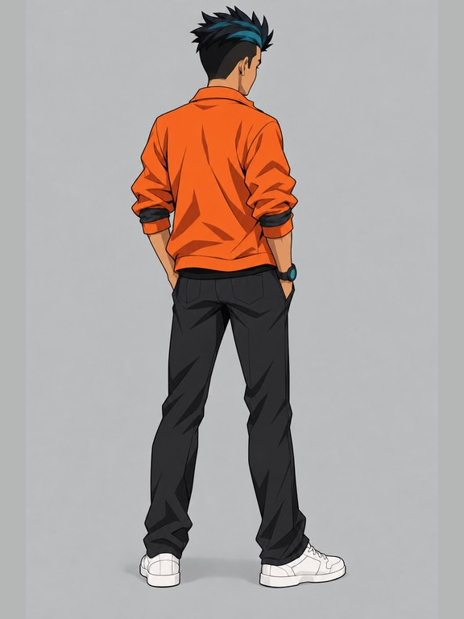

GPT Image 2.5 Sunburst · a closed model by OpenAI · $0.0484

## Bai

Agent's read: Side is a three-quarter side. Back is a three-quarter back: she looks over her shoulder, phone in hand.

### Bai · front (the base)

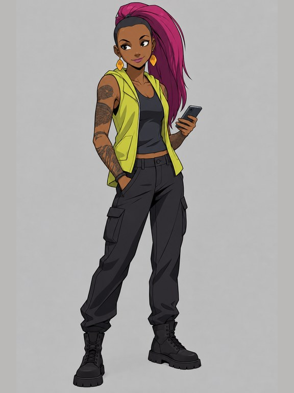

GPT Image 2.5 Sunburst · a closed model by OpenAI · $0.0487

### Bai · side

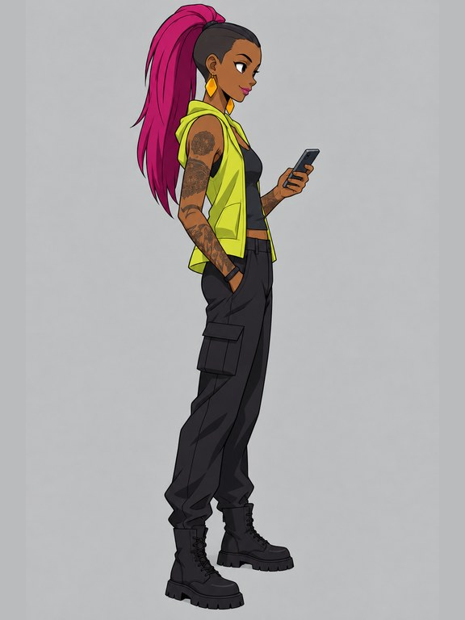

GPT Image 2.5 Sunburst · a closed model by OpenAI · $0.0484

### Bai · back

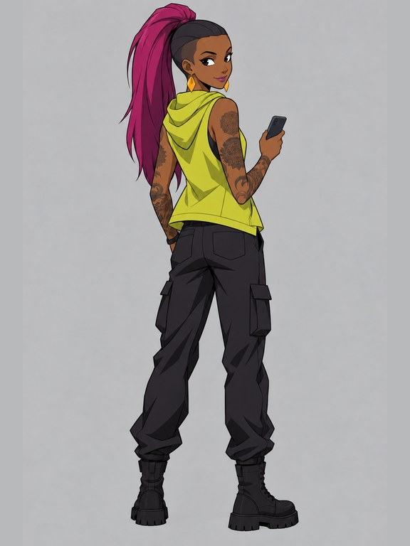

GPT Image 2.5 Sunburst · a closed model by OpenAI · $0.0484

## Gladias

Agent's read: Side is a three-quarter side. Back is a true back.

### Gladias · front (the base)

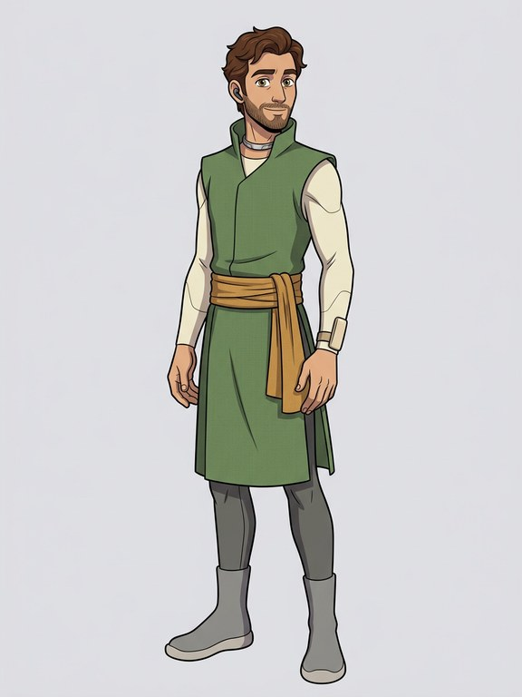

Gemini 3.1 Flash Image · a closed model by Google · $0.0671

### Gladias · side

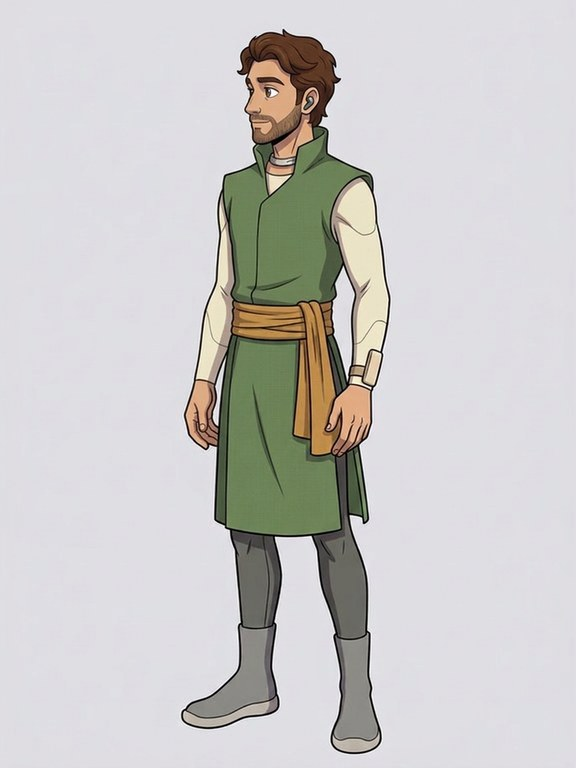

Gemini 3.1 Flash Image · a closed model by Google · $0.0677

### Gladias · back

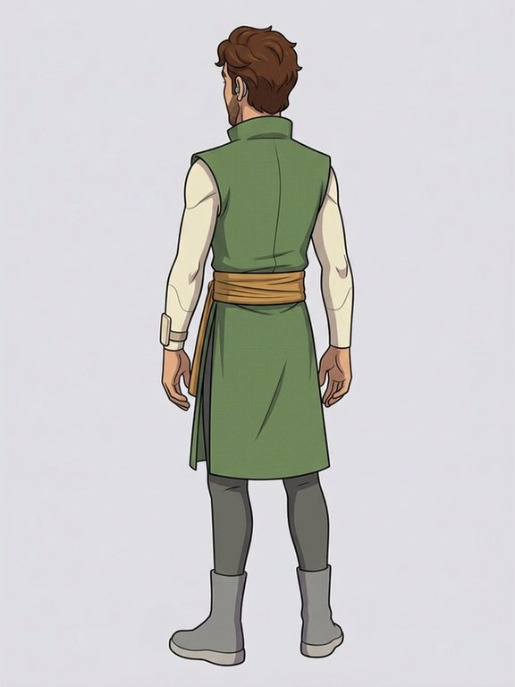

Gemini 3.1 Flash Image · a closed model by Google · $0.0677

## Seila

### Seila · front (the base)

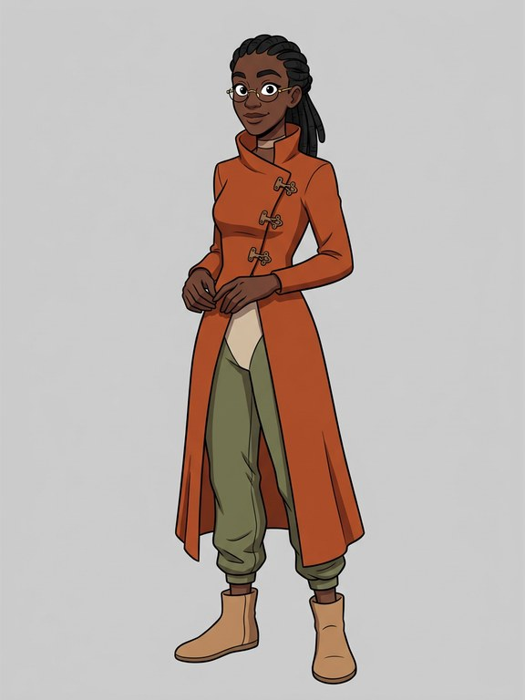

Gemini 3.1 Flash Image · a closed model by Google · $0.0671

### Seila · side

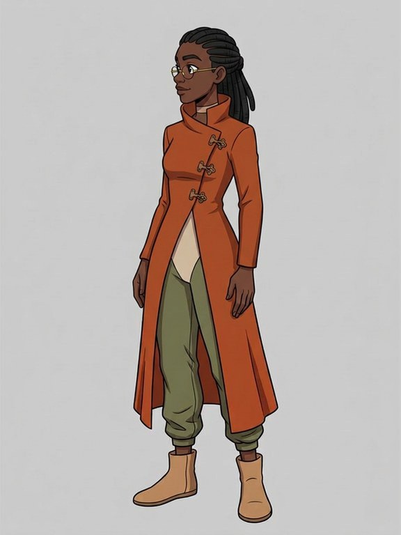

Gemini 3.1 Flash Image · a closed model by Google · $0.0677

### Seila · back

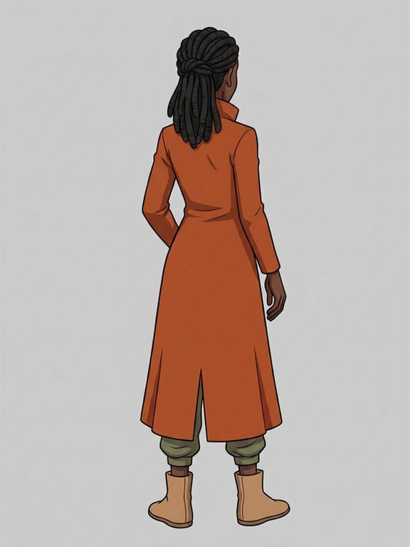

Gemini 3.1 Flash Image · a closed model by Google · $0.0677

## Deluin

### Deluin · front (the base)

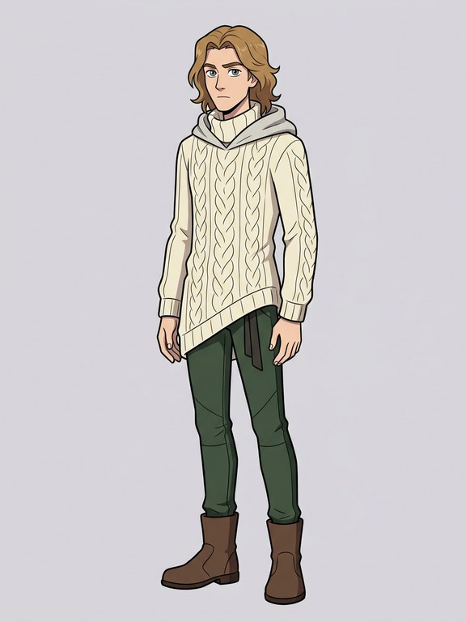

Gemini 3.1 Flash Image · a closed model by Google · $0.0671

### Deluin · side

Held until you pick Deluin's recast (owner, 2026-11-04; recast-contact-sheet.md).

### Deluin · back

Held until you pick Deluin's recast (owner, 2026-11-04; recast-contact-sheet.md).

## Mu

### Mu · front (the base)

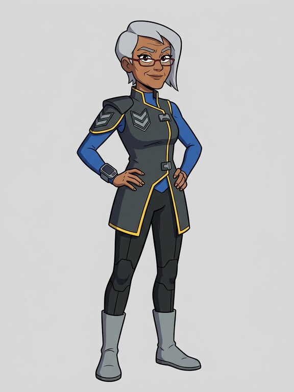

Gemini 3.1 Flash Image · a closed model by Google · $0.0671

### Mu · side

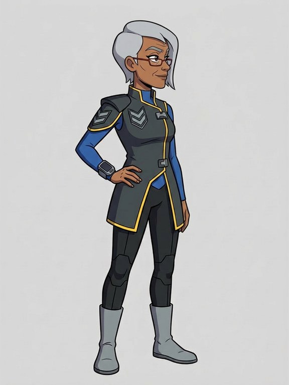

Gemini 3.1 Flash Image · a closed model by Google · $0.0677

### Mu · back

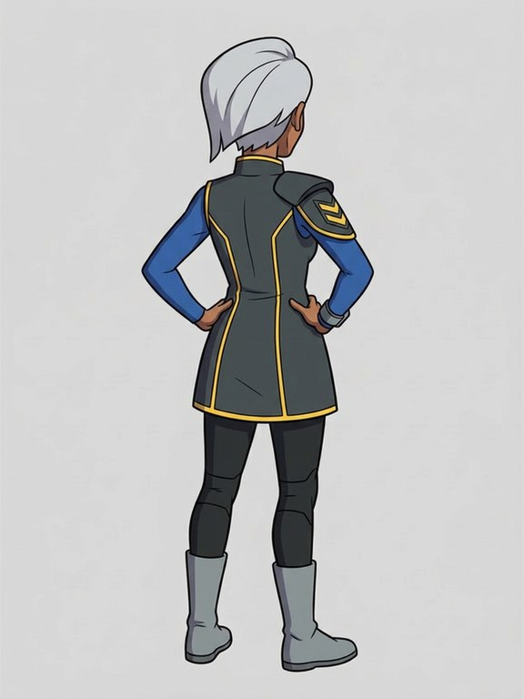

Gemini 3.1 Flash Image · a closed model by Google · $0.0677
