# Design directions and the "Animated series" fronts (DRAFT)

Made by the coding agent (Claude, a closed model by Anthropic), 2026-11-03/04 (machine date), on branch `challenge-styles`,
on the owner's decisions of 2026-11-04. **Drafts only: nothing published, nothing written to the database, nothing
uploaded to the site's storage.** Every front is AI-made. **The style text and every descriptor below were drafted by the
coding agent, for the owner to edit or rewrite.** They are picture descriptors, never story lines.

**Spent: $0.72238** (12 fronts and 12 prompt checks), against a $1 cap checked before
every call on the worst case (worst reached $0.9680). Nothing was left out.

## The owner's reference picture (Brought in)

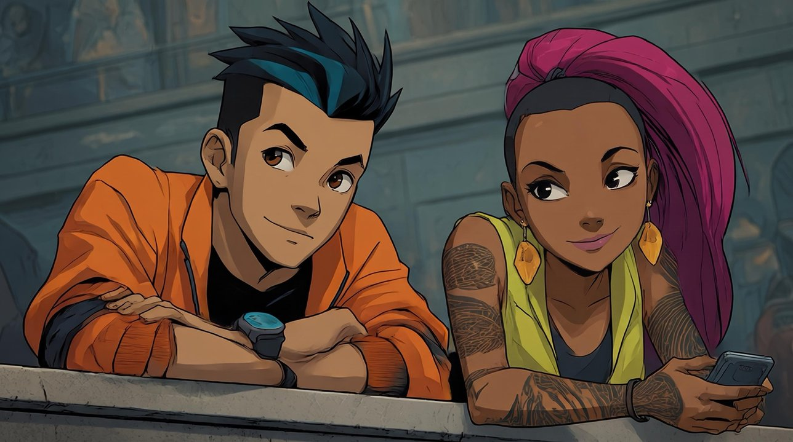

- **Made outside the site with Midjourney, a closed model by Midjourney, on a paid plan** (owner, 2026-11-04; which tier
  not given). The site's label: **Brought in**. Its prompt: not given; the owner will add it if he has it.
- Original: 2576 × 1438, sha256 `b955b192ae0d6b7474bef82fb795996146c75fe3f205c61db7fd8e6375421e4f`. Committed here as a
  small copy (1288 wide, sha256 `ec1781bc28d52f57d94606bc9aa57299d6cdbcfc1b94431c4ea7f769c020b1cc`).
- Crops (no model; each resized to 1024 high; the crop is the picture sent as the reference):

| Crop | Box (left, top, width, height) in the original | sha256 |
|---|---|---|
| 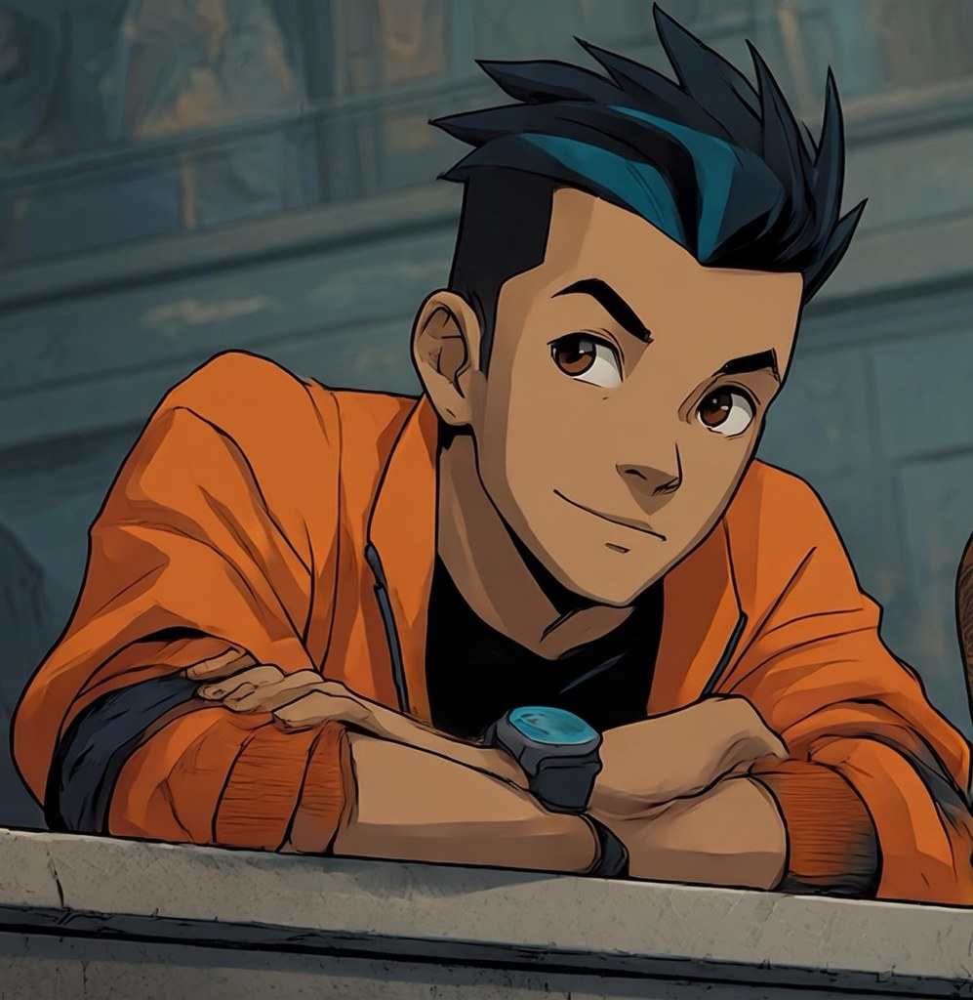 Zei | 60, 0, 1400, 1438 | `7753b06ecaaafb01aa963cf90b07b819029e98ff7aa662b3f0d676769aec2245` |
| 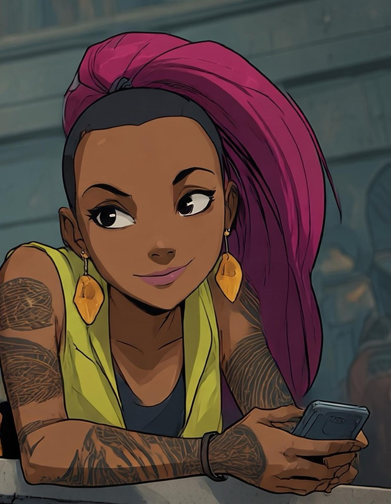 Bai | 1460, 0, 1116, 1438 | `a3bd0d92d7b78fd7e0b7557b5d7e982e0a8d5c0ca459e6738a16083d88009b69` |

## Direction 1: Animated series (fixed; from the owner's reference)

**Style, "Animated series"** (no artist, studio or film is named):

> Animated series look: clean bold black ink outlines of even weight, flat saturated cel colour with a single hard-edged shadow tone, simple graphic shapes, large expressive eyes and readable eyebrows, lively faces full of personality, slightly stylised proportions, crisp characters against soft muted backgrounds, clear readable faces and hands.

**Zei:**

> a young man of eighteen, slim, light golden-tan skin, tall spiky black hair swept up and back with a broad teal-blue streak and close-cut sides, warm brown eyes under strong dark eyebrows, a confident half-smile, wearing a loose orange zip jacket with the sleeves pushed up over a plain black crew-neck top, a chunky dark wrist display with a glowing teal face, a thin dark band around his throat, dark straight trousers and white sneakers

**Bai:**

> a young woman of about eighteen, slim and wiry, dark brown skin, a long sleek magenta ponytail pulled high with the sides of her head shaved close, dark eyes with a sly sideways look and a small confident smile, long amber drop earrings, a sleeveless yellow-green vest open over a dark grey tank top, both arms covered in fine brown line tattoos from shoulder to wrist, a dark bracelet, a hand device held in one hand, dark trousers and boots

Gladias, Seila, Deluin and Mu: their descriptors from `content/snowmoon/designs/characters/<slug>.json`, word for word,
with the same style text; one front each, **with Gemini 3.1 Flash Image** (the most faithful closed model in the drafts,
on Vertex with zero retention, so their recipes name Google only).

<table>
<tr><td align="center" valign="top">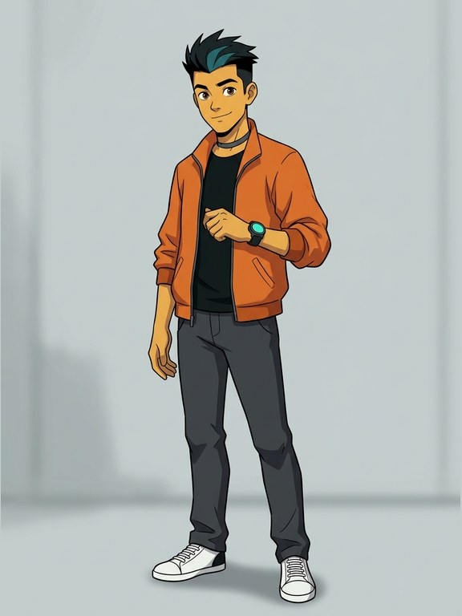 <b>Zei · Gemini</b> Gemini 3.1 Flash Image, a closed model by Google (Vertex, zero retention) $0.067668</td><td align="center" valign="top">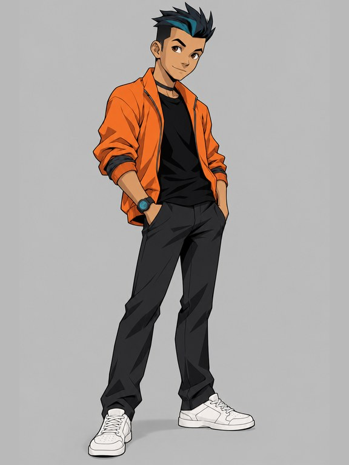 <b>Zei · GPT</b> GPT Image 2.5 Sunburst, a closed model by OpenAI (no training; kept up to 30 days) $0.050477</td><td align="center" valign="top">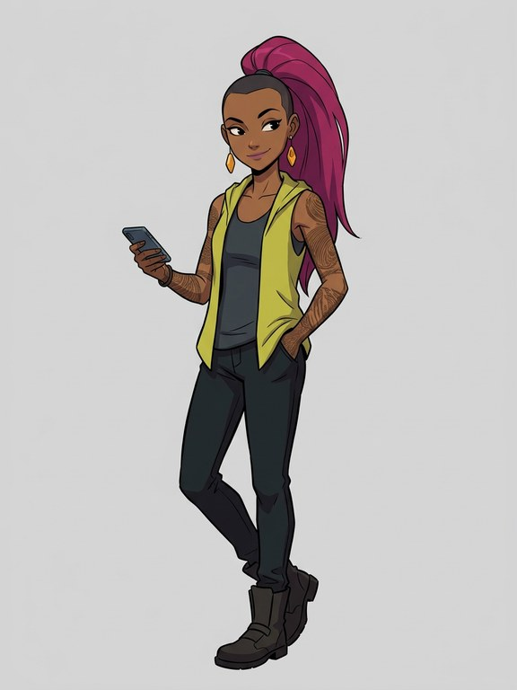 <b>Bai · Gemini</b> Gemini 3.1 Flash Image, a closed model by Google (Vertex, zero retention) $0.067667</td><td align="center" valign="top">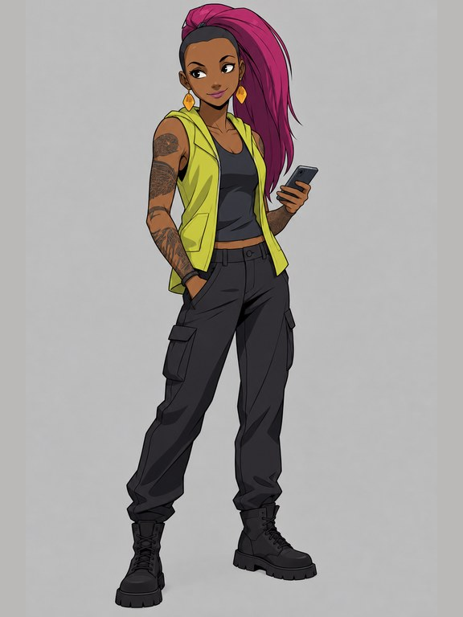 <b>Bai · GPT</b> GPT Image 2.5 Sunburst, a closed model by OpenAI (no training; kept up to 30 days) $0.048700</td></tr>
<tr><td align="center" valign="top">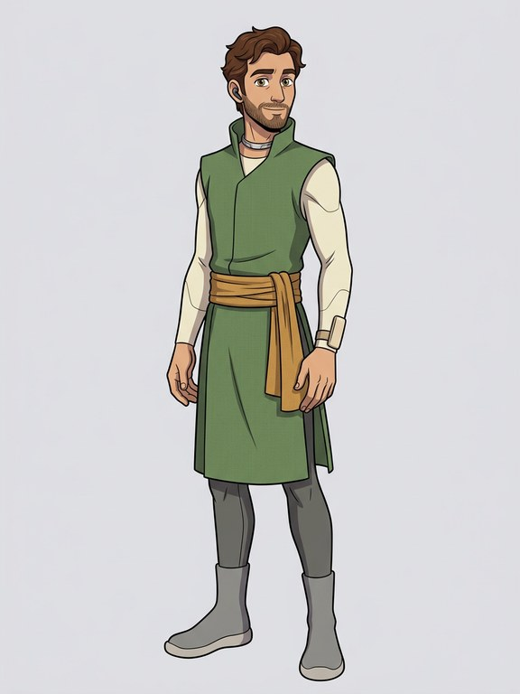 <b>Gladias · Gemini</b> Gemini 3.1 Flash Image, a closed model by Google (Vertex, zero retention) $0.067108</td><td align="center" valign="top">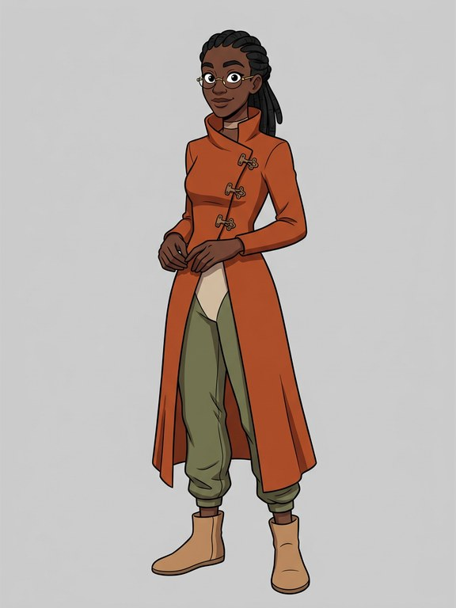 <b>Seila · Gemini</b> Gemini 3.1 Flash Image, a closed model by Google (Vertex, zero retention) $0.067100</td><td align="center" valign="top">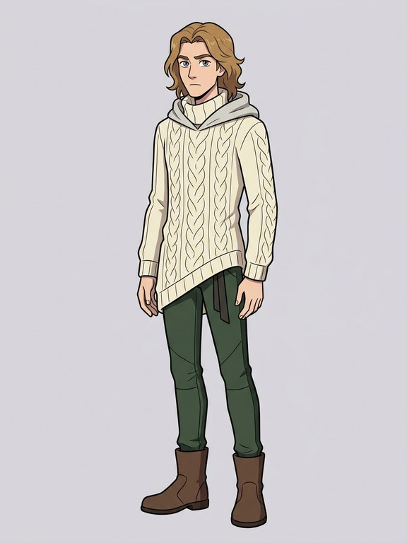 <b>Deluin · Gemini</b> Gemini 3.1 Flash Image, a closed model by Google (Vertex, zero retention) $0.067092</td><td align="center" valign="top">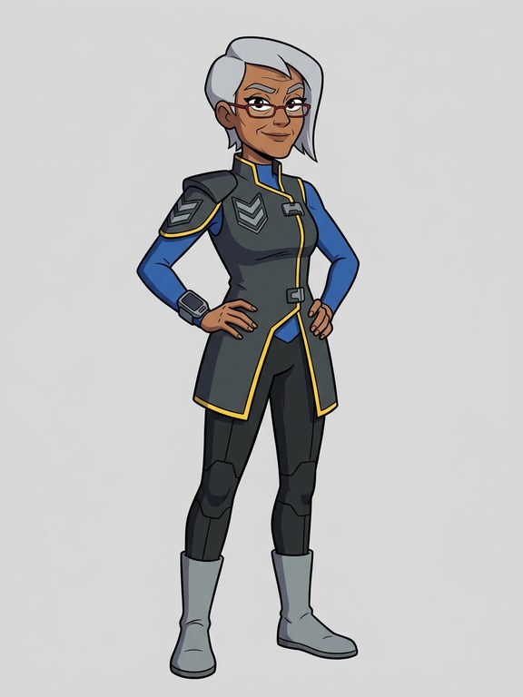 <b>Mu · Gemini</b> Gemini 3.1 Flash Image, a closed model by Google (Vertex, zero retention) $0.067092</td></tr>
</table>

## Direction 2: Grounded, a real teenager in a working city (Zei)

> a young man of eighteen from a busy working city, slim and of medium height, light golden-tan skin, short untidy black hair, alert dark eyes, wearing a faded olive work jacket with patched elbows over a plain grey hooded top, a canvas bag strap across his chest, dark straight-leg work trousers worn at one knee, scuffed brown boots, a thin black band around his throat, a simple wristwatch, and a soft support sleeve on his left forearm

<table><tr><td align="center" valign="top">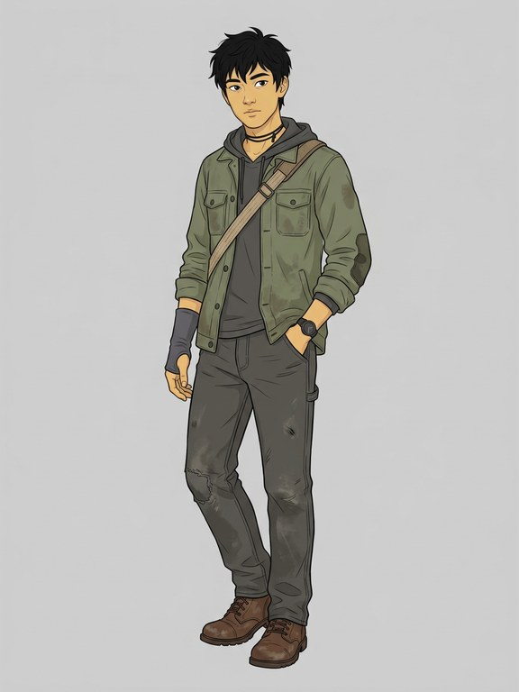 <b>Zei grounded · Gemini</b> Gemini 3.1 Flash Image, a closed model by Google (Vertex, zero retention) $0.067078</td><td align="center" valign="top">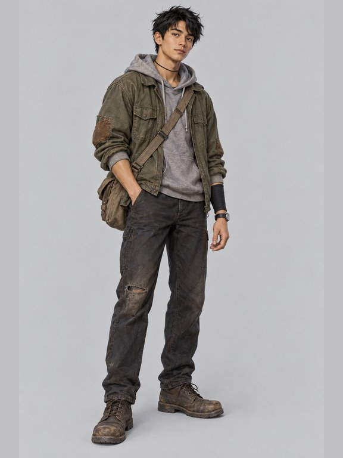 <b>Zei grounded · GPT</b> GPT Image 2.5 Sunburst, a closed model by OpenAI (no training; kept up to 30 days) $0.041970</td></tr></table>

## Direction 3: Bold reimagining, the champion (Zei)

> a young man of eighteen as a bold stylised game champion, tall and lanky with long limbs and a sharp angular silhouette, light golden-tan skin, a sharp asymmetric fringe of black hair bleached white at the tips, wearing a long sleeveless high-collared coat in deep crimson with a bold black pattern of grid squares, over a fitted white tunic, loose black trousers tucked into tall wrapped boots, one long fingerless glove on his left arm, a thin gold band around his throat, and round display glasses on a long coiled cable hanging around his neck

<table><tr><td align="center" valign="top">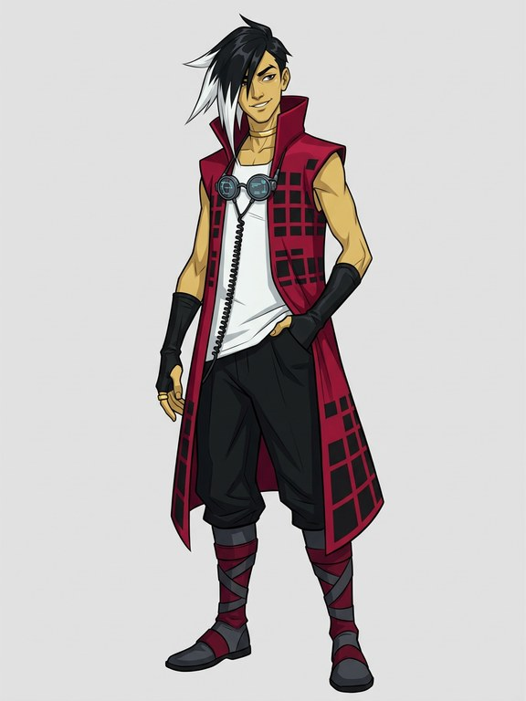 <b>Zei bold · Gemini</b> Gemini 3.1 Flash Image, a closed model by Google (Vertex, zero retention) $0.067087</td><td align="center" valign="top">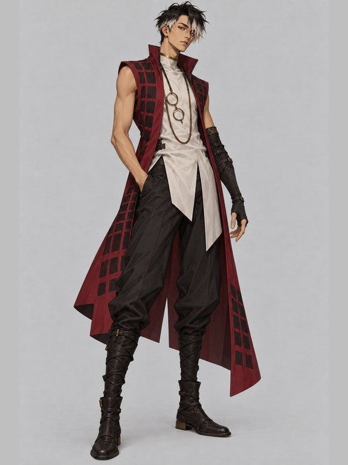 <b>Zei bold · GPT</b> GPT Image 2.5 Sunburst, a closed model by OpenAI (no training; kept up to 30 days) $0.042070</td></tr></table>

Directions 2 and 3 share a neutral rendering line, so they differ in design, not finish: "Clean full-colour character design illustration, even soft light, clear readable face and hands."
Every front's prompt: the stance line ("…standing in a relaxed three-quarter stance with some personality, plain light
grey background."), the style text, the descriptor, and the site's no-words line. Zei's and Bai's Animated fronts were
made from their crop ("The same person as in the reference picture…"); all others from text alone.

## Each front

| Front | Model | Maker | Cost | sha256 (the committed JPEG, 576 × 768) |
|---|---|---|---|---|
| [zei-animated-gemini](directions/zei-animated-gemini.jpg) | Gemini 3.1 Flash Image (Vertex, zero retention) | a closed model by Google | $0.067668 | `d036d754861213f8d4f313f69a0bfd49cb9dee0796aa970234af0e689f02ad1d` |
| [zei-animated-gpt](directions/zei-animated-gpt.jpg) | GPT Image 2.5 Sunburst (no training; OpenAI keeps up to 30 days, recorded) | a closed model by OpenAI | $0.050477 | `131f235227a54b06f6f11253f37a09b5001bf5f72326a6c9949a21800990dc7c` |
| [bai-animated-gemini](directions/bai-animated-gemini.jpg) | Gemini 3.1 Flash Image (Vertex, zero retention) | a closed model by Google | $0.067667 | `116c5a1b7d291eb9532b90de91d9813fb93d608beb9e95211a60bbcccaa0fe90` |
| [bai-animated-gpt](directions/bai-animated-gpt.jpg) | GPT Image 2.5 Sunburst (no training; OpenAI keeps up to 30 days, recorded) | a closed model by OpenAI | $0.048700 | `887d94d0570101bd1aadaf8f37330e72414702192ab312289ffe032dc323be72` |
| [gladias-animated-gemini](directions/gladias-animated-gemini.jpg) | Gemini 3.1 Flash Image (Vertex, zero retention) | a closed model by Google | $0.067108 | `aff6f24f59e5a2147f25cad9492499c1cff3770b66dd3a0973f76e84db7d9fbd` |
| [seila-animated-gemini](directions/seila-animated-gemini.jpg) | Gemini 3.1 Flash Image (Vertex, zero retention) | a closed model by Google | $0.067100 | `3ef4825ca8f49aabf05ddcdaa8119e9b229f523a3dfc1dc2af0238cbc95a4d13` |
| [deluin-animated-gemini](directions/deluin-animated-gemini.jpg) | Gemini 3.1 Flash Image (Vertex, zero retention) | a closed model by Google | $0.067092 | `ed9362662479c88e3ed88abd983031679fa2fb24f89d4fb69d0b1f247c5fe453` |
| [mu-animated-gemini](directions/mu-animated-gemini.jpg) | Gemini 3.1 Flash Image (Vertex, zero retention) | a closed model by Google | $0.067092 | `3e6ae696865441d24aa1dde262dac043964ab8c9633d19174eb7074091087fb5` |
| [zei-grounded-gemini](directions/zei-grounded-gemini.jpg) | Gemini 3.1 Flash Image (Vertex, zero retention) | a closed model by Google | $0.067078 | `ed55d2e418a78392b6e79bb9b10b992986cb805a097387cd792843911dd6fd50` |
| [zei-grounded-gpt](directions/zei-grounded-gpt.jpg) | GPT Image 2.5 Sunburst (no training; OpenAI keeps up to 30 days, recorded) | a closed model by OpenAI | $0.041970 | `373055b48de6f27e6a83f73d30c488f17e254c2b4c5749596e7e5cb75649bbf5` |
| [zei-bold-gemini](directions/zei-bold-gemini.jpg) | Gemini 3.1 Flash Image (Vertex, zero retention) | a closed model by Google | $0.067087 | `85c7f4753ad2b2900c78ac25f78e57b3a65fca74a7e540e590fcb141ee2205f3` |
| [zei-bold-gpt](directions/zei-bold-gpt.jpg) | GPT Image 2.5 Sunburst (no training; OpenAI keeps up to 30 days, recorded) | a closed model by OpenAI | $0.042070 | `be10dcc1d25e9574e456f581a1a72eb113623ac578480c0b334f756b54f13bfd` |
| 12 prompt checks, all passed first time | gpt-oss-safeguard-20b, through the gateway | open weights | $0.001271 | |

Full recipes (prompt, settings with the gateway options and the retention that applied, request id, reference sha256
and what it is, the original PNG's sha256): [`directions/ledger.json`](directions/ledger.json). Script:
`scripts/zei-directions.ts`; plan: [`directions/plan.json`](directions/plan.json).

## The book's facts behind the descriptors (word for word)

The book gives no looks; every appearance here is this edition's invention.

- 18: the message's envelope says the recipient "is 18 years old" (c19-b61). Bai: "Another woman walked in, about the
  same age as Zei." (c4-b70)
- From Pafogai Du, Dzego: "Zei Leimin from Pafogai Du" (c12-b146); a working city: "Hun Min street was one of the more
  lively commercial and industrial streets in Pafogai Du." (c2-b3), "the flickering lights of various small shops and
  factories" (c4-b53). Direction 2.
- Minpentai champion: "He was now the national Minpentai champion" (c15-b99). Direction 3.
- The arm: "opened and closed each finger of his left arm. That arm had been broken and taken a month to heal" (c9-b75).
  Direction 2's support sleeve and direction 3's glove, both on the left arm.
- Display glasses at the console: "offering glasses attached to a long cable" (c4-b82). Direction 3's glasses on a cable.
- Neck band and watch: "Zei whispered into his neck band to connect the watch to the display in his glasses." (c29-b113).
  Every direction keeps the band at the throat and a watch or wrist display.
- Bai: "Bai's grin faltered for a moment, then returned." (c7-b30): the sly smile. Her hand device: the book's shops sell
  "hand devices" (c2-b3).

## What the fronts show (the agent's read)

- **Animated series works on both models.** Both keep Zei's swept spiky hair with its teal streak, the orange jacket over
  black and the wrist display; GPT gives him more personality (hand in pocket, a looser stance) and heavier ink. For Bai,
  GPT is closer to the reference (the vest, the tattoos, the amber earrings, the phone); Gemini is a little thinner and
  plainer. Gemini's Zei skin reads slightly yellow-green.
- **The other four in Animated series** read as one cast with Zei and Bai: the same ink weight and flat colour, each keeping
  their file's clothes (Gladias's tabard and sash, Seila's rust coat and braids, Deluin's cable-knit tunic, Mu's
  charcoal tabard with yellow piping).
- **The three directions are three different people's takes,** not finishes: orange-and-black techwear energy; olive,
  grey and brown work clothes, slouched and tired; a tall crimson coat with a grid pattern, white-tipped hair, a game
  champion's swagger. On the neutral line, GPT drifts toward a painted, near-photographic finish; Gemini stays drawn.
  Gemini's bold Zei also has yellowish skin.
- Picks are the owner's. Once directions are picked, the other five characters get the same three, then side and back
  views from each front (not started).
